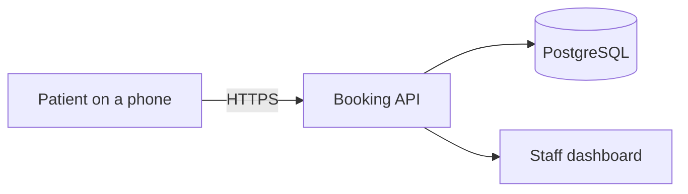
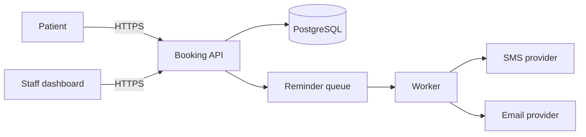

# What system design means

:::mental-model
**System design is the set of choices you make when building a system: what parts exist, how they talk, what data they keep, and what you trade away.**
:::

## Start with a sentence

Dr. Rao runs a small clinic. In a meeting she says:

> “I want patients to be able to book appointments online.”

That sentence sounds like one feature. It is actually a pile of decisions.

Who can book? Can a patient choose any doctor, or only their own? What happens when two people click the same 10:00 slot? Can a patient cancel? How late can they cancel? Do they pay online? Do they get a reminder? What happens when the clinic’s internet is down? What does the receptionist see?

None of those questions are answered by the sentence. They are answered by the design.

## The obvious first design

The simplest version looks like this:

A patient sends a request. The API checks the database. The database stores the appointment. Staff can see it. That is a legitimate first design for one clinic. It is also incomplete in ways that matter.

What happens when two patients try to book the same slot at the same time? What happens when the SMS provider is slow? What happens when the clinic grows to ten locations? The first diagram does not answer those questions, because it is only a picture of the happy path.

A better first design makes the important parts visible:

Now we can ask better questions. What if the queue is down? What if the SMS provider is slow? What if the database is unavailable? What if the API server dies? The diagram gives us places to point at.

## What system design actually decides

System design is not only “draw boxes.” It is a set of decisions in five layers:

| Layer | The question | Clinic example |
|---|---|---|
| **Components** | What parts exist, and what is each responsible for? | API, database, reminder worker, staff dashboard |
| **Interfaces** | How do the parts talk, and what do they promise? | `POST /appointments` returns `201` or `409` |
| **Data** | What is stored, where, and for how long? | Patients, doctors, slots, appointments, reminders |
| **Constraints** | What limits are we designing under? | $50/month, one part-time developer, 200 visits/week |
| **Tradeoffs** | What did we give up to get this? | SMS is reliable but costs money; email is cheap but easier to miss |

The last layer is the one beginners skip. Every design choice buys something and pays for it. A cache makes reads faster and makes stale data possible. A queue makes the response faster and makes the system more complex. A second server adds capacity and adds a new failure mode.

## Three questions to ask about any design

When you look at a system diagram, ask:

1. **What must it do?** These are the functional requirements: book, cancel, reschedule, remind, report.
2. **How well must it do it?** These are the non-functional requirements: latency, availability, consistency, security, cost.
3. **What happens when it fails?** This is the failure design: timeouts, retries, fallbacks, backups, alerts.

A design that answers only the first question is a demo. A design that answers all three is a system.

:::note
**A design is not a stack of technologies.** “React, Node and PostgreSQL” is a stack. A design explains why those parts exist, what each one owns, and what happens when one of them is slow or dead.
:::

## What it is not

System design is not only for enormous companies. A clinic with one server still has a design. The choices are smaller, but they are the same kind of choices.

It is also not a one-time decision. The clinic’s design at 200 appointments per week should not be the design at 200,000. Good design makes the next step cheap, not the first step impressive.

And it is not a search for “the best” architecture. There is no best architecture without a context. There is only the design that fits the constraints you have, with the tradeoffs you can defend.

:::deep-dive Deep dive: why “online booking” is not one feature
The sentence hides at least six user journeys:

- A patient finds an available slot.
- A patient books it.
- A patient reschedules it.
- A patient cancels it.
- Staff block a doctor’s holiday.
- A reminder reaches the patient before the visit.

Each journey has a different data shape, a different failure mode and a different urgency. Booking needs correctness: two patients must not get the same slot. Reminders need delivery: a reminder that arrives after the appointment is useless. Cancellation needs freshness: a cancelled slot should become available quickly.

When you separate the journeys, the design starts to appear.
:::

## Check yourself

:::quiz
[
  {
    "question": "Which of these is the best one-sentence definition of system design?",
    "options": [
      "Choosing a programming language and a database",
      "Choosing the parts of a system, how they communicate, what they store, and what each choice gives up",
      "Drawing a diagram with as many boxes as possible",
      "Making a system that can handle a million users on day one"
    ],
    "answer": 1,
    "explanation": "System design is broader than a tech stack and narrower than “scale everything.” It is the set of choices and tradeoffs that make the system work for its constraints."
  },
  {
    "question": "Dr. Rao says “patients should book online.” Which question is a system design question, not just a feature request?",
    "options": [
      "What colour should the booking button be?",
      "Which JavaScript framework should the form use?",
      "What happens when two patients try to book the same slot at the same time?",
      "Should the clinic logo be on the left or the right?"
    ],
    "answer": 2,
    "explanation": "Double booking is a correctness and concurrency question. It changes the data model, the API contract and the database constraints."
  },
  {
    "question": "Why is “we will use Redis” not a system design decision by itself?",
    "options": [
      "Because Redis is never useful",
      "Because it names a tool without saying what it is responsible for or what tradeoff it introduces",
      "Because only large companies may use Redis",
      "Because caches are always a bad idea"
    ],
    "answer": 1,
    "explanation": "A tool is not a design. The design question is what data is cached, for how long, who invalidates it, and what happens when the cache is stale."
  }
]
:::

## Exercise: ask before you draw

Write down five questions you would ask Dr. Rao before drawing any architecture. Then mark each question as **functional**, **non-functional**, or **failure-related**.

A useful first question is: *“What happens today when a patient calls and the slot they want is already taken?”* It tells you more about the real workflow than “what colour should the app be?”

:::discussion
- Which part of Dr. Rao’s sentence is most ambiguous?
- What would you need to know before choosing one server or two?
- If the clinic had to run for a week with no internet, what would still need to work?
:::

## Key takeaways

- System design is the set of choices that turn a sentence into a working system.
- A diagram is useful only when it shows responsibilities, interfaces, data and failure points.
- Every design decision has a tradeoff. If you cannot name it, you have not finished the decision.
- Start with the smallest design that answers the real constraints, then make the next step cheap.

## Free references

- [The System Design Primer](https://github.com/donnemartin/system-design-primer) — a broad free map of the building blocks.
- [Google SRE Book](https://sre.google/sre-book/table-of-contents/) — reliability and failure thinking.
- [AWS Well-Architected Framework](https://docs.aws.amazon.com/wellarchitected/latest/framework/welcome.html) — a practical checklist for tradeoffs.
