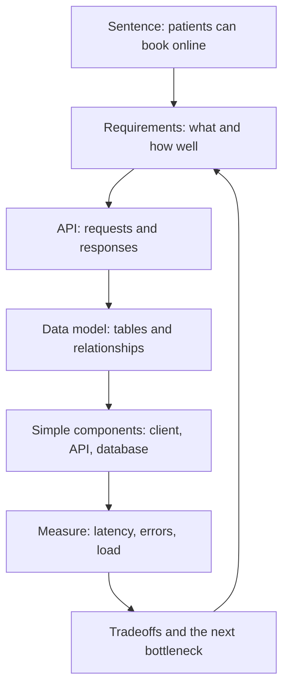
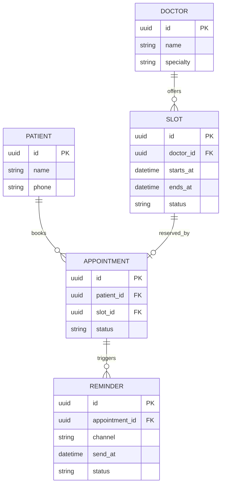
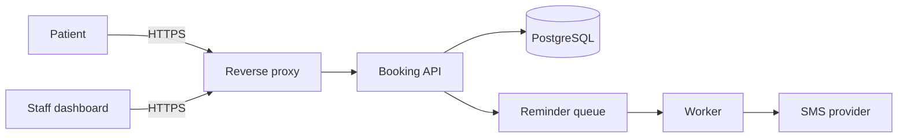

# The design process

:::mental-model
**A design is a chain of translations: a sentence becomes a requirement, a requirement becomes a request, a request becomes data, and data becomes a component you can measure.**
:::

## One sentence, many decisions

A product manager says:

> “Patients should be able to book appointments online.”

A developer hears: “Build a form.” A system designer hears: “Which patients, which slots, which rules, which failures, and how will we know it works?”

The design process is how you move from the first sentence to the second set of questions without getting lost.

The arrow from tradeoffs back to requirements is important. Design is not a waterfall. You learn something at every step, and that changes the earlier steps.

## Step 1: Clarify the sentence

Before choosing technology, turn the sentence into questions:

- **Who** is booking? A new patient, an existing patient, a receptionist?
- **What** are they booking? A doctor, a service, a room, a time?
- **When** can they book? Any time, or only during clinic hours? How far ahead?
- **What if** the slot is taken, the patient cancels, the doctor is sick, the payment fails?
- **How often** does this happen? Ten times a day or ten thousand times a second?

You do not need every answer to start. You need to know which answers change the design.

## Step 2: Write the requirements

Split requirements into two buckets:

- **Functional:** what the system does. “A patient can view free slots.” “A patient can book a slot.” “Staff can block a holiday.”
- **Non-functional:** how well it does it. “The slot list loads in under 300 ms at p99.” “No slot is double-booked.” “The clinic can lose internet for five minutes without losing a booking.”

The second bucket is where most of the design lives, and it is the topic of the next lesson.

## Step 3: Turn requirements into requests

For each user journey, write the request and the response. For the clinic:

| User journey | Request | Successful response | Failure response |
|---|---|---|---|
| View slots | `GET /doctors/rao/slots?from=2026-11-20&to=2026-11-20` | `200` with free slots | `404` if the doctor does not exist |
| Book a slot | `POST /appointments` with slot ID and patient ID | `201` with the appointment | `409` if the slot was taken |
| Cancel | `DELETE /appointments/{id}` | `204` | `404` or `409` if it cannot be cancelled |
| Reschedule | `PATCH /appointments/{id}` with a new slot | `200` with the updated appointment | `409` if the new slot is taken |
| Staff block a day | `POST /doctors/{id}/blocks` | `201` | `403` if the staff member lacks permission |

The API is a design tool, not just an implementation detail. It forces you to name the operations, the inputs, the outputs and the errors. If an operation is hard to express as a request, the requirement is probably still too vague.

## Step 4: Shape the data

The API tells you which entities exist. For the clinic, a first data model might be:

Two design details matter immediately:

- A slot can be reserved by at most one appointment. That is a uniqueness rule, not just a UI rule.
- An appointment can have more than one reminder attempt. That is a one-to-many relationship, not a column called `reminder_sent`.

The data model is where vague requirements become enforceable constraints.

## Step 5: Draw the simplest architecture

For one clinic, one server and one database is not an embarrassment. It is the correct first design until the measurements say otherwise.

The reverse proxy, queue and worker are not there to look impressive. They exist because the next lessons will show what happens when TLS, slow SMS calls and traffic spikes arrive.

## Step 6: Measure before you scale

A design is a hypothesis. The load test is the experiment.

For the clinic, measure:

- requests per second at the Monday 9 a.m. rush,
- p50 and p99 latency for the slot list and the booking request,
- error rate, especially `409` conflicts and database timeouts,
- database CPU and slow queries,
- reminder delivery success and delay.

The first measurement usually finds one bottleneck: a missing index, a synchronous SMS call, or a database connection limit. You fix that before adding servers, caches or queues.

## Step 7: Name the tradeoff and the next step

Every fix changes the system. Caching the doctor list makes reads faster and introduces stale data. Adding a queue makes the response faster and introduces retries and duplicate jobs. Adding a second server adds capacity and introduces session state and load balancing.

So the process ends with a sentence like:

> “We chose a single API server and one PostgreSQL database because the clinic handles about 200 appointments per week. We added an index on `slots(doctor_id, starts_at)` because the slot lookup was the slow query. The tradeoff is that writes are slightly slower, and we will revisit the single server when p99 crosses 300 ms during the Monday rush.”

That sentence is the design. The diagram is only its illustration.

:::interview
**Interview lens:** In a 45-minute design interview, spend the first 5–8 minutes on requirements, the next 10 on API and data, and the rest on components, bottlenecks and tradeoffs. Do not start with “I will use Kafka” before you know what the system must do.
:::

:::deep-dive Deep dive: why the API and the data model evolve together
It is tempting to finish the API first, then design the tables. In practice they correct each other.

The API says “book a slot.” The data model asks: what makes a slot unique? Is it the doctor and the start time? The room and the start time? The doctor, the room and the start time? That answer changes the API error: is a conflict a `409` on the slot, or a `409` on the appointment?

A useful loop is: write one request, update the tables, write the next request. Keep the loop small. You are looking for the constraint that makes the happy path safe.
:::

## Check yourself

:::quiz
[
  {
    "question": "What is the best first step after hearing “patients should book online”?",
    "options": [
      "Choose a database",
      "Ask who, what, when, and what happens when things go wrong",
      "Draw a microservices diagram",
      "Set up a Kubernetes cluster"
    ],
    "answer": 1,
    "explanation": "Clarifying the sentence is cheaper than changing an architecture later. The answers determine which parts of the design matter."
  },
  {
    "question": "Why is the API a useful design tool?",
    "options": [
      "Because it forces you to name operations, inputs, outputs and error cases",
      "Because JSON is faster than SQL",
      "Because every system needs a REST API",
      "Because it removes the need for a data model"
    ],
    "answer": 0,
    "explanation": "Writing requests and responses exposes vague requirements. It also gives you a contract to test and a vocabulary for the rest of the design."
  },
  {
    "question": "A slot can be reserved by at most one appointment. Where should that rule live?",
    "options": [
      "Only in the mobile app",
      "Only in the API documentation",
      "In the database as a uniqueness constraint, with the API translating the conflict into a useful error",
      "In a comment above the booking function"
    ],
    "answer": 2,
    "explanation": "Concurrency is not a UI problem. The database must enforce the uniqueness rule, and the API must return a clear conflict response."
  },
  {
    "question": "What should happen before adding a cache or a second server?",
    "options": [
      "Measure the current bottleneck",
      "Rewrite the app in a new language",
      "Add a message queue",
      "Move to microservices"
    ],
    "answer": 0,
    "explanation": "A fix without a measurement is a guess. Find the limiting resource first, then choose the smallest fix that moves it."
  }
]
:::

## Exercise: reschedule the appointment

Take the sentence “patients can reschedule an appointment.” Write:

1. Three clarifying questions.
2. One API request and its success and failure responses.
3. The tables it touches.
4. One non-functional requirement that makes rescheduling safe.

Then ask: what happens if the patient and the receptionist reschedule the same appointment at the same time?

:::discussion
- Which part of the design process is easiest to skip under deadline pressure?
- Why is “one server and one database” a legitimate design for this clinic?
- What measurement would convince you to add a cache?
:::

## Key takeaways

- The design process is a loop, not a waterfall.
- Clarify the sentence before you choose technology.
- Requirements become requests, requests become data, and data becomes constraints.
- Draw the simplest architecture that can be measured.
- End with a tradeoff and a next step, not just a diagram.

## Free references

- [The System Design Primer](https://github.com/donnemartin/system-design-primer) — requirements, API and data modeling basics.
- [PostgreSQL Documentation](https://www.postgresql.org/docs/current/) — constraints, indexes and transactions.
- [Martin Fowler: Microservices](https://martinfowler.com/articles/microservices.html) — useful later, when the question becomes whether to split the system.
