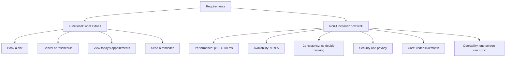

# Functional vs non-functional requirements

:::mental-model
**Functional requirements describe what the system does. Non-functional requirements describe how well it must do it — and they are where most of the design lives.**
:::

## “It should be fast and always up”

Dr. Rao is not a systems engineer, so she says:

> “The booking page should be fast, and the system should always be up.”

Those are real requirements, but they are not testable yet. Fast at what? For whom? On a phone on a train? Up during what — a disk failure, a database upgrade, a power cut?

A requirement is useful when a test could fail it.

| Vague requirement | A testable version |
|---|---|
| “The page should be fast.” | “The slot list returns in under 300 ms at p99 during the Monday 9 a.m. rush.” |
| “The system should always be up.” | “The booking API is available 99.9% of the time, measured monthly.” |
| “No double bookings.” | “A slot can have at most one confirmed appointment, enforced by a database constraint.” |
| “It should be cheap.” | “Infrastructure stays under $50 per month at 200 appointments per week.” |
| “It should be secure.” | “Patient phone numbers are encrypted at rest and only visible to staff who need them.” |

The left column is a wish. The right column is a design input.

## Two buckets

**Functional requirements** are the verbs. A patient books, cancels, reschedules. Staff block a holiday. A reminder goes out. If you removed the feature, the user would notice.

**Non-functional requirements** are the adjectives. Fast, available, consistent, secure, cheap, maintainable. If you removed the quality target, the feature might still exist but be unusable.

Both matter, but they fail differently. A missing functional requirement is usually obvious in a demo. A missing non-functional requirement shows up at 9 a.m. on Monday, when the database is locked and the SMS provider is timing out.

## The categories worth asking about

You do not need a 40-page requirements document. You need to ask about the categories that change the architecture.

| Category | Ask | Clinic example |
|---|---|---|
| **Performance** | How fast, for which operation, at which percentile? | Slot list p99 < 300 ms; booking p99 < 500 ms |
| **Availability** | What uptime, and what may fail? | 99.9% monthly; staff can still see today’s list if SMS is down |
| **Consistency** | What must never be wrong? | No double booking; a cancelled slot becomes available quickly |
| **Scalability** | What grows: users, data, cities, peak traffic? | 3 doctors now, 10 clinics in two years |
| **Security and privacy** | Who can see what? What must be encrypted? | Phone numbers are personal data; staff see only their clinic |
| **Cost** | What is the monthly budget? | Under $50/month for infrastructure |
| **Operability** | Who runs it, and how? | One part-time developer; simple deploy and backup |
| **Compliance** | What does the law require? | Medical records retention and deletion rules |

## How to find the non-functional requirements

Nobody hands you a list. You find them by asking about the edges:

1. **Users and peak.** How many patients, how many staff, and what is the busiest hour?
2. **Failure.** What happens if the database is down for five minutes? If SMS is slow? If the clinic’s internet drops?
3. **Growth.** What changes in one year: more doctors, more locations, more data?
4. **Money.** What is the monthly bill allowed to be?
5. **Trust.** What data would be embarrassing or illegal to lose or expose?
6. **Operations.** Who deploys, monitors and fixes it at 2 a.m.?

The answers become numbers, and the numbers become tests.

## p99, not the average

Suppose 100 patients load the slot list. Ninety-nine see it in 80 ms. One sees it in 8 seconds because the database is doing a report.

The average is about 159 ms. That sounds fine. The p99 is 8 seconds. The one patient who waited 8 seconds is the one who calls the clinic and says the app is broken.

Averages hide tails. Tail latency is where timeouts, retries and bad user experiences live. Use percentiles:

- **p50** is the typical request.
- **p95** is a slow request.
- **p99** is a very slow request — often the one that decides whether the system feels reliable.

:::deep-dive Deep dive: why p99 matters more as you fan out
If one page calls one service, a 1% chance of hitting a slow request is annoying. If the page calls ten services, the chance that at least one of them is slow is much higher.

For independent services with a 1% slow rate, the chance that at least one of ten calls is slow is:

`1 - 0.99^10 ≈ 9.6%`

So a page that “only” has a 1% tail per service can hit a tail on roughly one in ten page loads. This is why fan-out makes tail latency a system design problem, not a single-service problem.
:::

:::warning
**“Fast” is not a requirement.** A requirement needs a number, a percentile, a workload and a time window. “Fast at 9 a.m. on Monday for the slot list” is a requirement. “Fast” is a hope.
:::

## A worked clinic requirement set

| ID | Requirement | Type | How we test it |
|---|---|---|---|
| F1 | A patient can view free slots for a doctor and date | Functional | API test returns the expected free slots |
| F2 | A patient can book a free slot | Functional | `POST /appointments` returns `201` |
| F3 | A second booking of the same slot returns `409` | Functional | Two concurrent requests; one succeeds, one conflicts |
| F4 | Staff can block a doctor’s holiday | Functional | Block appears in the slot list immediately |
| N1 | Slot list p99 < 300 ms during the Monday rush | Non-functional | Load test at 5× normal traffic |
| N2 | Booking API availability ≥ 99.9% per month | Non-functional | Uptime monitor and error budget |
| N3 | No double booking, even under concurrency | Non-functional | Database uniqueness constraint plus race test |
| N4 | Patient phone numbers encrypted at rest | Non-functional | Schema and storage configuration review |
| N5 | Infrastructure ≤ $50/month at 200 appointments/week | Non-functional | Cloud billing dashboard |

Notice that N3 is both a correctness rule and a functional behavior. The categories are useful lenses, not rigid boxes. The important question is: *could a test fail this?*

## Check yourself

:::quiz
[
  {
    "question": "Which of these is a functional requirement?",
    "options": [
      "The booking page responds in under 300 ms at p99",
      "Patients can cancel an appointment",
      "The system is available 99.9% of the time",
      "Patient phone numbers are encrypted at rest"
    ],
    "answer": 1,
    "explanation": "“Patients can cancel” is a behavior. The others are quality targets: latency, availability and security."
  },
  {
    "question": "Why is “the app should be fast” a weak requirement?",
    "options": [
      "Because speed does not matter",
      "Because it has no operation, measurement, percentile or workload",
      "Because only the average matters",
      "Because fast systems are always expensive"
    ],
    "answer": 1,
    "explanation": "A testable performance requirement names the operation, the percentile, the target and the load. Without those, no test can pass or fail."
  },
  {
    "question": "A service has a 1% chance of a slow request. A page calls it 10 times. What is the chance at least one call is slow, assuming independence?",
    "options": [
      "About 1%",
      "About 5%",
      "About 10%",
      "Exactly 100%"
    ],
    "answer": 2,
    "explanation": "The chance all ten are fast is 0.99^10 ≈ 90.4%, so the chance at least one is slow is about 9.6%."
  },
  {
    "question": "Which requirement most directly forces a database uniqueness constraint?",
    "options": [
      "The slot list should load quickly",
      "Two patients must never book the same slot",
      "The clinic should spend less than $50/month",
      "The staff dashboard should be easy to use"
    ],
    "answer": 1,
    "explanation": "The no-double-booking rule is a correctness constraint. It must be enforced where concurrent writes meet, which is usually the database."
  }
]
:::

## Exercise: make the requirements testable

Classify each requirement, then rewrite the vague ones as testable statements:

1. Patients can see a doctor’s available slots.
2. The app should feel fast.
3. The clinic can block a holiday.
4. The system should not lose bookings.
5. The reminder should arrive before the appointment.
6. The system should be cheap to run.

For each, add a number, a time window or a failure condition where possible.

:::discussion
- Which non-functional requirement is most likely to be ignored by a small clinic?
- Why can a 99.9% availability target be more expensive than it sounds?
- What would “no double booking” mean if the clinic had two databases in two cities?
:::

## Key takeaways

- Functional requirements are behaviors; non-functional requirements are quality targets.
- A useful requirement is testable: it names a number, a percentile, a workload or a failure condition.
- p99 exposes the tail that averages hide.
- Fan-out makes tail latency worse: more calls means more chances to hit a slow one.
- Ask about performance, availability, consistency, security, cost, operations and growth.

## Free references

- [Google SRE Book](https://sre.google/sre-book/table-of-contents/) — SLIs, SLOs, error budgets and tail latency.
- [AWS Well-Architected Framework](https://docs.aws.amazon.com/wellarchitected/latest/framework/welcome.html) — reliability and performance tradeoffs.
- [The System Design Primer](https://github.com/donnemartin/system-design-primer) — non-functional requirements and back-of-the-envelope estimates.
