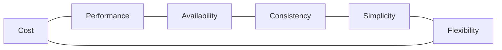

# Everything is a tradeoff

:::mental-model
**Every design choice buys something and pays for it. A good design is not the one with no downsides; it is the one whose downsides you can name and accept.**
:::

## The reminder that costs money

Dr. Rao wants fewer no-shows. The clinic currently calls every patient the day before. It takes two hours of staff time and patients still miss appointments.

Three options:

| Option | What it buys | What it costs |
|---|---|---|
| **SMS reminder** | Arrives on almost every phone; high open rate | About $0.02 per message; delivery can fail; no rich content |
| **Email reminder** | Almost free; can include details and a calendar link | Easier to miss; spam folders; patients may not check email |
| **In-app push** | Fast and free at the margin | Requires an app install and notifications enabled; useless for non-app patients |

There is no “best” option. There is only the option that fits the clinic’s constraints.

If a no-show costs the clinic $40 in lost revenue, spending $0.02 on an SMS is easy to justify. If the clinic has 2,000 appointments a week and a $50 monthly infrastructure budget, SMS alone could cost more than the rest of the system. The same feature becomes a different decision at a different scale.

That is the core of system design: **the answer depends on the constraints, and the constraints change as the system grows.**

## The usual suspects

Most system design tradeoffs are variations on a few tensions:

You cannot maximize all of them at once. Improving one usually puts pressure on another.

| Tradeoff | Choose one side, give up something |
|---|---|
| **Latency vs consistency** | Reading from the nearest replica is fast but may be stale. Reading from the primary is fresh but slower. |
| **Availability vs consistency** | During a partition, accepting writes on both sides keeps the system up but creates conflicts. Refusing writes keeps data consistent but makes the system unavailable. |
| **Cost vs performance** | A bigger machine, more replicas and a CDN all improve performance and all add cost. |
| **Simplicity vs flexibility** | One server is easy to operate but hard to scale. Microservices are flexible but require tracing, retries, gateways and more operational work. |
| **Read optimization vs write optimization** | An index makes reads fast and writes slower. A write-optimized store may make complex reads expensive. |
| **Security vs convenience** | Strong authentication and encryption reduce risk and add friction and operational work. |
| **Freshness vs cache hit rate** | A longer TTL improves hit rate and increases the chance of stale data. |

## How to choose

A tradeoff is not a feeling. It is a decision with a context. Use this sequence:

1. **State the constraint.** “The clinic can spend $50/month.” “A double booking is unacceptable.” “The Monday rush is 5× normal traffic.”
2. **Rank the priorities.** Is correctness more important than latency? Is cost more important than freshness? You cannot rank everything first.
3. **Quantify where you can.** A no-show costs $40. An SMS costs $0.02. A cache saves 200 ms but can serve a stale doctor list for 60 seconds.
4. **Choose the simplest option that satisfies the constraint.** Add complexity only when a measurement says you need it.
5. **Record the tradeoff.** Write down what you chose, what you gave up, and what would make you revisit it.

The last step is the one most teams skip. Six months later, nobody remembers why the cache TTL is 60 seconds or why the system writes to the primary for one specific read. The decision survives; the reason does not.

:::interview
**Interview lens:** Never say “the best.” Say: “Given these constraints, I chose X because Y matters more than Z here. The cost is W. I would revisit it if V changes.” That sentence is worth more than a diagram full of logos.
:::

## A worked tradeoff: caching the doctor list

The clinic’s home page shows the list of doctors and their specialties. It changes about once a month. It is read thousands of times a day.

**Option A: query the database every time.**

- Simple.
- Always fresh.
- Adds load to the database on every page view.

**Option B: cache the list for 60 seconds.**

- Much lower database load.
- Faster page loads.
- A doctor added or edited may take up to 60 seconds to appear.

The tradeoff is freshness for load and latency. For a doctor list, 60 seconds of staleness is almost certainly acceptable. For the free-slot list, it is not: a stale slot can cause a double booking.

The same caching mechanism is safe for one dataset and dangerous for another. The tradeoff is not “cache or no cache.” It is “which data can tolerate how much staleness?”

## The hidden second-order costs

Every choice has a first cost and a second cost.

- A cache adds a second system to operate and invalidate.
- A queue adds retries, duplicate jobs and a dead-letter queue.
- A second server adds load balancing, shared sessions and a new failure mode.
- A microservice adds a network call, a timeout, a retry policy and a trace.
- A read replica adds replication lag and failover decisions.
- A shard adds a shard key, cross-shard queries and rebalancing.

The first cost is the obvious one. The second cost is the one that shows up in production at 2 a.m.

:::reality-check
**Reality check:** “We can add a cache later” is often true. “We can add correctness later” is often false. If a tradeoff touches money, medical data or a seat that can be sold twice, choose the safer side first.
:::

## A decision record you can reuse

When you make a design choice, write four lines:

> **Decision:** Cache the doctor list for 60 seconds.
> **Because:** The list changes monthly and is read thousands of times a day.
> **We give up:** Up to 60 seconds of staleness.
> **Revisit if:** Doctors are added during the day, or the page must show changes instantly.

This is a lightweight architecture decision record. It turns a vague discussion into something a future teammate can evaluate.

## Check yourself

:::quiz
[
  {
    "question": "Why is “the best database” not a useful design statement?",
    "options": [
      "Because databases are all identical",
      "Because “best” depends on the workload, constraints and tradeoffs you care about",
      "Because only SQL databases are real",
      "Because a database is never the bottleneck"
    ],
    "answer": 1,
    "explanation": "A database is good or bad relative to a workload. A write-heavy event log and a read-heavy reporting store need different designs."
  },
  {
    "question": "What does a cache trade away?",
    "options": [
      "Latency",
      "Freshness and operational simplicity",
      "The need for a database",
      "Correctness in all cases"
    ],
    "answer": 1,
    "explanation": "A cache can serve stale data and adds another system to operate and invalidate. It improves latency and reduces load, but it is not free."
  },
  {
    "question": "Two patients try to book the same slot while the clinic has two databases in different regions. Which tradeoff becomes central?",
    "options": [
      "Colour contrast",
      "Consistency versus availability under a partition",
      "Image compression",
      "Font choice"
    ],
    "answer": 1,
    "explanation": "With data in two regions, a network partition forces a choice about whether to accept writes on both sides or preserve a single consistent view."
  },
  {
    "question": "Which is the best way to close a tradeoff discussion?",
    "options": [
      "“Let’s use the most popular tool.”",
      "“We chose X because of Y; we give up Z; we will revisit if W changes.”",
      "“We will decide later.”",
      "“It depends.”"
    ],
    "answer": 1,
    "explanation": "A useful decision names the choice, the reason, the cost and the trigger for revisiting. “It depends” is only the beginning of the answer."
  }
]
:::

## Exercise: write a decision record

Pick one feature from the clinic: reminders, slot lookup or booking. Write a decision record with:

- the constraint,
- the option you chose,
- what you gave up,
- the signal that would make you revisit it.

Then change one constraint — for example, the clinic grows to 10 locations — and see whether the decision still holds.

:::discussion
- Which tradeoff is hardest to explain to a non-technical stakeholder?
- When is “we will add it later” a legitimate deferral, and when is it a hidden liability?
- If a no-show costs $40 and an SMS costs $0.02, why might email still be the right default?
:::

## Key takeaways

- Every meaningful design choice has a cost. Name it.
- The right choice depends on constraints, and constraints change with scale.
- Prefer the simplest option that satisfies the constraint; add complexity only when a measurement demands it.
- Record the decision, the reason and the trigger for revisiting.
- Some tradeoffs are reversible; correctness and money usually are not.

## Free references

- [The System Design Primer](https://github.com/donnemartin/system-design-primer) — tradeoffs and building blocks.
- [AWS Well-Architected Framework](https://docs.aws.amazon.com/wellarchitected/latest/framework/welcome.html) — cost, reliability and performance tradeoffs.
- [Google SRE Book](https://sre.google/sre-book/table-of-contents/) — error budgets and the cost of reliability.
