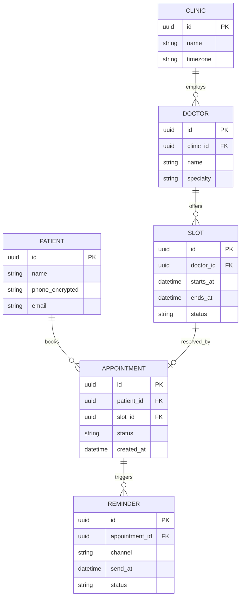
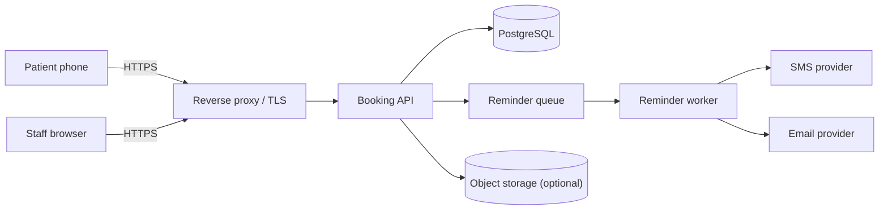

# Lab: Design system for a clinic

:::mental-model
**A lab is where requirements become decisions. The goal is not a perfect diagram; it is a design you can explain, defend and test.**
:::

## The brief

Dr. Rao runs a single clinic with three doctors and six consultation rooms. The clinic is open 9 a.m. to 6 p.m., Monday to Saturday, with 30-minute slots. It handles about 200 appointments a week. Monday morning is the rush: the receptionists take most of the week’s bookings in a two-hour window.

Today, patients call or message the clinic on WhatsApp. The two receptionists write appointments in a notebook. About 15% of patients miss their appointments. Dr. Rao wants online booking, fewer no-shows and less time spent on the phone.

She has a **$50/month infrastructure budget**, one part-time developer, and no appetite for a system that needs a full-time operations team.

:::note
**Your job:** produce a first design that is small enough to build, safe enough to trust, and clear enough to explain. You are not designing for 50 cities yet.
:::

## Constraints

- One clinic, three doctors, six rooms.
- 200 appointments per week, with a Monday 9 a.m. rush of about 5× normal traffic.
- Patients are on phones; many use WhatsApp more than email.
- Two receptionists need a shared view of the day.
- A double booking is unacceptable.
- Patient phone numbers are personal data.
- Budget: $50/month for infrastructure and messaging.
- One part-time developer; no 24/7 on-call.
- The clinic must still function if the internet is down for a short time.

## What to produce

Use the checklist as you work. It is saved in this browser.

1. **Five clarifying questions** for Dr. Rao.
2. **8–10 functional requirements.**
3. **Five measurable non-functional requirements.**
4. **Five to eight API endpoints** with request and response shapes.
5. **A data model** with tables, keys and relationships.
6. **A simple architecture diagram.**
7. **Three tradeoff decisions**, each with what you gave up.
8. **A v2 deferral list**: what you deliberately did not build.

## Step 1: Ask better questions

Start with the workflow, not the technology.

- Can a patient choose any doctor, or only their registered doctor?
- Can a patient book same-day? How far ahead?
- Can a patient cancel or reschedule? How late?
- Do patients pay at booking, at the clinic, or not at all?
- What should happen when the doctor is sick or a room is unavailable?
- Who can see patient phone numbers?
- What is the cost of a no-show, and what is a reminder worth?
- What happens today when the internet is down?

A good question changes a requirement. “Can a patient cancel?” changes the data model. “How late can they cancel?” changes the policy. “Who can see phone numbers?” changes security.

:::deep-dive Hint: the questions you probably missed
- **Time zone and daylight saving:** one clinic may not care, but the data model should store timestamps with a time zone.
- **Slot ownership:** is a slot tied to a doctor, a room, or both?
- **Walk-ins:** do they consume a slot, or are they separate?
- **Staff overrides:** can a receptionist book over a blocked slot? If so, who can, and is it audited?
- **Reminder consent:** can a patient opt out of SMS? What is the fallback?
- **Data retention:** how long do you keep cancelled appointments and phone numbers?
:::

## Step 2: Write the requirements

Aim for 8–10 functional requirements. A useful shape is “actor can action object under condition.”

Examples:

- A patient can view free slots for a doctor and date.
- A patient can book a free slot.
- A patient can cancel an appointment up to 12 hours before it starts.
- A patient can reschedule to another free slot.
- A receptionist can view and manage the day’s appointments.
- A receptionist can block a doctor’s holiday.
- The system sends a reminder 24 hours before an appointment.
- A receptionist can mark a patient as arrived, completed or no-show.

Then write five non-functional requirements with numbers:

- Slot list p99 < 300 ms during the Monday rush.
- Booking p99 < 500 ms.
- No double booking under concurrent requests.
- Booking API availability ≥ 99.9% per month.
- Infrastructure and messaging ≤ $50/month at 200 appointments/week.
- Patient phone numbers encrypted at rest; only clinic staff can read them.

## Step 3: Design the API

A small, honest API is better than a large, vague one.

| Method | Path | Purpose |
|---|---|---|
| `GET` | `/doctors` | List doctors and specialties |
| `GET` | `/doctors/{id}/slots?from=&to=` | List free slots in a date range |
| `POST` | `/appointments` | Book a slot |
| `GET` | `/appointments/{id}` | Read one appointment |
| `PATCH` | `/appointments/{id}` | Reschedule or change status |
| `DELETE` | `/appointments/{id}` | Cancel |
| `POST` | `/doctors/{id}/blocks` | Staff block a holiday |
| `GET` | `/clinic/day?date=` | Staff view of the day |

For each endpoint, write the success and failure responses:

- `POST /appointments` → `201` with the appointment, or `409` if the slot is no longer free.
- `DELETE /appointments/{id}` → `204`, or `409` if the appointment is inside the cancellation window.
- `PATCH /appointments/{id}` → `200`, or `409` if the new slot was taken.

The `409` matters. It is how the API tells the client “someone else got there first” without pretending the request succeeded.

## Step 4: Model the data

The critical constraint is **one confirmed appointment per slot**. Enforce it in the database with a unique constraint on the slot reference for confirmed appointments, or by making the slot row the lock target. The API translates the conflict into `409`.

:::warning
**Do not put the only double-booking check in the UI.** Two phones can tap “Book” at the same moment. The database must be the final arbiter.
:::

## Step 5: Draw the architecture

For this clinic, start small:

Why each part exists:

- **Reverse proxy:** terminates TLS, routes requests, and gives you one place for rate limits later.
- **API:** owns the booking rules and talks to the database.
- **PostgreSQL:** stores the data and enforces the no-double-booking constraint.
- **Queue + worker:** moves the slow reminder call out of the booking response. The patient should not wait for an SMS provider.
- **SMS and email:** two reminder channels. SMS is reliable but costs money; email is cheap.
- **Object storage:** optional, for scanned documents or clinic photos. Not needed for the first version.

## Step 6: Make three tradeoffs

Write each one as a decision record:

> **Decision:** Use a single API server and one PostgreSQL database for v1.
> **Because:** 200 appointments/week is small; one server is easy to operate and back up.
> **We give up:** No automatic failover; a server failure takes the clinic offline until it restarts.
> **Revisit if:** p99 exceeds 300 ms at the Monday rush, or the clinic opens a second location.

> **Decision:** Send reminders through a queue instead of inside the booking request.
> **Because:** An SMS provider can take seconds and fail; the patient should not wait for it.
> **We give up:** The queue adds retries, duplicate-job handling and monitoring.
> **Revisit if:** Reminder volume grows beyond what one worker can handle.

> **Decision:** Cache the doctor list for 60 seconds, but never cache free slots.
> **Because:** The doctor list changes monthly, while a stale slot can cause a double booking.
> **We give up:** A newly added doctor may take up to a minute to appear.
> **Revisit if:** the clinic needs instant doctor edits.

## Step 7: Decide what not to build

A strong design has a clear v2 list:

- Online payments.
- Multi-clinic tenancy.
- A patient mobile app.
- Video consultations.
- Insurance integration.
- A waiting-list feature.
- Analytics dashboards.
- WhatsApp reminders.

Deferring is not failure. It is how you keep the first version small enough to ship and safe enough to trust.

## Rubric

| Area | Points | What good looks like |
|---|---:|---|
| Clarifying questions | 3 | Questions change the requirements, not just restate them |
| Functional requirements | 3 | Clear actors, actions and conditions; no missing cancellation path |
| Non-functional requirements | 4 | Numbers, percentiles and failure conditions; cost included |
| API | 4 | Clear resources, success and failure responses, `409` on conflict |
| Data model | 3 | Keys, relationships and the no-double-booking constraint |
| Architecture | 2 | Simple, labeled, and every component has a reason |
| Tradeoffs | 3 | Three decisions, each with a cost and a revisit trigger |
| Clarity | 2 | A teammate could build from it without asking what you meant |
| **Total** | **24** | |

:::deep-dive Model answer outline
A solid answer usually looks like this:

1. **Requirements:** 8–10 functional, 5 measurable non-functional. Include cancellation, staff override, no double booking, p99 latency, availability and the $50 budget.
2. **API:** doctors, slots, appointments, cancellations, blocks, day view. Use `409` for conflicts.
3. **Data:** clinic, doctor, slot, patient, appointment, reminder. Unique constraint on confirmed slot. Store timestamps with a time zone.
4. **Architecture:** reverse proxy → API → PostgreSQL; queue → worker → SMS/email. Optional object storage.
5. **Tradeoffs:** one server vs high availability; queue vs simpler synchronous reminder; cache doctor list vs cache free slots.
6. **v2:** payments, multi-clinic, app, WhatsApp, analytics.
7. **Failure plan:** database backup and restore test; worker retries and dead-letter queue; `409` handling in the UI; an alert when reminder failures spike.

The exact tables and endpoints can vary. The non-negotiables are the correctness constraint, the measurable requirements and the named tradeoffs.
:::

## Check yourself

:::quiz
[
  {
    "question": "Two patients book the same slot at the same time. What should the system do?",
    "options": [
      "Accept both and let the receptionist sort it out",
      "Accept the first and return a clear conflict response for the second",
      "Hide the slot from the UI and hope nobody notices",
      "Delete the appointment table and start over"
    ],
    "answer": 1,
    "explanation": "The database must enforce one confirmed appointment per slot, and the API should return a conflict such as 409 so the client can offer another slot."
  },
  {
    "question": "Why is caching the free-slot list dangerous?",
    "options": [
      "Because slots are too large to cache",
      "Because a stale slot can be shown as free after someone else has booked it, causing a double booking",
      "Because caches cannot store lists",
      "Because PostgreSQL does not support caching"
    ],
    "answer": 1,
    "explanation": "A stale free slot is a correctness bug. The doctor list can tolerate a minute of staleness; a bookable slot cannot."
  },
  {
    "question": "Which component should be added first if the booking response is slow because the SMS provider takes 4 seconds?",
    "options": [
      "A second database",
      "A queue and a background worker for reminders",
      "A CDN for the API",
      "A sharded counter"
    ],
    "answer": 1,
    "explanation": "The slow work does not need to happen before the response. Move it to a queue and let a worker handle retries and failures."
  }
]
:::

## Discussion

:::discussion
- What would change if the clinic had 10 locations instead of one?
- What would you build first if the budget were $0?
- Which requirement would you challenge as unnecessary for v1?
- If a no-show costs $40, how much is an SMS reminder worth?
- What is the first thing you would monitor after launch?
:::

## Key takeaways

- A lab is a design rehearsal: clarify, specify, model, draw, trade off, defer.
- The no-double-booking constraint belongs in the database, not only the UI.
- Move slow work out of the user’s response path.
- A small design with named tradeoffs is stronger than a large diagram with no reasons.
- Deferring features is part of the design, not a failure of ambition.

## Free references

- [PostgreSQL Documentation](https://www.postgresql.org/docs/current/) — constraints, indexes and transactions.
- [The System Design Primer](https://github.com/donnemartin/system-design-primer) — API and data modeling basics.
- [Google SRE Book](https://sre.google/sre-book/table-of-contents/) — availability and monitoring.
- [AWS Well-Architected Framework](https://docs.aws.amazon.com/wellarchitected/latest/framework/welcome.html) — a checklist for the tradeoffs.
