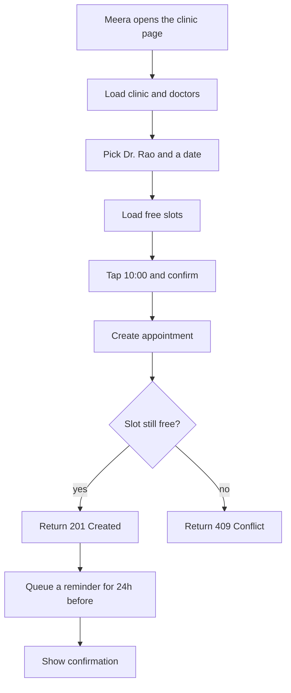

:::mental-model
**A requirement describes an outcome. A request is one unit of work that moves the system toward it. Design starts when you can list the requests behind a sentence.**
:::

## The sentence, again

Dr. Rao says:

> “Patients should be able to see my free slots, book one, and cancel if they change their mind.”

Three verbs: see, book, cancel. A junior developer hears three buttons. A system designer hears three journeys, each with its own reads, writes, failure modes and timing.

The first job is not to draw boxes. It is to walk through each journey the way a real patient would, and write down every call the system has to make.

## A journey is a sequence, not a screen

Meet Meera. It is Sunday night. She opens the clinic site on her phone because her daughter has a fever.

1. She searches for the clinic.
2. She picks Dr. Rao.
3. She looks at tomorrow’s slots.
4. She taps 10:00.
5. She confirms.
6. She gets a confirmation.

That feels like one flow. Underneath, it is a chain of requests. Some are reads, some are writes, and one is a message to a queue that will run hours later.



The branch in the middle is the whole design. Two patients can tap the same slot within milliseconds. The request that creates the appointment must be the thing that decides who wins, not the screen that displayed the slot.

## Anatomy of a request

Every HTTP request has the same skeleton:

```http
POST /appointments HTTP/1.1
Host: clinic.example.com
Authorization: Bearer eyJhbGciOi...
Content-Type: application/json
Idempotency-Key: 7f3c2a90-...

{
  "slotId": "slot_2026_11_17_1000_rao",
  "patientId": "pat_4412",
  "reason": "fever"
}
```

And a response:

```http
HTTP/1.1 201 Created
Content-Type: application/json

{
  "id": "apt_8812",
  "slotId": "slot_2026_11_17_1000_rao",
  "status": "booked",
  "startsAt": "2026-11-17T10:00:00+05:30"
}
```

Four parts matter most:

| Part | What it answers | Clinic example |
|---|---|---|
| **Method** | What kind of action is this? | `GET` reads, `POST` creates, `DELETE` cancels |
| **Path** | Which thing? | `/appointments/apt_8812` |
| **Body** | What data comes with it? | The slot and patient |
| **Status** | What happened? | `201`, `409`, `404`, `500` |

The status code is not decoration. It is the contract. `201` means “created.” `409` means “the state changed under you.” A UI that treats every response as success will double-book the clinic and blame the database.

## Reads are cheap to repeat. Writes are not.

A read can be retried safely. If Meera’s phone loses signal while loading slots and retries, nothing changes.

A write cannot be repeated blindly. If the confirmation times out after the appointment was created, and the app retries the `POST`, the clinic gets two appointments for one patient.

This is why serious booking and payment APIs accept an **idempotency key**: a unique string the client generates for one logical attempt. The server stores it. A retry with the same key returns the original result instead of creating a second booking.

:::warning
A timeout is not a failure. It is an unknown outcome. The write may have succeeded. Retrying without an idempotency key turns an unknown into a duplicate.
:::

## One screen, many requests

Meera’s booking flow is small. The receptionist’s screen is not. Arjun opens “today’s appointments” and expects one page. The browser may make:

- one request for the appointment list,
- one request for patient names,
- one request for doctor names,
- one request for clinic settings,
- one request for the count badge.

That is **fan-out**: one user action, several backend calls. It is normal. What is not normal is making one call per row.

Suppose the list shows 50 appointments, and for each appointment the code calls `GET /patients/{id}`. That is 51 requests where one would do. This is the **N+1 problem**, and it is one of the most common reasons a page that looks simple is slow in production. The fix is to ask for the page of appointments **with** the patient data it needs, or to fetch the 50 patients in one batch request.

Real-life version: a food-delivery app shows 20 restaurants, then fetches the menu for each one in a separate call. On a good network it feels fine. On a train with 2 bars, the page takes eight seconds and the user closes it.

:::reality-check
The number of requests is part of the user experience. On a fast office Wi-Fi, 20 small requests feel instant. On a 3G phone in a basement, each round trip costs 200–400 ms. Five requests become two seconds before any server work happens.
:::

## Sync now, async later

Not every request belongs in the user’s wait.

When Meera confirms, she needs the appointment to exist. She does not need the reminder SMS to be sent before the screen updates. Sending the SMS inline would make the booking depend on a third-party provider that might be slow or down.

So the design splits:

- **Synchronous:** create the appointment, return `201`.
- **Asynchronous:** put a reminder job on a queue, let a worker send it 24 hours later.

The queue is not an optimization for later. It is a decision about what the user is waiting for. If the answer is “nothing,” do not make them wait.

## From three sentences to a request map

Here is the first useful artifact for Module 2:

| Requirement | Requests | Type |
|---|---|---|
| See Dr. Rao’s free slots | `GET /doctors/rao/slots?date=…` | read |
| Book 10:00 | `POST /appointments` | write, transactional |
| Cancel | `DELETE /appointments/{id}` | write |
| Remind the patient | queue job → SMS/email | async |
| Show today’s list | `GET /appointments?date=today` | read, paginated |
| Show patient names | `GET /patients?ids=…` | read, batched |

That table is worth more than a architecture diagram at this stage. It exposes the writes, the reads, the batch points and the async boundary. The diagram comes after, and it has something real to draw.

:::widget request-trace
:::

## What “done” looks like for this step

You are done mapping requests when:

- every verb in the requirement has at least one request,
- every request has a method, a path and a success status,
- every write has a failure story (conflict, timeout, retry),
- every slow side effect is either async or has a timeout,
- every screen has a list of the calls it makes, and you know which ones can be batched.

If you cannot name the request that decides a race, you have not designed the feature yet.

:::interview
In an interview, do not jump to “I’ll use Postgres and Redis.” Start with: “Let me list the user journeys, then the requests each one makes.” Interviewers notice the difference between someone who knows tools and someone who can turn a vague requirement into a testable contract.
:::

## Check yourself

:::quiz
[
  {
    "question": "Meera taps “Confirm booking.” Which request should decide whether she gets the 10:00 slot?",
    "options": [
      "The GET request that displayed the free slots",
      "The POST request that creates the appointment, inside a transaction or unique constraint",
      "The reminder job that runs 24 hours later",
      "The browser’s local cache"
    ],
    "answer": 1,
    "explanation": "The screen is a snapshot. The write must re-check and enforce the rule atomically, or two patients can both pass the display check."
  },
  {
    "question": "Why is a read usually safe to retry but a write usually not?",
    "options": [
      "Reads are always faster",
      "A repeated read returns the same data, while a repeated write can create a second record",
      "Writes never fail",
      "Databases block all retries"
    ],
    "answer": 1,
    "explanation": "Retrying a GET does not change state. Retrying a POST can duplicate a booking, payment or message unless the operation is idempotent."
  },
  {
    "question": "A booking request times out. What do you actually know?",
    "options": [
      "The booking definitely failed",
      "The booking definitely succeeded",
      "The outcome is unknown; it may have succeeded",
      "The database is corrupt"
    ],
    "answer": 2,
    "explanation": "A timeout means the client stopped waiting, not that the server stopped working. That is why idempotency keys and status checks exist."
  },
  {
    "question": "The receptionist page shows 50 appointments and calls GET /patients/{id} for each row. What is this called?",
    "options": [
      "Sharding",
      "The N+1 query problem",
      "Caching",
      "Load balancing"
    ],
    "answer": 1,
    "explanation": "One query to list the rows, then N extra queries for related data. Batch the related data or join it on the server."
  }
]
:::

## Exercise: trace the cancel flow

Write the requests for this sentence:

> “A patient can cancel up to two hours before the appointment, and the slot becomes available again.”

Include:

1. the request that reads the appointment,
2. the request that cancels it,
3. the rule check,
4. what the response says if the patient is too late,
5. what the slot list shows afterward.

Then add one failure case: the cancel request succeeds but the response is lost. What should the app do on retry?

:::discussion
- Which request in the booking flow would you cache, and which would you never cache?
- Where would you put the two-hour cancellation rule: the UI, the API, or the database? Why?
- If the SMS provider is down for an hour, what should happen to bookings made during that hour?
:::

## Key takeaways

- Requirements become design when you can list the requests behind them.
- Reads can be repeated; writes need idempotency or a state check.
- One screen often makes several requests. Batch related data instead of calling per row.
- Keep the user waiting only for what they asked for. Move reminders and notifications to a queue.
- The request that enforces a rule must be the write, not the screen that displayed the data.

## Free references

- [MDN: HTTP request methods](https://developer.mozilla.org/en-US/docs/Web/HTTP/Methods) — the exact semantics of GET, POST, PUT, PATCH and DELETE.
- [Stripe API: idempotent requests](https://docs.stripe.com/api/idempotent_requests) — a production example of retry-safe writes.
- [Google SRE Book: Handling overload](https://sre.google/sre-book/handling-overload/) — what happens when requests arrive faster than the system can serve them.
