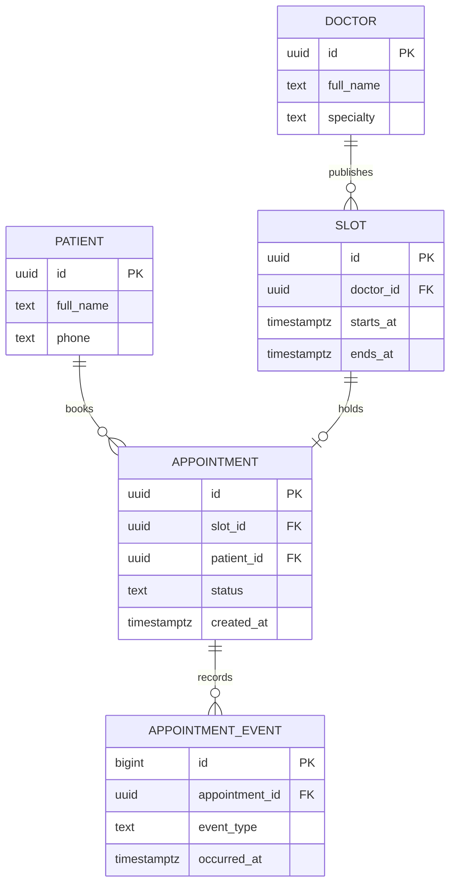

:::mental-model
**A data model is the set of facts the system must never contradict. Tables are where you make the important rules impossible to break.**
:::

## The part that outlives the code

Frameworks change. The booking API might be rewritten in another language in three years. The appointments table will still be there, with every patient visit the clinic ever recorded.

That is why data modeling deserves more care than it usually gets. A bad API can be replaced behind a version. A bad data model leaks into reports, migrations, backups and every future feature.

For the clinic, the first facts are simple:

- a **patient** exists,
- a **doctor** exists,
- a doctor publishes **slots**,
- a **patient books a slot**, creating an **appointment**,
- an appointment can be **cancelled** or **completed**.

Five nouns. A dozen rules hide inside them.

## Start with the nouns and the verbs

Write the sentences the business must be able to say without lying:

1. Every appointment belongs to exactly one patient and one doctor.
2. An appointment occupies exactly one slot.
3. A slot can have at most one active appointment.
4. A doctor can publish many slots.
5. A cancelled appointment frees its slot for someone else.
6. A patient can see only their own appointments.

Each sentence becomes a table, a key or a constraint.



The diagram is already making decisions. `SLOT ||--o| APPOINTMENT` says one slot holds zero or one appointment. That is the double-booking rule, written as a shape.

## Keys: how you name a fact

A **primary key** is the permanent name of a row. Prefer a surrogate key — a generated UUID or big integer — over a natural key such as a phone number.

Why? Phone numbers get reused, corrected, or shared between family members. If the phone number is the primary key and Meera changes hers, every foreign key in the system has to change with it. A generated ID never changes meaning.

Use a **unique constraint** for natural identifiers instead:

```sql
CREATE TABLE patients (
  id          uuid PRIMARY KEY DEFAULT gen_random_uuid(),
  full_name   text NOT NULL,
  phone       text NOT NULL,
  created_at  timestamptz NOT NULL DEFAULT now(),
  CONSTRAINT patients_phone_unique UNIQUE (phone)
);
```

Now the database enforces “one patient per phone number,” while the ID stays stable. If the clinic later allows a parent to book for a child with the same phone, you change one constraint instead of rewriting every relationship.

:::note
A foreign key is not just documentation. It prevents orphan rows: an appointment that points at a patient who no longer exists. Some high-scale systems drop foreign keys for write speed, but they replace them with application-level checks and reconciliation jobs. That is a tradeoff, not a free upgrade.
:::

## Constraints are business rules with teeth

The double-booking rule is the heart of the clinic. You can enforce it in three places:

| Place | What it does | What it misses |
|---|---|---|
| UI | Greys out booked slots | Two tabs, two phones, stale data |
| API check | `SELECT` then `INSERT` | Two requests can both pass the check |
| Database constraint | Refuses the second write | Nothing, if the constraint is correct |

The safe version puts the decision in one atomic write:

```sql
CREATE TABLE appointments (
  id          uuid PRIMARY KEY DEFAULT gen_random_uuid(),
  slot_id     uuid NOT NULL REFERENCES slots(id),
  patient_id  uuid NOT NULL REFERENCES patients(id),
  status      text NOT NULL CHECK (status IN ('booked', 'cancelled', 'completed', 'no_show')),
  created_at  timestamptz NOT NULL DEFAULT now()
);

-- Only one active appointment may hold a slot.
CREATE UNIQUE INDEX one_active_booking_per_slot
  ON appointments (slot_id)
  WHERE status = 'booked';
```

That partial unique index is a small piece of SQL that prevents an entire class of incidents. Notice that cancelled appointments do not block the slot, because the index only covers `status = 'booked'`.

Real-life version: railway and airline systems do not trust the seat map you see. The seat map is a hint. The seat is assigned by a conditional write at the moment you pay.

## Normalize first, denormalize on purpose

**Normalization** means storing each fact once. If a doctor’s name lives in the `doctors` table, do not copy it into every appointment. Otherwise Dr. Rao changes her name and half the history says “Dr. Rao,” half says “Dr. Sharma,” and the report is wrong.

But there is a legitimate exception: **snapshots**.

When Meera books, the price of the consultation is ₹500. Two years later it is ₹800. The invoice for her old visit must still say ₹500. So the appointment stores the price **at the time of booking**, even though the doctor’s current fee lives in another table.

The same idea appears in food delivery. An order stores the dish name and price as they were when ordered. The restaurant may rename the dish or raise the price tomorrow; the receipt must not change.

So the rule is not “never duplicate.” It is:

- duplicate **current reference data** only when you have a measured reason,
- snapshot **historical facts** deliberately, with a column name that says so (`price_at_booking`, not `price`).

## Types that prevent quiet disasters

Most data bugs are type bugs wearing a costume.

| Bad choice | What goes wrong | Better choice |
|---|---|---|
| `float` for money | ₹0.1 + ₹0.2 becomes ₹0.30000000000000004 | integer paise, or `numeric(12,2)` |
| `timestamp` without zone | A clinic in two cities shows the wrong hour | `timestamptz`, store UTC |
| `varchar(255)` everywhere | Arbitrary limits and silent truncation | real limits per field |
| `text` for status | Typos create new states nobody handles | `CHECK` or enum table |
| deleting rows | History and audits disappear | soft delete plus an event log |

Money deserves a special mention. Store **paise** as an integer, or use a fixed-precision decimal. Never a binary floating-point number. A payment system that loses a paisa per transaction loses real money at scale, and the bug is invisible until reconciliation.

Time deserves one too. Store instants in UTC (`timestamptz`), store the clinic’s time zone as a separate setting, and convert at the edges. “10:00” is not a fact until you know 10:00 **where**.

## Soft deletes and the event log

When Arjun deletes a patient by mistake, what should happen?

A hard `DELETE` removes the row and every foreign key pointing at it either blocks the delete or cascades into lost history. A **soft delete** keeps the row with `deleted_at` set. The patient disappears from normal queries, but appointments and invoices still make sense.

Soft deletes have a cost: every query must remember `WHERE deleted_at IS NULL`, and unique constraints get awkward. Use them where history matters (patients, appointments, invoices), not everywhere.

For state changes, an **event log** is often better than a mutable status column alone:

```text
2026-11-16 21:14  appointment.created
2026-11-17 08:02  appointment.cancelled   by: patient
2026-11-17 08:02  slot.released
```

The appointment row tells you the current state. The events tell you how it got there, who did it, and when. When a patient says “I cancelled last night,” the log is the answer.

## Migrations: change the schema without breaking the app

A schema change is a deploy to a shared, long-lived state. The safe pattern is expand-and-contract:

1. **Expand:** add the new nullable column or table. Deploy code that writes to both old and new.
2. **Backfill:** copy existing data in batches.
3. **Switch:** read from the new column.
4. **Contract:** drop the old column once nothing uses it.

Do not rename a column in one step while old app servers are still running. During a rolling deploy, both versions of the code exist at the same time. A one-step rename breaks half of them.

:::warning
On a large table, `ALTER TABLE ... ADD COLUMN ... DEFAULT ...` and index creation can lock or rewrite the table. In production, use concurrent index creation and batched backfills. A migration that takes four hours is an outage with extra steps.
:::

## When JSON is fine, and when it is a smell

A JSON column is useful for data you genuinely do not query by shape: a webhook payload, a settings blob, a third-party response you keep for debugging.

It becomes a problem when it hides the core model. If appointments are stored as `{"doctor": "...", "slot": "...", "patient": "..."}` inside one JSON blob, the database cannot enforce a foreign key, cannot index a patient’s history cleanly, and cannot answer “how many visits did Dr. Rao have in October?” without scanning and parsing every row.

Use JSON for the edges of the model. Keep the facts you join, filter and constrain in real columns.

## A model you can defend

For the clinic, a defensible first model is:

- `patients`, `doctors`, `slots`, `appointments`, `appointment_events`,
- UUID primary keys,
- foreign keys from appointments to patients and slots,
- a partial unique index for active bookings,
- `timestamptz` everywhere,
- status as a checked set of values,
- money as integer paise,
- an event row for every state change.

That model is not impressive. It is correct, and it will survive the next three features without a rewrite.

:::deep-dive Deep dive: why not one big table?
A single `bookings` table with patient name, doctor name, slot time and price is easy to start with. It also means:

- changing a doctor’s name requires updating every booking,
- a cancelled booking and a completed booking share the same row shape,
- there is no place to hang a slot’s availability before anyone books it,
- reporting on “free slots” means scanning bookings and guessing gaps.

Separate tables are not about purity. They are about giving each fact one home, so each rule has one place to live.
:::

## Check yourself

:::quiz
[
  {
    "question": "Why is a generated UUID usually a better primary key than a phone number?",
    "options": [
      "UUIDs are shorter",
      "Phone numbers can change or be reused, which would force every foreign key to change",
      "UUIDs are encrypted",
      "Databases cannot index phone numbers"
    ],
    "answer": 1,
    "explanation": "A primary key should never change meaning. Use a unique constraint for the phone number and a stable surrogate key for identity."
  },
  {
    "question": "Where should the “one active appointment per slot” rule live?",
    "options": [
      "Only in the UI",
      "In a database constraint or conditional write, because two requests can pass an application check at the same time",
      "In a cron job that runs every night",
      "In the API documentation"
    ],
    "answer": 1,
    "explanation": "The database is the last shared point of truth. A partial unique index or a transactional conditional insert makes the race impossible."
  },
  {
    "question": "Why might an appointment store the consultation price even though the doctor table already has a fee?",
    "options": [
      "To save a join",
      "Because the price at booking time is a historical fact that must not change when the doctor raises their fee",
      "Because money should be duplicated everywhere",
      "Because foreign keys are illegal"
    ],
    "answer": 1,
    "explanation": "This is a deliberate snapshot, not accidental duplication. The invoice must reflect what the patient actually agreed to pay."
  },
  {
    "question": "What is the safest way to store a consultation price?",
    "options": [
      "A floating-point number",
      "A string with a currency symbol",
      "An integer number of paise, or a fixed-precision decimal",
      "A JSON blob"
    ],
    "answer": 2,
    "explanation": "Binary floating point cannot represent many decimal amounts exactly. Integer minor units or fixed precision avoid quiet rounding errors."
  }
]
:::

## Exercise: model the no-show

The clinic wants to track patients who do not arrive and charge a small fee after two no-shows.

Add to your model:

1. a way to mark an appointment as `no_show`,
2. a way to count no-shows per patient without scanning every appointment,
3. a rule that a no-show does not block the slot forever,
4. an audit trail of who marked it and when.

Write the tables, keys and constraints. Then explain one query that would become slow if you stored the no-show count only as a JSON field.

:::discussion
- Should a cancelled appointment keep its slot row, or should the slot be deleted? What does each choice make easy or hard?
- Would you soft-delete a patient? What about a slot?
- Where is the line between a snapshot you need and duplication you will regret?
:::

## Key takeaways

- Model the facts and the rules, not the screens.
- Use stable surrogate keys and unique constraints for natural identifiers.
- Put critical rules in the database, where concurrent requests cannot both win.
- Normalize current facts; snapshot historical facts on purpose.
- Choose types that make silent corruption impossible: integer money, `timestamptz`, checked statuses.
- Change schemas in expand-and-contract steps, because old and new code run at the same time.

## Free references

- [PostgreSQL: Constraints](https://www.postgresql.org/docs/current/ddl-constraints.html) — primary keys, foreign keys, checks and unique indexes.
- [Use The Index, Luke: SQL design](https://use-the-index-luke.com/) — how schema and query shape affect performance.
- [Martin Fowler: Evolutionary Database Design](https://martinfowler.com/articles/evodb.html) — migrations as a normal part of delivery.
