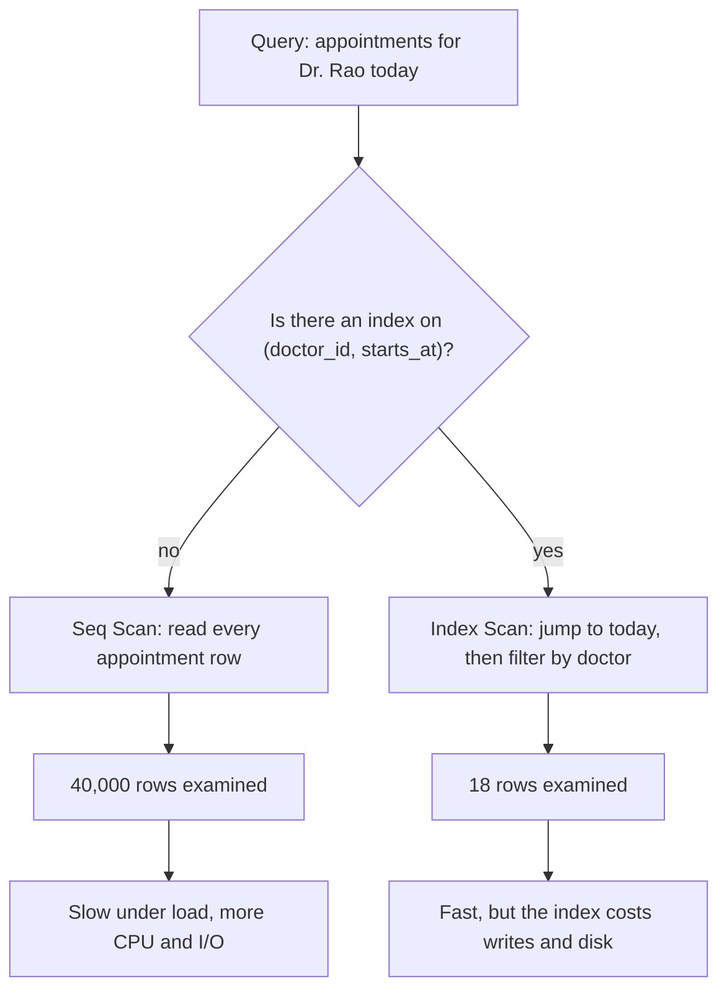

:::mental-model
**An index is a sorted shortcut that turns “read everything” into “jump to the answer.” You pay for it on every insert, update and delete.**
:::

## The clinic at 8:59 on Monday

Arjun opens the reception screen. It needs today’s appointments for Dr. Rao, ordered by time. There are 40,000 appointments in the table from the last two years.

Without help, the database reads all 40,000 rows, throws away the ones that are not today or not Dr. Rao, sorts what is left, and returns 18 rows. That takes a few milliseconds on a laptop and much longer when ten receptionists do it at once.

With the right index, the database jumps straight to today’s rows for that doctor. It reads 18 rows instead of 40,000.

That is the whole idea. Everything else is detail about **which** columns, in **which order**, and **what it costs**.

## The book-index analogy

A textbook has an index at the back:

```text
indexes ......... 142
isolation ....... 88
idempotency ..... 71
```

You do not read the whole book to find “idempotency.” You go to the index, find the page number, and jump there. The index is smaller than the book, sorted, and updated when the book changes.

A database index works the same way:

- it stores a **key** (the column value),
- sorted so the database can binary-search it,
- plus a pointer to the row,
- and it is maintained on every write.

For most relational databases the structure is a **B-tree**: a shallow tree that keeps keys in order. That ordering is why an index can serve equality (`=`) and range (`>`, `<`, `BETWEEN`) queries, and why it can return sorted rows without a separate sort.



## What a query does without an index

A **sequential scan** reads the table from start to finish. It is not always bad. If you ask for 90% of the rows, reading the table in order is cheaper than jumping around an index.

The planner decides. Your job is to give it a useful option and then check what it chose.

Here is a real-shaped example:

```sql
SELECT id, starts_at, patient_id
FROM appointments
WHERE doctor_id = 'doc_rao'
  AND starts_at >= '2026-11-17'
  AND starts_at <  '2026-11-18'
ORDER BY starts_at;
```

The index that matches this query is:

```sql
CREATE INDEX idx_appointments_doctor_time
  ON appointments (doctor_id, starts_at);
```

Column order matters. `(doctor_id, starts_at)` lets the database jump to one doctor and then walk that doctor’s appointments in time order. `(starts_at, doctor_id)` is a different index: good for “everything today,” less direct for “Dr. Rao’s day.”

This is the **leftmost prefix** rule: an index on `(a, b, c)` can serve queries that filter on `a`, or `a` and `b`, or `a`, `b` and `c`. It generally cannot serve a query that filters only on `b`.

## Composite indexes: order is a design decision

Suppose the food-delivery app has a screen “biryani restaurants in Bengaluru, sorted by rating.” The query filters on city and cuisine, then sorts by rating. A composite index can serve all three:

```sql
CREATE INDEX idx_restaurants_city_cuisine_rating
  ON restaurants (city, cuisine, rating DESC);
```

Now the database can jump to `city = 'Bengaluru' AND cuisine = 'biryani'` and read rows already ordered by rating. No sort step.

But look at what happens if the product changes: “show all cuisines in Bengaluru, sorted by rating.” The index still helps with `city = 'Bengaluru'`, but the cuisine column sits between city and rating, so the rating order is not usable across cuisines. You may need a second index `(city, rating DESC)`. This is normal. Indexes follow query patterns, and query patterns change.

## Covering indexes: answer from the index alone

If an index contains every column a query needs, the database can answer without visiting the table. That is a **covering index**.

```sql
CREATE INDEX idx_slots_doctor_time_covering
  ON slots (doctor_id, starts_at) INCLUDE (ends_at);
```

The query `SELECT starts_at, ends_at FROM slots WHERE doctor_id = ? AND starts_at >= ?` can be satisfied from the index. Fewer page reads, less I/O.

The cost: a wider index uses more disk and makes writes slightly more expensive. Cover the queries that matter, not every query.

## Selectivity: how much does the index narrow things down?

**Selectivity** is the fraction of rows a condition keeps. A unique phone number is highly selective: one row out of millions. A status column with values `active` and `inactive` is not: if 95% are active, an index on `status` barely narrows anything.

The planner knows this approximately, using statistics. That is why:

```sql
-- probably fine: highly selective
WHERE phone = '+91-98765-43210'

-- often ignored: matches most of the table
WHERE status = 'active'
```

An index on a low-selectivity column is not useless — it can still help if the matching rows are clustered together — but it is rarely the first index you should add.

:::warning
“Add an index on every column” is a common beginner move. It slows down writes, wastes disk, confuses the planner, and makes migrations heavier. Index the queries you actually run.
:::

## Read the plan, not your intentions

Every serious relational database can show you the plan:

```sql
EXPLAIN ANALYZE
SELECT id, starts_at
FROM appointments
WHERE doctor_id = 'doc_rao'
  AND starts_at >= '2026-11-17'
  AND starts_at <  '2026-11-18'
ORDER BY starts_at;
```

What to look for:

| Signal | What it means |
|---|---|
| `Seq Scan` on a large table | No usable index, or the planner thinks a scan is cheaper |
| `Index Scan` | The index is being used to find rows |
| `Bitmap Index Scan` | The index finds candidates, then reads table pages in batches |
| `rows=` estimate far from `actual rows=` | Statistics are stale; run `ANALYZE` |
| `Sort` after an index scan | The index order did not match the requested order |
| `Filter` removing most rows | The index narrowed some, but not enough |

The plan is a conversation with the database. It tells you whether your index is helping or just sitting there costing writes.

:::note
`EXPLAIN` shows the plan. `EXPLAIN ANALYZE` actually runs the query and shows real timings. Never run `EXPLAIN ANALYZE` on a destructive statement, and be careful with expensive queries in production.
:::

## Every index taxes every write

An index is a second copy of part of the table, kept sorted. When you insert a row, the database must insert into the table **and** into every index. When you update an indexed column, it must move the key in every affected index. When you delete, it must remove the entries.

So an index is a trade:

- **Reads get faster** for the queries it serves.
- **Writes get slower** for every row that touches it.
- **Disk and memory grow.**
- **Vacuum and maintenance grow.**

A table with twelve indexes can be several times slower to write than the same table with three. On a booking system that writes thousands of appointments an hour, that difference is real.

The practical rule: start with indexes for primary keys, foreign keys you join on, and the unique constraints that protect correctness. Add more only when a real query needs them.

## Anti-patterns that quietly disable an index

An index only helps if the query can use it. These patterns often prevent that:

**1. A function on the indexed column**

```sql
-- index on created_at is not used
WHERE date(created_at) = '2026-11-17'

-- rewrite as a range
WHERE created_at >= '2026-11-17' AND created_at < '2026-11-18'
```

**2. A leading wildcard**

```sql
-- normal B-tree index cannot seek with a leading %
WHERE name LIKE '%biryani%'
```

For real text search, use a trigram index, a full-text index, or a search engine — not a normal B-tree.

**3. Type mismatch**

If `phone` is text and you compare it to a number, the database may cast the column and lose the index. Keep types aligned.

**4. `OR` across different columns**

`WHERE doctor_id = ? OR patient_id = ?` may force a scan unless the planner can combine two indexes. Sometimes two queries and a union are faster.

**5. Wrapping a column in `COALESCE` or `LOWER`**

`WHERE LOWER(email) = ?` needs an expression index on `LOWER(email)` or a case-insensitive type.

## Real systems, same idea

- **Bank statement:** an index on `(account_id, posted_at)` makes “my last 30 days” fast without scanning the bank’s entire ledger.
- **Food delivery:** an index on `(city, cuisine, rating)` makes the restaurant list fast; an index on `(order_id)` makes order tracking fast.
- **Chat:** an index on `(conversation_id, sent_at)` makes loading the last 50 messages fast, even with billions of messages.
- **Clinic:** an index on `(doctor_id, starts_at)` makes the schedule fast; a unique partial index on `(slot_id) WHERE status = 'booked'` makes double booking impossible.

Notice that the last one is not only for speed. It is for correctness. Some indexes exist to enforce a rule, not to accelerate a read.

## A way to choose indexes

1. List the queries the product actually runs, with their filters and sort order.
2. Estimate how often each runs and how many rows it touches.
3. For the slow, frequent ones, propose an index whose **leftmost columns match the filters** and whose later columns support the sort.
4. Check the plan with `EXPLAIN ANALYZE`.
5. Measure write impact. Remove indexes nothing uses.
6. Revisit when the query pattern changes.

Index design is not a one-time act. It follows the product.

:::widget index-lab
:::

:::deep-dive Deep dive: why index order is not alphabetical
A B-tree is sorted by the tuple of indexed columns, left to right. Think of a phone book sorted by `(last_name, first_name)`. You can find “Sharma, Meera” quickly. You can also find all “Sharma” entries together. But you cannot efficiently find everyone named “Meera” regardless of surname, because first name is not the leading column.

Composite indexes work exactly like that. The first column is the outer sort; later columns sort within it. Choose the column order to match how you search.
:::

## Check yourself

:::quiz
[
  {
    "question": "A query filters by doctor_id and a date range, then orders by starts_at. Which index fits best?",
    "options": [
      "An index on (starts_at)",
      "An index on (doctor_id, starts_at)",
      "An index on (patient_id)",
      "An index on (status)"
    ],
    "answer": 1,
    "explanation": "The leading column matches the equality filter, and the second column supports both the range and the sort order."
  },
  {
    "question": "Why can an index on a status column with two values often be ignored by the planner?",
    "options": [
      "Status columns cannot be indexed",
      "If most rows match, reading the table sequentially is cheaper than jumping through the index",
      "Indexes only work on numbers",
      "The planner never uses indexes"
    ],
    "answer": 1,
    "explanation": "Low selectivity means the index does not narrow the search much. The planner may choose a sequential scan instead."
  },
  {
    "question": "What is the main cost of adding an index?",
    "options": [
      "It makes all reads slower",
      "It slows down inserts, updates and deletes, and uses disk and memory",
      "It prevents foreign keys",
      "It changes the data type of the column"
    ],
    "answer": 1,
    "explanation": "Every write must maintain every index. Indexes are a read/write tradeoff, not free speed."
  },
  {
    "question": "Why does WHERE date(created_at) = '2026-11-17' often fail to use a normal index on created_at?",
    "options": [
      "Dates cannot be indexed",
      "The function wraps the column, so the database cannot compare raw indexed values directly",
      "The query is invalid SQL",
      "It always uses the index"
    ],
    "answer": 1,
    "explanation": "Rewrite it as a range on the raw column, or create an expression index on date(created_at)."
  },
  {
    "question": "What does EXPLAIN ANALYZE add over EXPLAIN?",
    "options": [
      "It formats the query",
      "It runs the query and reports actual row counts and timings",
      "It creates the index automatically",
      "It backs up the database"
    ],
    "answer": 1,
    "explanation": "EXPLAIN estimates; EXPLAIN ANALYZE executes and compares estimates with reality, which is where stale statistics show up."
  }
]
:::

## Exercise: index the reception screen

The screen runs:

```sql
SELECT a.id, a.starts_at, p.full_name
FROM appointments a
JOIN patients p ON p.id = a.patient_id
WHERE a.doctor_id = $1
  AND a.starts_at >= $2
  AND a.starts_at <  $3
  AND a.status = 'booked'
ORDER BY a.starts_at
LIMIT 50;
```

1. Propose one index for `appointments` and one for `patients`.
2. Explain why the order of columns matters.
3. Write the `EXPLAIN ANALYZE` you would run.
4. Name one index you would **not** add, and why.

:::discussion
- Which queries in the clinic would you index first, and which would you leave alone?
- When would you accept a slower write to get a faster read?
- How would you find indexes that are no longer used?
:::

## Key takeaways

- An index is a sorted shortcut: it trades write cost and disk for faster reads.
- Match the index to the query: equality columns first, then range and sort columns.
- Composite index order matters; the leftmost prefix rule decides what it can serve.
- Low-selectivity columns rarely justify an index on their own.
- Read `EXPLAIN ANALYZE` to confirm the plan, then measure the write cost.
- Some indexes exist for correctness — like the unique index that prevents double booking.

## Free references

- [Use The Index, Luke](https://use-the-index-luke.com/) — the best free guide to SQL indexing and query plans.
- [PostgreSQL: Indexes](https://www.postgresql.org/docs/current/indexes.html) — index types and how the planner uses them.
- [PostgreSQL: Using EXPLAIN](https://www.postgresql.org/docs/current/using-explain.html) — how to read a plan without guessing.
