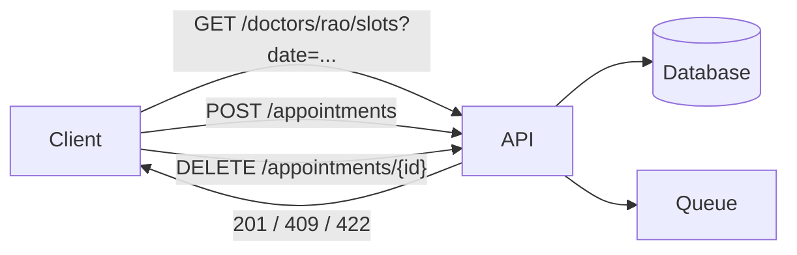

:::mental-model
**A good API makes the correct call easy, the incorrect call fail loudly, and a future change possible without breaking existing clients.**
:::

## The API is the product boundary

Meera’s phone does not touch the database. It talks to the API. So does the staff dashboard, and so will the lab partner the clinic integrates with next year.

That makes the API a contract with three audiences:

1. **today’s clients** — the web app and the mobile app,
2. **future clients** — a partner, a kiosk, a reporting tool,
3. **future maintainers** — the people who must change it without breaking the first two.

Most API mistakes are not syntax mistakes. They are contract mistakes: a status code that lies, a list that silently truncates, an error the client cannot act on, a field that changes meaning.

## Resources are nouns, actions are HTTP

Start with the things the clinic has:

- patients
- doctors
- slots
- appointments

Then use HTTP methods for the verbs:

| Method | Meaning | Clinic example |
|---|---|---|
| `GET` | Read, no side effects | `GET /doctors/rao/slots?date=2026-11-17` |
| `POST` | Create, or run an action | `POST /appointments` |
| `PATCH` | Partially update | `PATCH /appointments/apt_8812` |
| `DELETE` | Remove or cancel | `DELETE /appointments/apt_8812` |

Prefer nouns in paths: `/appointments`, not `/bookAppointment`. The method already carries the verb. If an action does not map cleanly to create/read/update/delete, model it as a sub-resource (`POST /appointments/{id}/cancellation`) or accept a pragmatic verb endpoint and document it.



## Status codes are the error contract

The status code tells the client what kind of thing happened before it parses the body. Use them precisely:

| Code | When | What the client should do |
|---|---|---|
| `200 OK` | A successful read or update | Use the body |
| `201 Created` | A resource was created | Read `Location` and the body |
| `204 No Content` | Success with nothing to return | Do not expect a body |
| `400 Bad Request` | Malformed request | Fix the request; do not retry |
| `401 Unauthorized` | Missing or invalid credentials | Sign in, then retry |
| `403 Forbidden` | Authenticated but not allowed | Do not retry |
| `404 Not Found` | The resource does not exist | Show a not-found state |
| `409 Conflict` | The state changed under you | Re-read and decide |
| `422 Unprocessable Entity` | Valid syntax, invalid values | Show field errors |
| `429 Too Many Requests` | Rate limited | Back off using `Retry-After` |
| `500 Internal Server Error` | A bug | Retry carefully, report |
| `503 Service Unavailable` | Temporarily down or overloaded | Retry with backoff |

The clinic’s double-booking case is a `409`, not a `500`. The request was valid. The world changed. The client should refresh the slot list, not show “something went wrong.”

:::warning
Returning `200 OK` with `{"success": false}` is a contract smell. Proxies, retries, monitoring and client libraries all read the status line. If it says success, they believe it.
:::

## One error shape, every time

Clients should not need a different parser for each failure. Pick one envelope:

```json
{
  "error": {
    "code": "SLOT_ALREADY_BOOKED",
    "message": "That slot was just booked by someone else.",
    "requestId": "req_01J8Z6K3",
    "details": [
      { "field": "slotId", "issue": "not available" }
    ]
  }
}
```

Why each field matters:

- **code** is stable and machine-readable; clients can branch on it.
- **message** is for humans and can change.
- **requestId** lets support find the exact server log line.
- **details** lets a form highlight the right field.

Never leak stack traces, SQL or internal hostnames. Log them with the request ID; return the ID.

## Writes need idempotency

Meera taps “Confirm.” The request reaches the server, the appointment is created, and the response is lost on a flaky train connection. Her app retries.

Without protection, the clinic now has two appointments.

The fix is an idempotency key:

```http
POST /appointments
Idempotency-Key: 7f3c2a90-2f4e-4b1a-9a77-2f4b0c8e91d1
```

The server stores the key with the result for a window (often 24 hours). A retry with the same key returns the original response instead of creating a new appointment. A retry with a **different** payload but the same key is rejected as a conflict.

This is how payment APIs avoid charging twice. It is not optional for money or bookings.

## Pagination: never return “all”

The reception screen cannot load 40,000 appointments. Even if the database could, the phone cannot, and the user will not scroll.

Use a bounded list:

```http
GET /appointments?date=2026-11-17&limit=50&cursor=eyJpZCI6...
```

Two common styles:

| Style | How it works | Strength | Weakness |
|---|---|---|---|
| Offset | `?offset=100&limit=50` | Simple, jump to page N | Rows shift when data changes; deep offsets get slow |
| Cursor | `?limit=50&cursor=...` | Stable under inserts, efficient at depth | No random page access |

For feeds, logs and appointment lists that change, cursor pagination is usually the better default. Return a `nextCursor` and let the client ask for the next slice.

Always cap `limit`. An API that accepts `limit=1000000` is a denial-of-service tool with a friendly name.

## Filtering and sorting: allowlist, do not pass through

Clients will send anything:

```http
GET /appointments?sort=starts_at;DROP TABLE patients;--
```

Never interpolate query parameters into SQL. Map allowed filters and sort fields to known columns:

```text
allowedSort = { starts_at, created_at, status }
allowedStatus = { booked, cancelled, completed, no_show }
```

Anything else is a `400`. This is both a security rule and a product rule: a stable, documented set of filters is easier to support than arbitrary query construction.

## Versioning without drama

The safest change is **additive**:

- add a new optional field,
- add a new endpoint,
- add a new enum value only if clients are tolerant of unknown values,
- never change the meaning of an existing field.

When you must break a contract, version the API (`/v2/appointments`) or the media type, announce a deprecation window, and keep the old path working long enough for real clients to move.

:::note
Changing a field from `"price": 500` to `"price": "₹500"` is a breaking change even though the endpoint still returns `200`. Types are part of the contract.
:::

## Authentication and authorization are different questions

- **Authentication** asks “who are you?” A missing or invalid token is `401`.
- **Authorization** asks “are you allowed to do this?” A patient trying to read another patient’s appointment is `403` (or `404`, if you do not want to reveal that the appointment exists).

A patient token should carry the patient’s identity, and every query should scope by it. Do not trust a `patientId` in the request body for “my appointments.” Derive it from the token, or verify it against the token.

## Contract first

Write the contract before the implementation:

- paths and methods,
- request schema,
- response schema for success **and** failure,
- auth requirements,
- pagination and limits,
- examples.

OpenAPI is a common format. Even a table in a README beats an undocumented API that only the original author understands.

:::reality-check
The API will be called by a client you did not write: a mobile app on an old version, a partner’s script, a support tool. If your only documentation is the current frontend code, every one of those clients is guessing.
:::

## A clinic API contract, in miniature

| Endpoint | Success | Failure that matters |
|---|---|---|
| `GET /doctors/{id}/slots?date=` | `200` list of slots | `404` doctor, `400` bad date |
| `POST /appointments` | `201` appointment | `409` slot taken, `422` invalid patient |
| `GET /appointments/{id}` | `200` appointment | `403` not yours, `404` missing |
| `DELETE /appointments/{id}` | `204` cancelled | `409` too late to cancel |
| `GET /appointments?date=&cursor=` | `200` page + `nextCursor` | `400` bad filter |

That table is small enough to review and complete enough to build against. Notice that every endpoint has a failure that matters. A contract without failures is a demo.

## Check yourself

:::quiz
[
  {
    "question": "A patient tries to book a slot that was taken a second earlier. Which status code fits best?",
    "options": [
      "200 OK",
      "409 Conflict",
      "500 Internal Server Error",
      "401 Unauthorized"
    ],
    "answer": 1,
    "explanation": "The request was valid, but the state changed. 409 tells the client to re-read and choose again."
  },
  {
    "question": "What problem does an Idempotency-Key solve?",
    "options": [
      "It makes the API faster",
      "It lets a retry return the original result instead of creating a duplicate",
      "It encrypts the request body",
      "It replaces authentication"
    ],
    "answer": 1,
    "explanation": "A lost response is an unknown outcome. The key ties retries to one logical operation."
  },
  {
    "question": "Why is cursor pagination often better than offset pagination for a live appointment list?",
    "options": [
      "It returns more rows",
      "It stays stable when rows are inserted or removed, and deep pages stay efficient",
      "It does not need a database",
      "It removes the need for limits"
    ],
    "answer": 1,
    "explanation": "Offsets shift when data changes and get slower at depth. A cursor anchors to a known row."
  },
  {
    "question": "A logged-in patient requests another patient’s appointment. What should the API return?",
    "options": [
      "200 with the appointment",
      "403 Forbidden, or 404 if you do not want to reveal existence",
      "500",
      "201 Created"
    ],
    "answer": 1,
    "explanation": "Authentication succeeded, but authorization failed. The exact choice between 403 and 404 is a privacy decision."
  },
  {
    "question": "Which change is safest for an existing API?",
    "options": [
      "Renaming a response field",
      "Changing a number field to a string",
      "Adding a new optional field",
      "Removing an endpoint without notice"
    ],
    "answer": 2,
    "explanation": "Additive changes keep old clients working. Renames, type changes and removals break contracts."
  }
]
:::

## Exercise: design the cancel contract

Design `DELETE /appointments/{id}` for the clinic, including:

1. who is allowed to cancel (patient, staff, both),
2. the two-hour cutoff rule and the status code when it is violated,
3. what happens on a second cancel of the same appointment (idempotent success or conflict?),
4. the response body for success and failure,
5. one audit event you would record.

Then write the same operation for “reschedule,” and decide whether it is a `PATCH`, a `POST`, or a pair of cancel-and-book calls. Defend your choice.

:::discussion
- Should a cancelled appointment be `DELETE`d or moved to a `cancelled` status? What does each choice do to reporting?
- Is `POST /appointments/{id}/cancellation` better than `DELETE /appointments/{id}`? Why might a team choose either?
- What belongs in the API contract but not in the database schema?
:::

## Key takeaways

- Model resources as nouns and let HTTP methods carry the verbs.
- Status codes are part of the contract; do not hide failures inside `200`.
- Use one stable error shape with a machine code and a request ID.
- Protect writes with idempotency keys.
- Paginate with a bounded limit and a cursor when data changes.
- Allowlist filters and sort fields; never pass them into SQL.
- Prefer additive changes, and version only when you must break a promise.

## Free references

- [Stripe API reference](https://docs.stripe.com/api) — a widely copied model for errors, pagination and idempotency.
- [GitHub REST API](https://docs.github.com/en/rest) — clear resource design and status codes.
- [OpenAPI Specification](https://spec.openapis.org/oas/latest.html) — a formal way to write the contract.
- [MDN: HTTP response status codes](https://developer.mozilla.org/en-US/docs/Web/HTTP/Status) — the full list, with semantics.
