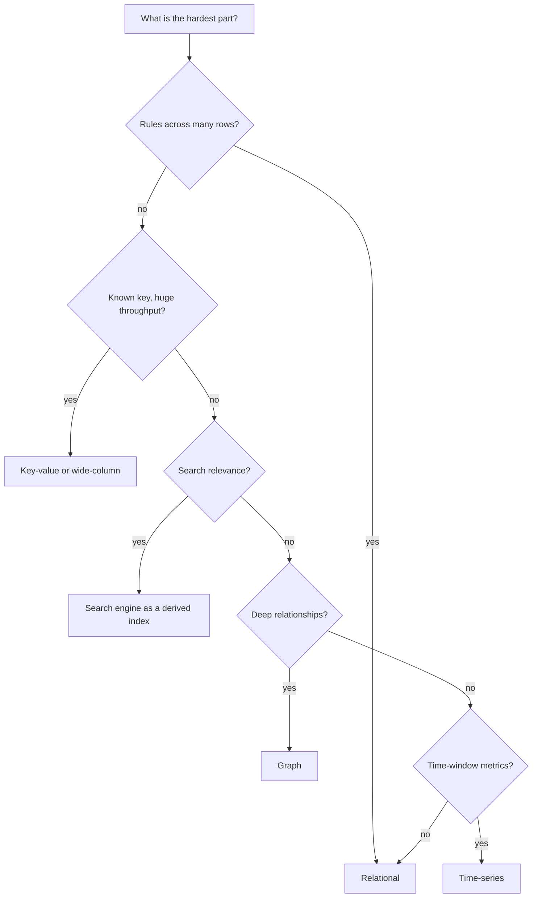

:::mental-model
**There is no best database. There is a database whose read shape, write shape, consistency model and operational cost match your problem — and whose weaknesses you can afford.**
:::

## The question behind the question

“Which database should I use?” is usually shorthand for four separate questions:

1. **What does a read look like?** One row by key, a join across five tables, a full-text search, a graph walk, a time-window aggregate?
2. **What does a write look like?** A few rows per second, millions of appends, or bursts of updates to the same record?
3. **How consistent must it be?** Must every reader see the latest write immediately, or is a few seconds of lag acceptable?
4. **How much operational work can you afford?** One managed server, or a team that can run a distributed cluster at 3 a.m.?

Answer those first. The product name comes last.

## The families, and what each gives up

| Family | Good at | Gives up | Clinic example |
|---|---|---|---|
| **Relational** (PostgreSQL, MySQL) | Joins, constraints, transactions, ad-hoc queries | Easy horizontal writes; schema changes need care | Patients, slots, appointments, invoices |
| **Document** (MongoDB) | Whole-document reads, flexible shape | Cheap joins, multi-document transactions | A CMS article, a product page |
| **Key-value** (Redis, DynamoDB) | Known keys, very high throughput, low latency | Ad-hoc queries and relationships | Sessions, carts, idempotency keys |
| **Wide-column** (Cassandra, ScyllaDB) | Massive append-heavy writes, multi-region | Joins, flexible queries, strong multi-row transactions | Chat history, sensor events |
| **Search** (Elasticsearch, OpenSearch) | Relevance, fuzzy match, facets | Being the source of truth | “Find a cardiologist near me” |
| **Graph** (Neo4j) | Multi-hop relationships | Simple scale-out, broad tooling | Fraud rings, social graphs |
| **Time-series** (TimescaleDB, ClickHouse) | Append-only metrics, window aggregates | Frequent updates, point lookups | Clinic wait times, prices, metrics |

The table is not a ranking. It is a map of what breaks first in each family.

## Start with a relational database

For most products, the first correct answer is PostgreSQL or MySQL. Not because they are fashionable, but because they cover the widest range of early problems without a second system:

- transactions for bookings and payments,
- foreign keys and unique constraints for correctness,
- joins for screens that need data from several tables,
- JSON columns when a shape is genuinely flexible,
- full-text search that is good enough for a first version,
- mature backups, replication and managed hosting.

The clinic at 200 appointments a week will never outgrow a single Postgres instance. Reaching for a distributed database on day one buys complexity you cannot yet use.

:::note
“Start with Postgres” is not “use Postgres forever.” It is “do not pay for distributed-systems complexity until a measured bottleneck forces you to.”
:::

## When the relational default is wrong

There are real cases where the access pattern is so specific that a relational database becomes the wrong tool:

**1. Sessions and carts at scale.** You need `get(key)` in under a millisecond, millions of times a second, with expiration. A key-value store is the natural fit. The relational database remains the source of truth for orders; Redis holds the disposable session state.

**2. Chat history.** Messages are append-only, read by conversation in time order, and enormous. A wide-column store partitioned by `(conversation_id, time bucket)` scales writes across nodes and serves “last 50 messages” without a join. You give up “show me all messages containing ‘fever’ across all conversations” unless you build another index.

**3. Search.** Users expect typo tolerance, synonyms, ranking and facets. A B-tree cannot do relevance. A search engine is the right tool — as a **derived** index fed from the database, not as the primary store.

**4. Analytics.** “Average wait time per doctor per hour for the last year” will make a transactional database unhappy. A columnar or time-series store compresses and aggregates efficiently. Copy the data; do not run the dashboard on the booking database.

**5. Graph traversal.** “Which patients share a phone number with a patient who has a fraud flag, within three hops?” is painful in SQL and natural in a graph database. If relationship depth is the product, a graph store earns its place.

## Consistency is a product decision

Relational databases usually give you **ACID**:

- **Atomicity:** the booking and its payment either both happen or neither does.
- **Consistency:** constraints hold before and after.
- **Isolation:** concurrent transactions do not see each other’s half-finished work.
- **Durability:** a committed write survives a crash.

Distributed systems often relax these for availability and scale, landing on **eventual consistency**: a write becomes visible everywhere after some delay. That is fine for a “likes” counter and dangerous for an appointment slot.

The practical question is not “SQL or NoSQL?” It is:

> If two users act at the same moment, what must be true immediately, and what can be true a second later?

For the clinic: the slot assignment must be immediate and unique. A “visits this month” counter can lag. A search index can lag. A reminder can lag by minutes. Put each fact in the category it belongs to.

:::warning
“Eventually consistent” does not mean “correct eventually.” If two nodes accept conflicting writes and you have no conflict rule, the system can settle on the wrong answer forever. Decide the rule before you choose the database.
:::

## Polyglot persistence has a tax

Using several databases is normal at scale. It is also a tax:

- every store needs backups, monitoring, upgrades and credentials,
- data can drift between stores,
- a write may succeed in one place and fail in another,
- debugging spans more systems,
- the team must learn more failure modes.

Add a second database only when the first one has a measured weakness that the second one fixes. “It might scale someday” is not a measurement.

## Managed versus self-hosted

A managed database costs more per month and less per engineer. It gives you backups, failover, patching and monitoring. A self-hosted database is cheaper on a invoice and more expensive at 2 a.m.

For a small clinic, managed Postgres is almost always the right call. For a company with a database team and a very specific workload, self-hosting can be justified. The decision is about who carries the operational risk, not only about licensing.

## Benchmark your workload, not someone’s blog post

A benchmark that inserts one million tiny rows tells you little about a booking system that runs transactions, joins, range queries and unique constraints under concurrent load.

A useful test:

1. Use a realistic schema and data size.
2. Run the actual top queries, not `SELECT 1`.
3. Include the write mix: bookings, cancellations, updates.
4. Measure p50, p95 and p99, not just average throughput.
5. Run long enough to hit garbage collection, checkpointing and cache eviction.
6. Test failure: kill a node, add latency, exhaust connections.

The database that wins a synthetic benchmark may lose on your access pattern. Measure the thing you will actually do.

## A defensible clinic stack

For the clinic’s first year:

- **PostgreSQL** for patients, doctors, slots, appointments, invoices and audit events.
- **Redis** only if sessions or slot-list caching becomes a measured need.
- **Object storage** for scanned documents and photos, not the database.
- **A queue** for reminders, backed by the database at first if volume is low.

That stack is boring. It is also cheap, understandable, and correct for the constraints. Boring is a feature.

:::deep-dive Deep dive: why “NoSQL scales better” is incomplete
NoSQL databases often scale writes by partitioning data across nodes. That is real. But partitioning moves the hard problem into your application:

- a query that spans partitions becomes a scatter-gather,
- a transaction across partitions becomes a saga,
- a unique constraint across partitions becomes a coordination problem,
- a hot partition becomes a hotspot no matter how many nodes you add.

Relational databases also scale — read replicas, connection pooling, partitioning, and yes, sharding. The difference is where the complexity lives, not whether it exists.
:::

:::widget db-picker
:::

## Check yourself

:::quiz
[
  {
    "question": "What is the first thing to understand before choosing a database?",
    "options": [
      "Which database has the best logo",
      "The read shape, write shape, consistency needs and operational budget",
      "Which one is newest",
      "Which one has the most features"
    ],
    "answer": 1,
    "explanation": "The access pattern and constraints decide the family. Product names are the last step."
  },
  {
    "question": "Why is a relational database a good default for the clinic?",
    "options": [
      "It is always faster than NoSQL",
      "It provides transactions, constraints and joins for the rules the clinic actually has",
      "It never needs backups",
      "It cannot be sharded"
    ],
    "answer": 1,
    "explanation": "Double-booking prevention, invoicing and reporting are naturally relational problems."
  },
  {
    "question": "When does a key-value store fit better than a relational database?",
    "options": [
      "When you need complex joins",
      "When you need known-key lookups at very high throughput, such as sessions or carts",
      "When you need ad-hoc reporting",
      "When you need foreign keys"
    ],
    "answer": 1,
    "explanation": "Key-value stores excel at simple, predictable key access and give up query flexibility."
  },
  {
    "question": "What is the hidden cost of adding a second database?",
    "options": [
      "Nothing; it is always free",
      "Backups, monitoring, drift, partial failures and more failure modes to debug",
      "It removes the need for a schema",
      "It makes all queries faster"
    ],
    "answer": 1,
    "explanation": "Polyglot persistence trades operational complexity for specialized performance."
  },
  {
    "question": "Which statement about consistency is most accurate?",
    "options": [
      "Eventually consistent means the data is always correct immediately",
      "The business rule decides what must be immediate and what may lag",
      "Strong consistency is always worth the cost",
      "Consistency only matters for analytics"
    ],
    "answer": 1,
    "explanation": "Slot assignment must be immediate; a visit counter or search index can lag. Classify each fact by its consequence."
  }
]
:::

## Exercise: justify the stack

For each requirement, choose a store and name what you give up:

1. “A patient must never get a slot someone else already booked.”
2. “The doctor search box should tolerate typos and rank by relevance.”
3. “We need to show the last 50 messages in a chat in under 100 ms.”
4. “The clinic wants a monthly report of average wait time by doctor.”
5. “A logged-in session should expire after 30 minutes.”

Then write one paragraph explaining why you would **not** put all five in the same database.

:::discussion
- Which is riskier for a small team: one database doing everything, or three specialized databases?
- When would you accept eventual consistency for the appointment list? What would you never accept it for?
- How would you migrate from one database family to another without downtime?
:::

## Key takeaways

- Choose by access pattern, consistency requirement and operational budget, not by popularity.
- Relational databases are the right default for most products; deviate for a measured reason.
- Each family gives something up: joins, query flexibility, transactions, or operational simplicity.
- Classify each fact: what must be immediate, what may lag, and what must never be wrong.
- Polyglot persistence is powerful and expensive. Add stores deliberately.
- Benchmark your real workload, including writes, concurrency and failure.

## Free references

- [PostgreSQL: Don't Do This](https://wiki.postgresql.org/wiki/Don%27t_Do_This) — practical pitfalls from a mature relational database.
- [Redis: Persistence](https://redis.io/docs/latest/operate/oss_and_stack/management/persistence/) — what you keep and what you can lose.
- [Apache Cassandra: Data modeling](https://cassandra.apache.org/doc/latest/cassandra/developing/data-modeling/intro.html) — query-first design in a wide-column store.
- [Jepsen: Consistency models](https://jepsen.io/consistency) — a rigorous map of what “consistent” can mean.
