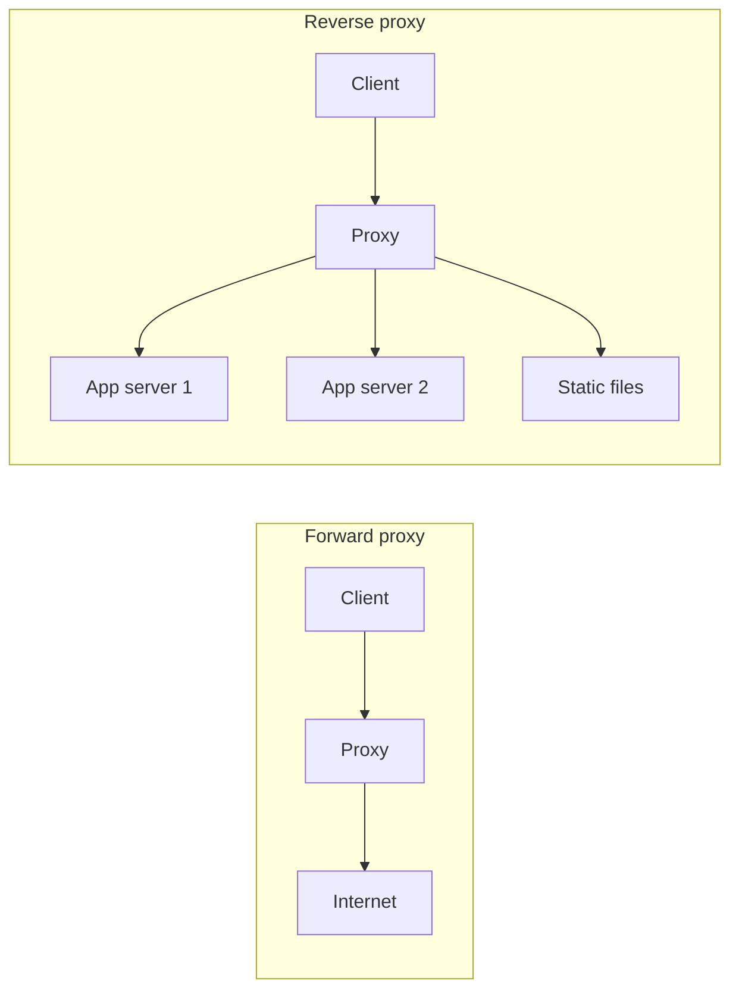
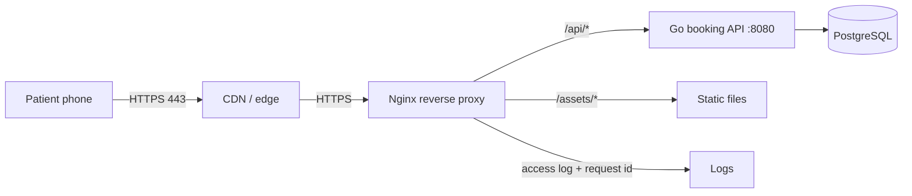

:::mental-model
**A reverse proxy is the front door to your system. Clients talk to it; it decides what reaches the application, and it can say no before your app is troubled.**
:::

## The problem with exposing the app directly

You can start a Go or Node server on port 8080 and let the internet talk to it. For a demo, that works. In production, it means your application process must also:

- terminate TLS and renew certificates,
- serve static files efficiently,
- handle slow or malicious clients,
- compress responses,
- route `/api` and `/assets` differently,
- rate limit abusive traffic,
- survive restarts without dropping every connection,
- emit consistent access logs.

Those are infrastructure jobs. A reverse proxy does them once, in front of every app server, so the app can focus on business logic.

## Forward proxy versus reverse proxy

The words sound similar; the direction is opposite.

- A **forward proxy** sits in front of **clients**. It hides the client from the server. Corporate egress proxies and VPNs work this way.
- A **reverse proxy** sits in front of **servers**. It hides the servers from the client. The client thinks it is talking to one host.



The clinic needs the reverse kind. Patients should never know whether one server or five are behind the name `clinic.example.com`.

## What the front door actually does

A modern reverse proxy handles a surprising amount of the system:

| Job | Why it belongs at the edge |
|---|---|
| **TLS termination** | One place to manage certificates; the app speaks plain HTTP inside the private network |
| **Routing** | `/api/*` to the app, `/assets/*` to files, `/ws` to a WebSocket service |
| **Static files** | Send images and CSS without waking the application |
| **Compression** | gzip or Brotli for text responses, once, for every client |
| **Caching** | Cache public GET responses and static assets close to users |
| **Rate limiting** | Reject floods before they consume app CPU or database connections |
| **Authentication hooks** | Validate tokens or API keys at the edge when appropriate |
| **Request IDs** | Add a traceable ID to every request and log it |
| **Timeouts** | Stop waiting on a stuck app server and return a controlled error |
| **Retries** | Retry idempotent requests on another healthy server |
| **Load balancing** | Spread requests across servers (Module 4) |
| **Access logs** | One consistent log line per request, including latency and status |

That is why almost every production system has one, even when it is “just” a managed load balancer or CDN in front of the app.

## The clinic’s front door

A realistic small setup:



The patient sees one domain and one certificate. Behind it, Nginx owns the public edge, and the Go process only accepts traffic from the private network.

A minimal Nginx configuration looks like this:

```nginx
server {
  listen 443 ssl;
  server_name clinic.example.com;

  ssl_certificate     /etc/letsencrypt/live/clinic/fullchain.pem;
  ssl_certificate_key /etc/letsencrypt/live/clinic/privkey.pem;

  client_max_body_size 10m;

  location /api/ {
    proxy_pass http://127.0.0.1:8080/;
    proxy_http_version 1.1;
    proxy_set_header Host              $host;
    proxy_set_header X-Real-IP         $remote_addr;
    proxy_set_header X-Forwarded-For   $proxy_add_x_forwarded_for;
    proxy_set_header X-Forwarded-Proto $scheme;
    proxy_connect_timeout 3s;
    proxy_read_timeout   30s;
  }

  location /assets/ {
    root /var/www/clinic;
    expires 7d;
    add_header Cache-Control "public, immutable";
  }
}
```

Even this short file is making decisions: a 10 MB upload cap, a 3-second connect timeout, a 30-second read timeout, and headers that tell the app the original client IP and protocol.

## The headers that keep the truth

Once a proxy is in front, the app no longer sees the client directly. It sees the proxy’s IP. If the app logs that IP, every request appears to come from one machine.

The proxy passes the truth along:

```http
X-Real-IP: 203.0.113.42
X-Forwarded-For: 203.0.113.42, 10.0.0.7
X-Forwarded-Proto: https
```

Two cautions:

1. **Do not trust these headers from the open internet.** A client can send a fake `X-Forwarded-For`. Trust them only from known proxies, and strip or overwrite them at the edge.
2. **Use them for logging and redirects, not for authorization.** “The header says I’m internal” is not a security control.

## Timeouts are a feature

A reverse proxy without timeouts lets one stuck backend hold connections until the client gives up. Under load, those connections pile up and the proxy runs out of workers.

Set explicit values:

- **connect timeout:** how long to wait for a TCP connection (short, often 1–5 s),
- **read timeout:** how long to wait for the app’s response (depends on the endpoint),
- **idle timeout:** how long to keep a keep-alive connection,
- **client body timeout:** how long a slow upload may take.

Then decide what the client sees when a timeout fires. A `504 Gateway Timeout` is honest. A hanging spinner is not.

:::warning
Retries are only safe for idempotent requests. A proxy that retries a `POST /appointments` after a timeout can create two appointments. Configure retries per method, or make writes idempotent first.
:::

## Compression, buffering and slow clients

Two small settings prevent big problems:

- **Compression:** gzip or Brotli for HTML, JSON, CSS and JS. Do not compress images or video; they are already compressed.
- **Buffering:** the proxy can read the full response from the app before sending it to a slow client. That protects the app from slow readers, at the cost of memory and time-to-first-byte.

For large downloads or streaming responses, buffering may be the wrong choice. Know which endpoints stream.

## Where the proxy ends and the app begins

A useful rule: the proxy handles **generic HTTP concerns**; the app handles **business rules**.

| Concern | Proxy | App |
|---|---|---|
| TLS, certificates | ✓ | |
| Compression | ✓ | |
| Static files | ✓ | |
| Global rate limit per IP | ✓ | |
| “This patient may cancel this appointment” | | ✓ |
| “One active booking per slot” | | ✓ (plus database) |
| Request ID creation | ✓ | reads it |
| Business audit events | | ✓ |

Putting business authorization in the proxy seems convenient until the second client (a partner API) has different rules. Keep policy close to the data it protects.

## Managed edges are reverse proxies too

Cloudflare, AWS ALB, Google Cloud Load Balancing, Fastly and API gateways all play this role. They add global anycast, DDoS protection, WAF rules and certificate management.

The tradeoff is control and cost. A managed edge is usually the right default for a public product; a self-hosted Nginx is often right for a small clinic or an internal service. Many systems use both: a CDN in front, Nginx inside.

:::reality-check
The reverse proxy is now a single point of failure. If it dies, every request dies with it. In Module 4 you will put more than one behind a load balancer, or use a managed edge that is already redundant. For now, know that the front door needs a backup plan too.
:::

## Check yourself

:::quiz
[
  {
    "question": "What is the main difference between a forward proxy and a reverse proxy?",
    "options": [
      "A forward proxy hides clients; a reverse proxy hides servers",
      "A reverse proxy only works with HTTPS",
      "A forward proxy is always faster",
      "There is no difference"
    ],
    "answer": 0,
    "explanation": "Direction matters: forward proxies represent clients, reverse proxies represent servers."
  },
  {
    "question": "Why should TLS terminate at the reverse proxy rather than in every app server?",
    "options": [
      "App servers cannot do cryptography",
      "One place manages certificates, and the app can focus on business logic",
      "TLS is insecure inside a private network",
      "It makes the database faster"
    ],
    "answer": 1,
    "explanation": "Centralizing certificates simplifies renewal and configuration, and keeps the app’s responsibilities smaller."
  },
  {
    "question": "A client can send a fake X-Forwarded-For header. What should you do?",
    "options": [
      "Trust it for authorization",
      "Trust it only from known proxies, and use it for logging or redirects, not access control",
      "Delete all logs",
      "Use it as the primary key"
    ],
    "answer": 1,
    "explanation": "Headers from the internet are user input. Overwrite or validate them at the edge."
  },
  {
    "question": "Why are automatic retries dangerous for a POST that creates a booking?",
    "options": [
      "POST requests are always slow",
      "A timed-out request may have succeeded, so a retry can create a duplicate",
      "Proxies cannot send POST",
      "Retries break TLS"
    ],
    "answer": 1,
    "explanation": "Retry only idempotent operations, or make the write idempotent with a key."
  }
]
:::

## Exercise: configure the front door

Write the reverse proxy rules for the clinic:

1. `/api/*` goes to the booking API on `127.0.0.1:8080`.
2. `/assets/*` is served from disk with a one-week cache.
3. Requests larger than 10 MB are rejected.
4. The app receives the real client IP and protocol.
5. A backend that takes longer than 30 seconds gets a `504`.

Then answer: what happens to in-flight requests when you deploy a new API version behind the proxy?

:::discussion
- Which jobs would you move from the app to the proxy, and which would you keep in the app?
- Would you put rate limiting at the edge, in the app, or both?
- When is a managed CDN worth its cost for a single-clinic system?
:::

## Key takeaways

- A reverse proxy is the server-side front door: clients see it, not your app servers.
- It handles TLS, routing, static files, compression, caching, rate limiting, timeouts and logs.
- Pass the real client IP and protocol with trusted forwarding headers; never trust them from the open internet.
- Set explicit timeouts; a stuck backend should fail predictably, not hang forever.
- Retry only idempotent requests. A blind retry on a write creates duplicates.
- The proxy is part of the failure design, not just a convenience.

## Free references

- [Nginx: Reverse proxy guide](https://docs.nginx.com/nginx/admin-guide/web-server/reverse-proxy/) — the canonical configuration walkthrough.
- [Caddy: Automatic HTTPS](https://caddyserver.com/docs/automatic-https) — certificates without manual renewal.
- [MDN: X-Forwarded-For](https://developer.mozilla.org/en-US/docs/Web/HTTP/Headers/X-Forwarded-For) — what the header means and why it is spoofable.
- [Cloudflare: What is a reverse proxy?](https://www.cloudflare.com/learning/cdn/glossary/reverse-proxy/) — a plain-language overview.
