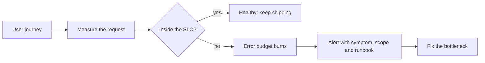

:::mental-model
**Measure what the user experiences, at the tail, under real traffic. A system is “working” when its service-level indicators stay inside the promises you made.**
:::

## “It feels fast” is not a measurement

On Friday afternoon, the clinic’s booking page feels instant. On Monday at 9 a.m., it feels slow. Nothing in the code changed. The traffic did.

If the team only tests with one request on a laptop, they will ship a system that works in the lab and fails in the waiting room.

The fix is to define, in advance, what “working” means:

- **Fast:** how fast, for which requests, at which percentile?
- **Available:** what fraction of requests succeed, over what window?
- **Correct:** which rules must never break?
- **Within capacity:** how close is each component to its limit?

Then measure those things continuously.

## SLI, SLO, SLA

Three terms that are often mixed up:

| Term | Meaning | Clinic example |
|---|---|---|
| **SLI** (indicator) | The measurement | “99.2% of booking requests succeeded in the last 30 days” |
| **SLO** (objective) | The internal target | “99.9% of booking requests succeed in a 30-day window” |
| **SLA** (agreement) | The external promise, often with penalties | “If availability drops below 99.5%, the vendor credits the clinic” |

An SLI is a number. An SLO is a target for that number. An SLA is a contract with consequences.

Start with a small set of SLIs that map to user journeys:

- **Availability:** fraction of `POST /appointments` requests that return a success or a valid business rejection (`409` is not an outage).
- **Latency:** p99 of `GET /doctors/{id}/slots`, not the average.
- **Correctness:** number of double bookings per week. This one should be zero.
- **Freshness:** how long until a cancelled slot becomes bookable again.
- **Saturation:** database connections used, CPU, queue depth.

## The four golden signals

Google’s SRE book names four signals worth watching for every service:

1. **Latency:** how long requests take, split by success and failure. A fast error is not a healthy request.
2. **Traffic:** requests per second, split by endpoint and client.
3. **Errors:** explicit failures, plus implicit ones such as wrong content or `200` with an empty body.
4. **Saturation:** how full the system is — CPU, memory, disk, connections, queue length.

If you have only four charts, make them these.



## Averages lie

Suppose 100 requests arrive:

- 99 take 80 ms,
- 1 takes 2,000 ms.

The average is:

```text
(99 × 80 + 1 × 2,000) / 100 = 99.2 ms
```

The average says “about 100 ms.” The unluckiest user waited two seconds. If that user was trying to book an appointment while a doctor had one slot left, they may have lost it.

This is why we use **percentiles**:

- **p50 (median):** half of requests are faster than this.
- **p95:** 95% are faster; 1 in 20 is slower.
- **p99:** 99% are faster; 1 in 100 is slower.

The tail is where timeouts, retries, abandoned carts and support calls live. A system with a great p50 and a terrible p99 is a system that works for most people and fails the ones who are unlucky.

:::widget tail-latency
:::

:::note
Percentiles do not average across machines. “Average of each server’s p99” is not the system p99. Aggregate the raw distributions, or use a histogram, before computing the percentile.
:::

## Error rate: count requests, not servers

“All servers are up” is not the same as “booking works.”

A server can be running while:

- every request returns `500`,
- the database connection pool is exhausted,
- the queue is full and reminders are silently dropped,
- a DNS change sends traffic nowhere,
- the app returns `200` with stale or empty data.

Measure errors per request and per journey:

```text
booking_success_rate = successful_bookings / booking_attempts
```

Then decide what counts as failure. A `409` because the slot was taken is a valid business outcome, not an outage. A `500` is an outage. A `429` may be a capacity problem or an attack.

## Saturation: the quiet precursor

Most outages are preceded by a resource approaching its limit:

- CPU at 95% for ten minutes,
- database connections at 98 of 100,
- disk at 92%,
- queue depth growing faster than workers drain it,
- memory climbing until the process is killed.

Saturation is the early warning. Latency and errors are the symptoms that arrive later.

The **USE method** is a compact checklist for every resource:

- **Utilization:** how busy is it?
- **Saturation:** how much work is waiting?
- **Errors:** how often does it fail?

For a database: CPU utilization, wait queue, connection errors. For a queue: depth, age of oldest message, consumer errors. For a disk: space, I/O wait, write errors.

## Throughput and latency are not the same axis

You can have high throughput and terrible latency: the system processes 10,000 requests per second, but each one waits two seconds in a queue. You can have low latency and low throughput: one request at a time, very fast.

Little’s Law gives the intuition:

```text
concurrency = throughput × latency
```

If the clinic’s API handles 200 requests per second and each takes 100 ms, about 20 requests are in flight on average. If latency rises to 1 second at the same throughput, 200 requests are in flight. Connections, memory and queue slots are now under pressure.

This is why a latency regression can become a capacity outage even when traffic is flat.

## Dashboards and alerts that respect humans

A good dashboard answers three questions in ten seconds:

1. Are users succeeding?
2. Is anything close to its limit?
3. What changed recently?

A good alert fires when users are affected or about to be. It should include:

- the symptom (“booking success rate below 99% for 5 minutes”),
- the scope (“all clinics” or “one region”),
- a link to the dashboard and runbook,
- the current value and the threshold.

Avoid alerts on every CPU spike. A CPU that briefly hits 90% during a deploy is normal. An SLO burn rate that will exhaust the error budget in an hour is not.

:::reality-check
“Uptime” measured by a ping is close to meaningless. The server can answer `ping` while the booking endpoint is down. Measure the journey, from the user’s side, with synthetic checks and real-user monitoring.
:::

## A clinic’s first SLO set

| Journey | SLI | SLO |
|---|---|---|
| View slots | p99 latency | under 400 ms |
| Book appointment | success rate | 99.9% over 30 days |
| Book appointment | p99 latency | under 800 ms |
| Cancel appointment | success rate | 99.9% |
| Reminder delivery | delivered before visit | 99% |
| Double bookings | count per week | 0 |

Six numbers. They are specific, testable and tied to real consequences. That is enough to start.

:::interview
When asked “how would you know this design works?”, do not answer “I’d add monitoring.” Name the SLIs, the percentiles, the error budget and the saturation signal. Then say what you would do when the SLO is at risk.
:::

## Check yourself

:::quiz
[
  {
    "question": "Why is p99 more useful than the average for user-facing latency?",
    "options": [
      "It is easier to compute",
      "It shows the experience of the slowest 1%, which the average hides",
      "It is always lower",
      "It measures throughput"
    ],
    "answer": 1,
    "explanation": "A few very slow requests barely move the average but dominate the worst user experiences."
  },
  {
    "question": "Which set is the four golden signals?",
    "options": [
      "CPU, disk, memory, network",
      "Latency, traffic, errors, saturation",
      "Uptime, revenue, signups, churn",
      "p50, p95, p99, average"
    ],
    "answer": 1,
    "explanation": "The golden signals describe service health from the user’s perspective and the system’s capacity."
  },
  {
    "question": "A slot-taken response returns 409. Should it count as an availability error?",
    "options": [
      "Yes, every non-200 is an error",
      "No, it is a valid business outcome; availability should count successful and valid rejections",
      "Only on Mondays",
      "Only if the patient complains"
    ],
    "answer": 1,
    "explanation": "Mixing business rejections with outages makes the SLI lie and trains the team to ignore alerts."
  },
  {
    "question": "What does saturation measure?",
    "options": [
      "How many users signed up",
      "How close a resource is to its limit and how much work is waiting",
      "The average response size",
      "The number of deployments"
    ],
    "answer": 1,
    "explanation": "Saturation is the early warning: utilization, queueing and errors for each constrained resource."
  },
  {
    "question": "Why can a latency regression cause a capacity outage at constant traffic?",
    "options": [
      "Latency and capacity are unrelated",
      "Little’s Law: more time per request means more requests in flight, consuming connections and memory",
      "Slow requests use less CPU",
      "Because the database shrinks"
    ],
    "answer": 1,
    "explanation": "Concurrency = throughput × latency. Higher latency at the same throughput means more in-flight work."
  }
]
:::

## Exercise: write the SLOs

For the clinic, define:

1. one availability SLI and a 30-day SLO for booking,
2. one latency SLI and a target for viewing slots,
3. one correctness SLI that must be zero,
4. one saturation signal for the database,
5. one alert that should page a human, and one that should only create a ticket.

Then explain how you would measure each one without asking users to report it.

:::discussion
- Which is worse for the clinic: a 1% error rate on booking, or a 1% error rate on viewing slots? Why?
- Would you alert on p99 or on the fraction of requests over a threshold?
- How would you measure reminder delivery, which happens outside the request path?
:::

## Key takeaways

- Define “working” as measurable SLIs, with SLO targets tied to user journeys.
- Watch latency, traffic, errors and saturation — the four golden signals.
- Report percentiles, especially p99; averages hide the pain.
- Count errors per request, and separate business rejections from outages.
- Saturation is the early warning; latency and errors are the symptoms.
- Alert on user impact and SLO burn, not on every resource spike.

## Free references

- [Google SRE Book: Service Level Objectives](https://sre.google/sre-book/service-level-objectives/) — the canonical explanation of SLIs, SLOs and error budgets.
- [Google SRE Book: Monitoring Distributed Systems](https://sre.google/sre-book/monitoring-distributed-systems/) — the four golden signals.
- [The USE Method](https://www.brendangregg.com/usemethod.html) — a practical checklist for resource bottlenecks.
- [Prometheus: Histograms and summaries](https://prometheus.io/docs/practices/histograms/) — how to compute percentiles correctly.
