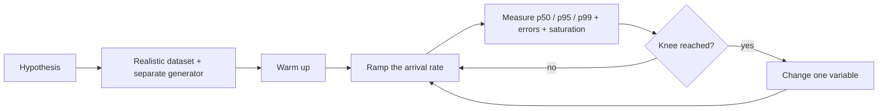

:::mental-model
**A load test is a controlled experiment. State the hypothesis, hold the variables, measure the tail and the bottleneck — then change one thing.**
:::

## The question

The clinic’s API works for one user. Will it work for the Monday 9 a.m. rush?

“It feels fast” is not an answer. We need a number: at what request rate does latency climb, and which resource saturates first?

This experiment uses the smallest honest setup:

- **API:** a Go HTTP service with three endpoints: list slots, book a slot, cancel a booking.
- **Database:** PostgreSQL on the same machine, with 500,000 appointments and 50,000 slots.
- **Load generator:** `k6` running on a **separate** machine, so it does not steal CPU from the server.
- **Dataset:** one clinic, 20 doctors, two years of history, 18 slots per doctor per day.

The hypothesis:

> Without an index on `(doctor_id, starts_at)`, the slot-list endpoint will saturate the database CPU before the API CPU. Adding the index will move the bottleneck and raise sustainable throughput.

## The endpoints under test

```text
GET  /doctors/{id}/slots?date=2026-11-17
POST /appointments
DELETE /appointments/{id}
```

The read is the one the patient hits first. The write is the one that must stay correct under concurrency. Both matter; they stress different resources.

The query behind the read:

```sql
SELECT id, starts_at, ends_at
FROM slots
WHERE doctor_id = $1
  AND starts_at >= $2
  AND starts_at <  $3
ORDER BY starts_at;
```

## The method

1. **Warm up for 60 seconds.** Let the JIT, connection pool and database cache settle.
2. **Ramp traffic** in steps: 10, 25, 50, 100, 200 requests per second.
3. **Hold each step for two minutes.** Short bursts measure startup, not steady state.
4. **Record p50, p95, p99, error rate, API CPU, database CPU and connection count.**
5. **Stop when p99 exceeds the SLO or errors exceed 1%.**
6. **Change one variable:** add the index. Repeat.

The load generator uses a **closed model** (a fixed number of virtual users, each waiting for a response before sending the next request). That is realistic for a user tapping through a screen, but it can hide queueing: when the server slows down, the generator also slows down. For capacity planning, also run an **open model** with a fixed arrival rate.

:::warning
A load test on the same laptop as the server measures the laptop’s ability to do two jobs at once. Use a separate generator, or at least pin CPU and watch for generator saturation.
:::



## Reference results

These numbers come from a reference run on a 2 vCPU / 4 GB VM with PostgreSQL 16 and a Go 1.22 service. Treat them as a shape, not a promise; your hardware and data will differ.

### Before the index

| Target rate | Achieved | p50 | p95 | p99 | Errors | DB CPU |
|---:|---:|---:|---:|---:|---:|---:|
| 10/s | 10/s | 8 ms | 14 ms | 22 ms | 0% | 12% |
| 25/s | 25/s | 12 ms | 25 ms | 40 ms | 0% | 28% |
| 50/s | 49/s | 30 ms | 90 ms | 180 ms | 0.2% | 61% |
| 100/s | 82/s | 120 ms | 420 ms | 900 ms | 3.1% | 94% |
| 200/s | 88/s | 380 ms | 1,400 ms | 2,900 ms | 11% | 99% |

The knee is around 50–100 requests per second. Throughput stops rising, latency climbs, and the database CPU pins at 99%. The API CPU stays under 40%. The database is the bottleneck, and it is doing sequential scans.

```text
EXPLAIN ANALYZE
Seq Scan on slots  (cost=0.00..18420.00 rows=1 width=40)
  Filter: (doctor_id = 'doc_rao' AND starts_at >= ... AND starts_at < ...)
  Rows Removed by Filter: 499,982
  Execution Time: 92.4 ms
```

Nearly every row is read and discarded. At 100 requests per second, that is 50 million row checks per second. No amount of API tuning fixes that.

### After the index

```sql
CREATE INDEX idx_slots_doctor_time
  ON slots (doctor_id, starts_at);
```

| Target rate | Achieved | p50 | p95 | p99 | Errors | DB CPU |
|---:|---:|---:|---:|---:|---:|---:|
| 10/s | 10/s | 2 ms | 4 ms | 7 ms | 0% | 3% |
| 25/s | 25/s | 3 ms | 6 ms | 11 ms | 0% | 6% |
| 50/s | 50/s | 4 ms | 9 ms | 18 ms | 0% | 11% |
| 100/s | 100/s | 6 ms | 14 ms | 28 ms | 0% | 19% |
| 200/s | 198/s | 11 ms | 30 ms | 65 ms | 0.1% | 38% |
| 400/s | 355/s | 28 ms | 95 ms | 240 ms | 1.4% | 72% |

The knee moved to roughly 350–400 requests per second. The p99 at 200 requests per second dropped from 2.9 seconds to 65 milliseconds. The database is no longer the first limit; the API’s own CPU and connection pool become visible.

```text
Index Scan using idx_slots_doctor_time on slots
  Index Cond: (doctor_id = 'doc_rao' AND starts_at >= ... AND starts_at < ...)
  Rows Removed by Filter: 0
  Execution Time: 0.8 ms
```

Same query, same data, same hardware. One index changed the shape of the work.

## What the numbers actually say

Three lessons are hiding in the table:

**1. The bottleneck moved.** Before, the database was pinned and the API was idle. After, the API’s CPU and connection pool matter. The next optimization is not another index; it is fewer round trips, a bigger API machine, or a cache.

**2. Latency is not linear.** At 50 requests per second the system looks healthy. At 100 it is already in the knee. Capacity planning needs the curve, not a single “it handled 100” number.

**3. The tail fails first.** The p50 at 100 requests per second is 120 ms; the p99 is 900 ms. Users on slow connections, or unlucky enough to hit a queue, experience the p99. The average would have looked acceptable.

## The write path is a different experiment

Booking is not a read. It runs a transaction, checks the slot, inserts an appointment, and maintains indexes. Under concurrency, the interesting questions are:

- Does the unique constraint reject the second booking cleanly?
- Do connection pool waits dominate?
- Does lock contention appear on the same slot?
- What happens when the queue or SMS provider is slow?

Test it with a mix: 80% reads, 20% writes, many users competing for the same popular slots. A read-only benchmark will make the write path look healthier than it is.

:::reality-check
A benchmark that runs one query in a loop with no think time, no concurrent writes and a warm cache is a CPU test, not a system test. It will find the fastest possible number and tell you nothing about Monday morning.
:::

## Reproduce it

A minimal `k6` script:

```javascript
import http from 'k6/http';
import { check, sleep } from 'k6';

export const options = {
  stages: [
    { duration: '1m', target: 50 },
    { duration: '2m', target: 50 },
    { duration: '1m', target: 100 },
    { duration: '2m', target: 100 },
  ],
  thresholds: {
    http_req_failed: ['rate<0.01'],
    'http_req_duration{endpoint:slots}': ['p(99)<400'],
  },
};

export default function () {
  const res = http.get(
    'http://api.internal/doctors/doc_rao/slots?date=2026-11-17',
  );
  check(res, { 'status is 200': (r) => r.status === 200 });
  sleep(0.5);
}
```

Watch the server with `top`, `pg_stat_activity`, and `EXPLAIN ANALYZE`. A load test without the database’s view is a black box.

:::deep-dive Deep dive: coordinated omission
In a closed-model test, a virtual user waits for a response before sending the next request. When the server slows, the generator sends less often, so the slowest period is under-sampled. This is **coordinated omission**: the test reports better tail latency than a real user would experience.

Open-model tools and constant-arrival-rate executors avoid it by sending at a fixed rate regardless of responses. Use them when the question is “what happens when traffic keeps arriving while the server is struggling?”
:::

## Check yourself

:::quiz
[
  {
    "question": "In the reference run, what was the first bottleneck before the index?",
    "options": [
      "Network bandwidth",
      "Database CPU from sequential scans",
      "The load generator",
      "TLS handshakes"
    ],
    "answer": 1,
    "explanation": "The database pinned at 99% while the API stayed under 40%, and EXPLAIN showed a sequential scan."
  },
  {
    "question": "Why did adding the index raise throughput instead of just making one query faster?",
    "options": [
      "It compressed the table",
      "It reduced the work per request, so the database could serve more requests before saturating",
      "It added more CPU",
      "It cached every response"
    ],
    "answer": 1,
    "explanation": "Less work per request means more requests fit in the same resource budget. The bottleneck moved."
  },
  {
    "question": "Why is a closed-model load test prone to coordinated omission?",
    "options": [
      "It runs too long",
      "Virtual users wait for responses, so they send less often exactly when the server is slow",
      "It cannot measure errors",
      "It uses too much disk"
    ],
    "answer": 1,
    "explanation": "The generator’s pace follows the server’s slowdown, under-sampling the worst periods. Open-model tests send at a fixed rate."
  },
  {
    "question": "After the index, what should you investigate next?",
    "options": [
      "Add ten more indexes",
      "The new bottleneck: API CPU, connection pool, or query count per request",
      "Rewrite the database",
      "Nothing; the work is done"
    ],
    "answer": 1,
    "explanation": "Optimization moves the bottleneck. The next step is to identify the new limit, not to keep adding indexes."
  }
]
:::

## Exercise: design the experiment

You suspect the reception screen is slow because it makes 51 queries for 50 appointments.

Write:

1. the hypothesis,
2. the traffic mix (reads, writes, think time),
3. the metrics you will record,
4. the one change you will make between runs,
5. the result that would prove you wrong.

Then explain why a test with a warm cache might understate the problem in production.

:::discussion
- Would you load-test against production data, a copy, or a synthetic dataset? What are the risks?
- Which SLO would you use to decide the test passed?
- How would you test the double-booking rule under concurrency?
:::

## Key takeaways

- A load test needs a hypothesis, a realistic dataset and a separate generator.
- Measure p50, p95 and p99, plus errors, throughput and the bottleneck resource.
- The first bottleneck before the index was database CPU from sequential scans.
- The index moved the knee from roughly 100 to 350–400 requests per second and cut p99 dramatically.
- After every optimization, find the new bottleneck.
- Closed-model tests can hide tail latency; use open-model tests for capacity questions.

## Free references

- [k6 documentation](https://grafana.com/docs/k6/latest/) — open-source load testing with thresholds and scenarios.
- [PostgreSQL: EXPLAIN](https://www.postgresql.org/docs/current/using-explain.html) — reading the plan behind the numbers.
- [Google SRE Book: Handling overload](https://sre.google/sre-book/handling-overload/) — what happens when demand exceeds capacity.
- [Gil Tene: How NOT to measure latency](https://www.infoq.com/presentations/latency-pitfalls/) — coordinated omission and tail latency, explained by the person who named it.
