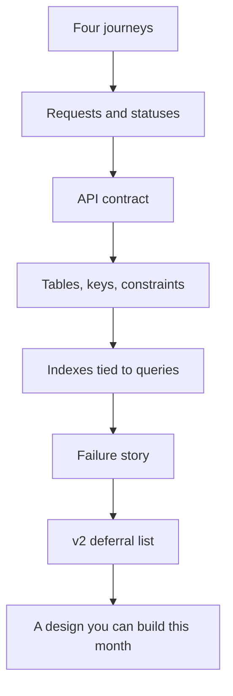

:::mental-model
**A good first design is small enough to build this month, strict enough to prevent the one bug that matters, and explicit about what it defers.**
:::

## The brief

Dr. Rao’s clinic has grown. There are now three doctors, two receptionists and about 200 appointments a week. Patients book on their phones; staff use a desktop dashboard.

Constraints:

- **Budget:** $50 per month for infrastructure.
- **Team:** one part-time developer, no dedicated operations engineer.
- **Traffic:** a Monday 9 a.m. rush of about 20 bookings in ten minutes, then quiet.
- **Correctness:** a slot must never be booked twice.
- **History:** the clinic must be able to answer “who cancelled this, and when?” for at least two years.
- **Payments:** not yet. Invoices are settled at the desk.

Your job: produce the API contract, the data model and the indexes for version 1.



## Deliverable 1: journeys to requests

Start with four journeys:

1. A patient views a doctor’s free slots for a date.
2. A patient books a slot.
3. A patient cancels.
4. A receptionist views today’s appointments.

For each, list the requests: method, path, success status, and the failure that matters.

Example:

| Journey | Request | Success | Failure that matters |
|---|---|---|---|
| View slots | `GET /doctors/{id}/slots?date=` | `200` | `404` doctor, `400` bad date |
| Book | `POST /appointments` | `201` | `409` slot taken |
| Cancel | `DELETE /appointments/{id}` | `204` | `409` too late |
| Today’s list | `GET /appointments?date=&cursor=` | `200` | `400` bad filter |

Keep this table. It is the spine of the rest of the lab.

## Deliverable 2: the API contract

For each endpoint, write:

- path and method,
- who may call it,
- request body or query parameters,
- success response with an example,
- at least two failure responses,
- one note on idempotency or pagination.

The booking endpoint deserves the most care:

```http
POST /appointments
Authorization: Bearer <patient token>
Idempotency-Key: 7f3c2a90-...

{
  "slotId": "slot_2026_11_17_1000_rao",
  "reason": "fever"
}
```

```http
HTTP/1.1 201 Created
Location: /appointments/apt_8812

{
  "id": "apt_8812",
  "slotId": "slot_2026_11_17_1000_rao",
  "status": "booked",
  "startsAt": "2026-11-17T10:00:00+05:30",
  "doctor": { "id": "doc_rao", "name": "Dr. Rao" }
}
```

Failure cases to specify:

- slot already booked → `409` with code `SLOT_ALREADY_BOOKED`,
- patient not found or not authenticated → `401` / `404`,
- slot in the past → `422`,
- same idempotency key with a different body → `409`.

Do not let the patient send `patientId` in the body. Take it from the token, or verify it. Otherwise anyone can book in someone else’s name.

## Deliverable 3: tables, keys and constraints

Write SQL for at least:

- `patients`,
- `doctors`,
- `slots`,
- `appointments`,
- `appointment_events`.

A starting skeleton:

```sql
CREATE TABLE doctors (
  id         uuid PRIMARY KEY DEFAULT gen_random_uuid(),
  full_name  text NOT NULL,
  specialty  text NOT NULL,
  timezone   text NOT NULL DEFAULT 'Asia/Kolkata'
);

CREATE TABLE slots (
  id         uuid PRIMARY KEY DEFAULT gen_random_uuid(),
  doctor_id  uuid NOT NULL REFERENCES doctors(id),
  starts_at  timestamptz NOT NULL,
  ends_at    timestamptz NOT NULL,
  CONSTRAINT slot_time_valid CHECK (ends_at > starts_at)
);

CREATE TABLE appointments (
  id            uuid PRIMARY KEY DEFAULT gen_random_uuid(),
  slot_id       uuid NOT NULL REFERENCES slots(id),
  patient_id    uuid NOT NULL REFERENCES patients(id),
  status        text NOT NULL
                CHECK (status IN ('booked', 'cancelled', 'completed', 'no_show')),
  price_paise   integer NOT NULL CHECK (price_paise >= 0),
  created_at    timestamptz NOT NULL DEFAULT now()
);

CREATE UNIQUE INDEX one_active_booking_per_slot
  ON appointments (slot_id)
  WHERE status = 'booked';
```

Explain, in one sentence each:

- why `slot_id` is not the primary key of `appointments`,
- why `price_paise` is stored on the appointment,
- why the unique index is **partial**,
- why times use `timestamptz`.

If you cannot explain a choice, simplify it until you can.

## Deliverable 4: indexes tied to queries

List the five most important queries. For each, write the query, the index you propose, and why the column order fits.

At minimum:

```sql
-- Patient's upcoming appointments
SELECT * FROM appointments
WHERE patient_id = $1 AND status = 'booked'
ORDER BY created_at DESC
LIMIT 20;

-- Doctor's day
SELECT * FROM appointments a
JOIN slots s ON s.id = a.slot_id
WHERE s.doctor_id = $1
  AND s.starts_at >= $2
  AND s.starts_at <  $3
  AND a.status = 'booked'
ORDER BY s.starts_at;

-- Slot lookup by phone (reception)
SELECT * FROM patients WHERE phone = $1;
```

Then run `EXPLAIN ANALYZE` on at least one query with and without the index. Paste the two plans and write one sentence about the difference.

Remember: every index costs writes. Name one query you decided **not** to index, and why.

## Deliverable 5: the rules that must never break

Write a short “invariants” list:

1. A slot has at most one `booked` appointment.
2. A cancelled appointment frees the slot.
3. A patient cannot cancel within two hours of the start.
4. An appointment cannot be moved to a slot that is already booked.
5. Every state change writes an event with actor and timestamp.

For each, say where it is enforced: database, API, or both.

The double-booking rule is the one to get right. A check in the API is not enough; two requests can pass it at the same time. The database constraint is the backstop.

## Deliverable 6: what you would cache, and what you never would

Write two lists:

**Safe to cache (with a short TTL):**

- the doctor list for a clinic,
- clinic opening hours,
- specialty descriptions.

**Never cache as authoritative:**

- free-slot availability,
- appointment status,
- the result of “is this slot bookable?”

A cached slot list is a hint. The booking write must re-check the database. If you cache availability, you must invalidate it on every booking and cancellation, and you still need the database constraint for the race.

## Deliverable 7: the failure story

For each failure, write what the user sees and what the system does:

| Failure | User sees | System does |
|---|---|---|
| Two patients book the same slot | “That slot was just taken” | One `201`, one `409`; no duplicate row |
| Response lost after booking | Confirmation on retry | Idempotency key returns the original appointment |
| SMS provider down | Booking confirmed, reminder delayed | Queue retries with backoff; alert after threshold |
| Cancel request times out | “We’re checking your booking” | Retry is idempotent; UI re-reads status |
| Database failover | Brief error or retry | Connection pool reconnects; request retried if safe |

## Deliverable 8: the v2 deferral list

Write down what you are **not** building, and why:

- online payments (regulatory and reconciliation work),
- multi-clinic scheduling (different time zones and staff roles),
- waitlists (a new state machine),
- insurance claims (external integration),
- SMS two-way replies (provider and compliance work).

A deferral list is not an apology. It is proof that you chose a boundary.

:::widget lab-checklist
:::

## Rubric

| Criterion | Strong | Adequate | Weak |
|---|---|---|---|
| **Requests** | Every journey has requests, statuses and failure cases | Main journeys covered | Screens listed, no requests |
| **Data model** | Keys, foreign keys and constraints enforce the rules | Tables exist, some constraints | One big table or no keys |
| **Indexes** | Tied to real queries, checked with EXPLAIN, write cost named | A few plausible indexes | “Index everything” |
| **API contract** | Consistent errors, idempotency, pagination | Endpoints and status codes | Only happy paths |
| **Failure design** | Race, timeout and retry handled | Some failures noted | “It won’t fail” |
| **Scope** | Clear v2 deferrals with reasons | Short deferral list | Everything is “phase 1” |

A strong submission is not the biggest one. It is the one where every rule has a home and every deferred feature has a reason.

:::warning
Common mistakes to avoid:

- Putting the double-booking check only in the UI or only in a `SELECT` before `INSERT`.
- Storing money as a float.
- Using `timestamp` without a time zone for appointment times.
- Caching free slots without invalidation.
- Returning `200` for every error.
- Designing for 10 million users when the clinic has 200 appointments a week.
:::

## Stretch goals

If you finish early:

1. Add a waitlist: when a slot is cancelled, offer it to the first waiting patient for 10 minutes.
2. Add a reschedule endpoint and decide whether it is one transaction or cancel-plus-book.
3. Add a staff role and an audit requirement for “who changed this appointment.”
4. Design a read replica strategy for the reception dashboard.
5. Write the OpenAPI fragment for three endpoints.

:::deep-dive Deep dive: how to review your own design
Read your design as if you were the on-call engineer at 9 a.m. on Monday. Ask:

- Which query runs most often, and what does it cost?
- What happens if two receptionists click “book” at the same moment?
- What happens if the API server restarts mid-request?
- What does the patient see when the SMS provider is down?
- Which number would tell you the system is in trouble before users call?

If you cannot answer one of these, the design is not finished. That is useful information, not a failure.
:::

## Check yourself

:::quiz
[
  {
    "question": "Which constraint actually prevents two patients from booking the same slot?",
    "options": [
      "A UI check that greys out the slot",
      "A partial unique index on active appointments for the slot",
      "A nightly report",
      "A README warning"
    ],
    "answer": 1,
    "explanation": "Only a shared, atomic constraint can stop two concurrent writes. The UI and API checks are helpful but racy."
  },
  {
    "question": "Why store price_paise on the appointment?",
    "options": [
      "To avoid a join",
      "Because the price at booking time is a historical fact, even if the doctor’s fee changes later",
      "Because integers are always faster",
      "To make the table wider"
    ],
    "answer": 1,
    "explanation": "This is a deliberate snapshot for invoices and disputes, not accidental duplication."
  },
  {
    "question": "What should the booking API do when the same idempotency key is retried with the same body?",
    "options": [
      "Create a second appointment",
      "Return the original result without creating a duplicate",
      "Return 500",
      "Delete the first appointment"
    ],
    "answer": 1,
    "explanation": "The key ties retries to one logical operation. Same key and body should be safe to repeat."
  }
]
:::

## Discussion

:::discussion
- Which part of your design would you build first, and which could wait a week?
- If the clinic doubled to 400 appointments a week, what would break first?
- What would you monitor on day one, and what would you alert on?
- Which deferral would you revisit first, and what signal would trigger it?
:::

## Key takeaways

- Start from journeys and requests; the schema follows the rules.
- Put correctness in the database, convenience in the API, and clarity in the contract.
- Index the queries you actually run, and measure the plans.
- Cache hints, never authority. Re-check availability at write time.
- Write the failure story and the deferral list; both are part of the design.
- The best first design is the smallest one that cannot double-book.

## Free references

- [PostgreSQL: Partial indexes](https://www.postgresql.org/docs/current/indexes-partial.html) — the mechanism behind “one active booking per slot.”
- [PostgreSQL: Transaction isolation](https://www.postgresql.org/docs/current/transaction-iso.html) — what concurrent transactions can see.
- [Stripe: Idempotent requests](https://docs.stripe.com/api/idempotent_requests) — a production pattern for safe retries.
- [OpenAPI Specification](https://spec.openapis.org/oas/latest.html) — write the contract in a machine-readable form.
