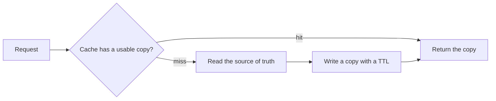

:::mental-model
**A cache is a copy of data kept closer to the reader. It is a bet that the copy will still be right when someone reads it — and a promise to pay for that bet with memory and invalidation.**
:::

## The same answer, four hundred times

It is 8:55 on Monday. Meera opens the clinic page on her phone to check Dr. Rao’s hours before leaving home. The page loads the clinic’s doctor list: three names, three specialties, three sets of working hours.

By 9:05, four hundred other patients have opened the same page. The list has not changed since Friday. Yet the database has answered the same query four hundred times, parsed the same rows, and sent the same JSON over the network.

That is the moment a cache becomes interesting. Not because the database is slow at one query — it is fast. Because the same expensive work is being repeated for an answer that nobody changed.

## What a cache is

A cache is a second copy of data, stored somewhere cheaper to read than the original. The original is usually the database. The copy might live in the application’s memory, in a Redis server, at the edge of a CDN, or in the patient’s browser.

Two words describe every cache read:

- **Hit:** the copy exists and is usable. The request never reaches the database.
- **Miss:** the copy is missing or expired. The request goes to the source of truth, and the result is usually written back into the cache.

**Hit rate** is the fraction of reads that hit:

```text
hit rate = hits / (hits + misses)
```

A 95% hit rate means 95 of every 100 reads are served from the copy. The other five reach the database.



## The arithmetic that decides whether it is worth it

Suppose the clinic’s doctor list gets 1,000 requests per second at the Monday rush. A database read takes 40 ms. A cache read takes 1 ms.

At a 95% hit rate:

```text
average latency = 0.95 × 1 ms + 0.05 × (1 ms + 40 ms)
                = 0.95 + 2.05
                = 3 ms

database queries = 1,000 × 0.05
                 = 50 per second
```

The average request drops from about 40 ms to 3 ms, and the database sees 50 queries per second instead of 1,000. That is the whole sell.

Now change the hit rate:

| Hit rate | Average latency | Database queries/sec |
|---:|---:|---:|
| 0% | 41 ms | 1,000 |
| 50% | 21 ms | 500 |
| 90% | 5 ms | 100 |
| 95% | 3 ms | 50 |
| 99% | 1.4 ms | 10 |

Two lessons hide in that table.

First, **hit rate matters more than cache speed**. A cache that answers in 0.1 ms but misses half the time is barely better than no cache at all. Second, **the database load falls linearly with the miss rate**. At 99% hits, the database gets 1% of the traffic. At 90%, it gets 10%. Capacity planning has to use the miss rate, not the request rate.

:::warning
A cache does not remove the database. It reduces how often the database is asked. The miss path must still be fast enough to survive a cold cache, a deploy, or a cache restart. If the database cannot handle the miss traffic, the cache is now a single point of failure with extra steps.
:::

## What is worth caching

Not all data deserves a copy. Four questions decide it:

1. **How often is it read compared with how often it changes?** A doctor list read 10,000 times a day and edited once a week is a gift. A live slot count that changes with every booking is a hazard.
2. **How stale may a reader tolerate?** Opening hours can be five minutes old. A payment status cannot.
3. **How expensive is the original read?** A three-table join, a remote API call, or a 200 ms report is worth caching. A single-row lookup by primary key usually is not.
4. **How big is the copy?** Caching a 20 MB report for every user will fill memory and evict everything useful.

| Data | Read / write shape | Staleness tolerance | Cache? |
|---|---|---|---|
| Doctor list | Read constantly, edited weekly | Minutes | Yes |
| Opening hours | Read often, edited monthly | An hour | Yes |
| Specialty list | Read often, almost static | A day | Yes |
| Free appointment slots | Read constantly, changes on every booking | Seconds, and never authoritative | Display hint with a short TTL; re-check at write |
| Appointment status | Per patient, changes on cancel | Must be current for the owner | Short TTL or invalidate on write |
| Patient session | Read on every request, written at login | Until expiry | Yes, in a shared store |
| Consultation fee | Read often, edited rarely | Display can lag; charge cannot | Cache the display, re-read at checkout |
| Search results | Read often, changes slowly | 30 seconds | Yes, with a short TTL |

The pattern is not “cache the fast things.” It is **cache the things whose copies are allowed to be a little old**.

## TTL: the freshness dial

Every cached entry needs an exit. The usual one is a **time to live (TTL)**: after a fixed number of seconds, the entry is considered expired and the next read goes back to the source.

TTL is a tradeoff between freshness and hit rate:

- **Long TTL:** higher hit rate, fewer database reads, more stale data.
- **Short TTL:** fresher data, more misses, more database load.

How much staleness does a TTL buy? If data changes every `I` seconds and the TTL is `T` seconds, then when `T` is shorter than `I`, a read is stale for the part of the interval after a change, until the next expiry. On average, that is about `T / 2` seconds per change interval, so the stale fraction is roughly:

```text
stale fraction ≈ T / (2 × I)     when T < I
```

A 60-second TTL on data that changes every 10 minutes gives roughly `60 / 1,200 = 5%` stale reads. The same 60-second TTL on data that changes every minute gives roughly 50%, because the copy is stale for half of every minute.

When `T` is longer than `I`, the entry usually survives at least one change, and the stale fraction is closer to:

```text
stale fraction ≈ 1 − I / T       when T ≥ I
```

A 10-minute TTL on data that changes every minute is stale for about 90% of its life. At that point you are not caching a fresh copy; you are caching history.

:::note
These formulas are a planning tool, not a guarantee. Changes are not evenly spaced, reads are not uniform, and invalidation may remove entries earlier. Use them to choose a starting TTL, then measure the actual staleness that users see.
:::

## Cache only when you must

A cache is not free. It adds:

- **A second copy that can disagree** with the source of truth.
- **An invalidation path** that must work when a write happens.
- **A new failure mode**: if the cache is down, the database sees the full load.
- **Memory and operational cost**, plus another service to monitor and upgrade.
- **Debugging cost**, because “the data is wrong” now has two possible locations.

For a clinic with 200 appointments a week, caching the free-slot list would add all of that to save a query that takes 3 ms. That is a bad trade. Caching the doctor list for a public page that gets thousands of reads a minute is a good one.

The rule is not “caching is good.” The rule is: **measure the repeated read, estimate the miss traffic, and only then decide whether the copy earns its keep.**

## Cache what you display, verify what you act on

There is a line that separates safe caching from dangerous caching:

> A cached value is a **hint** for what to show. It is not **permission** to act.

Meera may see a slot list that is five seconds old. That is fine for choosing a time. When she taps “Book,” the write must check the database — inside a transaction or against a unique constraint — because the slot may have been taken in those five seconds.

The same line appears outside the clinic:

- A shopping cart may show a cached price; checkout must re-read it.
- A ticket site may show a cached seat map; seat assignment must be atomic.
- A dashboard may show a cached follower count; a follow action must hit the source of truth.
- A bank app may cache your balance for display; a transfer must not trust it.

A stale menu is annoying. A stale reservation is a double booking.

:::reality-check
The most common caching incident is not “the cache was slow.” It is “the cache was fast and wrong.” A correct-but-slow answer can be retried; a wrong answer that looks authoritative is much harder to detect.
:::

:::widget cache-hit-rate
:::

## The cache you already use

You have been using caches all day:

- **CPU caches** keep recently used memory close to the core.
- **The operating system page cache** keeps disk blocks in RAM.
- **DNS** caches name-to-address mappings for a TTL.
- **Browsers** cache images, CSS and API responses according to HTTP headers.
- **CDNs** keep copies of static content near users.
- **Databases** keep a buffer pool of hot pages in memory.

They all make the same bet: the copy is cheaper to read than the original, and it will be right often enough. The rest of this module is about keeping that bet honest.

:::deep-dive Deep dive: why not cache every query?
A cache keyed by the exact SQL text can “work” for every query, and it is usually a trap. Every write invalidates an unknown set of query results. The cache fills with one-off queries that are never read again. Memory is spent on cold data while the hot data is evicted. And a change to one row may leave a dozen cached reports wrong.

Cache by **access pattern**, not by query string. “The doctor list for this clinic” is a stable, understandable object with a clear invalidation point. “The result of this arbitrary join” is not.
:::

## Check yourself

:::quiz
[
  {
    "question": "Which piece of clinic data is the safest first candidate for caching?",
    "options": [
      "The list of doctors and their specialties",
      "The free/busy status of every slot today",
      "A patient’s appointment status",
      "The result of a payment authorization"
    ],
    "answer": 0,
    "explanation": "The doctor list is read constantly and changes rarely, so a slightly old copy is harmless. Slots, appointment status and payments change often and are acted on, so a stale copy can cause a double booking or a wrong charge."
  },
  {
    "question": "A service handles 1,000 requests per second with a 90% cache hit rate. How many requests reach the database?",
    "options": [
      "10 per second",
      "100 per second",
      "900 per second",
      "1,000 per second"
    ],
    "answer": 1,
    "explanation": "A 90% hit rate means 10% miss. 10% of 1,000 is 100 requests per second. The database load follows the miss rate, not the total traffic."
  },
  {
    "question": "A cache has a 60-second TTL. The underlying data changes about every 5 minutes. Roughly what fraction of reads may see stale data?",
    "options": [
      "About 1%",
      "About 10%",
      "About 50%",
      "About 100%"
    ],
    "answer": 1,
    "explanation": "With T shorter than the change interval, stale fraction is roughly T / (2 × I) = 60 / 600 = 10%. The copy is refreshed every minute, but a change can happen just after a refresh."
  },
  {
    "question": "The slot list on Meera’s screen is served from a cache. What may the booking request do with that cached list?",
    "options": [
      "Trust it and create the appointment without another read",
      "Use it for display only; re-check the slot in the database before writing",
      "Delete the cache and skip the database",
      "Cache the appointment confirmation without checking"
    ],
    "answer": 1,
    "explanation": "A cached list is a hint for what to show. The write must verify the slot against the source of truth, or two patients can both pass a stale check."
  }
]
:::

## Exercise: build a cache inventory

Pick five reads from an app you use: a product page, a feed, a profile, a search result, a balance. For each, write:

1. how often it is read and how often it changes,
2. how stale a user could tolerate,
3. whether you would cache it, and for how long,
4. whether it is safe to **act** on the cached value, or only to display it.

Then mark the one item you would never cache, and explain the failure it would cause.

:::discussion
- Which repeated read in your own work wastes the most database time?
- Would you rather have a 99% hit rate with 5-minute-old data, or a 90% hit rate with 5-second-old data? What does the product need?
- Why does a cache make a cold start more dangerous than a system without one?
:::

## Key takeaways

- A cache is a copy; a hit avoids the original, a miss pays for it and refills the copy.
- Hit rate, not cache latency, decides most of the benefit. Database load follows the miss rate.
- Cache data that is read far more often than it changes, and whose staleness a user can tolerate.
- TTL is the freshness dial: longer TTL means fewer misses and older data.
- A cached value is a hint to display, never permission to act on a booking, payment or permission check.
- Caching adds a second source of truth, an invalidation path and a new failure mode. Make it earn its place.

## Free references

- [MDN: HTTP caching](https://developer.mozilla.org/en-US/docs/Web/HTTP/Caching) — the browser-side version of the same tradeoff, with concrete headers.
- [AWS: Caching best practices](https://aws.amazon.com/caching/best-practices/) — patterns, TTLs and anti-patterns from a cloud provider.
- [Martin Fowler: Cache](https://martinfowler.com/bliki/Cache.html) — a short, durable explanation of why cache invalidation is hard.
- [Redis: Client-side caching](https://redis.io/docs/latest/develop/clients/client-side-caching/) — how a shared cache and a local copy interact.
