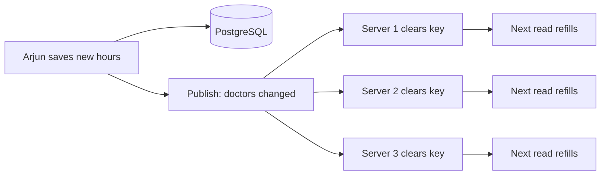

:::mental-model
**Where the cache lives decides who can see it, how fast it answers, and how hard it is to keep it honest. Start with the closest copy that can serve every reader who needs the same answer.**
:::

## The Monday the second server arrived

The clinic’s doctor list is cached in the API process. It has worked for months. Then the Monday rush doubles, and Dr. Rao adds a second API server behind the reverse proxy.

Nothing in the code changes. But now there are two caches. A request for the doctor list can land on server A, which has the list, or server B, which has its own copy. When Arjun edits Dr. Rao’s hours at 10:00, the update arrives on server A and clears its copy. Server B still holds the old list until its own TTL runs out. Half the patients see 6 p.m., half see 7 p.m., and nobody can explain why refreshing sometimes fixes it.

The cache did not fail. The placement did. A cache inside one process is private; the moment there are two processes, “the cache” is really two caches that happen to share a name.

## The four places a copy can live

There are four common homes for a cached copy, ordered from closest to the reader to furthest from the server:

| Where | Typical latency | Shared by | Best for | Main cost |
|---|---:|---|---|---|
| Browser | 0 ms (no request) | One user, one device | Images, CSS, static pages, API responses marked cacheable | You cannot purge it; you can only wait or change the URL |
| CDN edge | 10–40 ms | All users near that edge | Static assets, public pages, video, downloads | Purge is slow and partial; personalised content is a trap |
| In-process memory | ~0.1 ms | One API process | Small hot lookups, config, feature flags | Every process has a different copy |
| Shared cache server | ~0.5–1 ms | Every API process | Sessions, hot rows, counters, rate-limit buckets | One more service to run, monitor and fail over |

The numbers are the useful part. An in-process map is roughly ten thousand times faster than a network round trip, but a Redis read in the same datacenter is still a thousand times faster than a database read that has to parse, plan and fetch.

That does not mean the fastest option always wins. The right question is not “which is fastest?” It is “who needs to see the same copy?”

## In-process: perfect until you have two servers

An in-process cache is a hash map inside the API. A Go `sync.Map`, a Node `Map` with a TTL, a Python `functools.lru_cache`. No network, no serializer, no extra service.

For the clinic at one server, this is the correct answer. The doctor list is 3 rows and about 2 KB of JSON. Caching it locally costs nothing and removes thousands of database reads a day. Adding Redis at this size would add a service to install, a port to firewall, a failure mode to monitor, and a network hop that is slower than the copy it replaces.

Two properties make in-process caching safe at small scale:

1. **There is only one copy**, so there is no disagreement between servers.
2. **A restart is cheap**, because the cache refills from the database in milliseconds.

Both properties disappear at the second server. Now every process must be told when data changes, and a restart only clears one copy while the others keep serving their own.

:::warning
An in-process cache without a TTL is a memory leak with good intentions. Even if you publish invalidation messages, keep a TTL as a backstop. A missed message should cost you seconds of staleness, not a stale copy that survives until the next deploy.
:::

## Invalidating local copies: pub/sub plus a TTL

When the clinic runs three API servers, Arjun’s edit must reach all three. The usual pattern is a broadcast channel — Redis pub/sub, NATS, Postgres `LISTEN/NOTIFY`, or a message bus you already run.

The flow is:

Pub/sub is fast and simple. It is also **best effort**. A subscriber that is reconnecting, paused, or not yet subscribed misses the message and keeps its old copy. That is why the TTL stays. The message makes invalidation immediate in the normal case; the TTL bounds the damage in the abnormal one.

There is a second cost. After the broadcast, all three servers miss at the same moment and all three query the database for the same rows. At three servers that is harmless. At three hundred it is a stampede, which is a subject for 3.6.

## Shared cache server: one copy for everyone

A shared cache — Redis, Memcached, a managed equivalent — is a separate process that every API server talks to over the network. There is one copy of the doctor list. A write deletes one key. Every server sees the same answer on the next read.

The tradeoffs are concrete:

- **You gain a single, consistent copy** across all API servers, and the ability to store more than one machine’s RAM.
- **You gain features** in Redis that a hash map does not have: atomic increments, expirations, sorted sets, Lua scripts, pub/sub.
- **You pay a network hop**, usually 0.4–1 ms inside a datacenter, and more if the cache is in another zone.
- **You add a dependency.** If Redis is down and your code has no fallback, every read becomes an error. Plan what happens when the cache is unavailable: go to the database, shed load, or serve a degraded page.
- **You add a new bottleneck.** A single Redis node handles a surprising amount — often 100,000 simple operations per second — but it is still one machine with one CPU core for command execution.

For the clinic at three servers, a small Redis instance is the natural next step. The doctor list, sessions and rate-limit counters all want one shared copy.

## The browser and the CDN: caching you do not run

The cheapest cache is the one that never sends a request. Browsers and CDNs do this using HTTP headers: `Cache-Control`, `ETag`, `Last-Modified`, `Vary`.

- `Cache-Control: max-age=300` lets the browser reuse a response for five minutes without asking.
- `ETag` lets it ask “has this changed?” and get a cheap `304 Not Modified` if not.
- `Vary` tells caches which request headers change the response. Get it wrong and one user’s personalised page is served to another.

The clinic uses both. Its logo and CSS get a long `max-age` with a versioned filename (`app.7f3c2.css`), so a deploy changes the URL and the old copy is simply ignored. The public doctor list gets `max-age=60`, because a minute of staleness is acceptable for a page nobody acts on directly.

What you give up is control. You cannot reliably purge every browser that already downloaded a file. A CDN purge can take seconds to minutes to reach every edge, and some intermediaries ignore it. The only dependable invalidation is a new URL.

:::note
Never put personalised or authenticated responses in a shared cache unless you understand `Vary`, `private`, and `no-store`. “Cache everything at the CDN” is how one patient’s appointment list ends up on another patient’s screen.
:::

## A worked placement decision

The clinic now has three API servers, 400 requests per second at the Monday peak, and four candidate caches:

| Data | Size | Read rate | Change rate | Placement |
|---|---:|---:|---|---|
| Doctor list | 2 KB | 380/s | Weekly | Shared Redis, 10-minute TTL, invalidate on write |
| Patient session | 1 KB × 50k | Every request | Login/logout | Shared Redis, 30-minute TTL |
| Logo and CSS | 200 KB | Every page load | Per deploy | CDN with 1-year TTL and versioned URLs |
| Free slots for today | 18 rows per doctor | 200/s | Every booking | No shared cache; short in-process TTL of 2–5 s for display, re-check on write |

The first row is the classic shared cache. The second must be shared because the next request may hit a different server. The third belongs at the edge. The fourth looks cacheable and is not, because its whole value is being current.

Memory is the other constraint. Fifty thousand sessions at 1 KB is 50 MB, which fits comfortably. A million product pages at 4 KB is 4 GB, which does not. When the working set is larger than memory, you need an eviction policy — the subject of 3.5 — or a bigger cache, or both.

:::widget cache-placement
:::

## What breaks when placement is wrong

Three failures cover most of it:

1. **Split-brain copies.** Two servers, two local caches, no invalidation. Users see different data depending on which server the load balancer picked. The fix is a shared cache, or broadcast invalidation plus a short TTL.
2. **Cache as a hard dependency.** Every request calls Redis first, and a Redis restart takes the site down even though the database is healthy. The fix is a fallback path that reads the source of truth under a circuit breaker.
3. **Private data in a public cache.** A CDN caches a response that includes a patient name because the origin forgot `Cache-Control: private`. The fix is to default to `no-store` for authenticated responses and opt in deliberately.

None of these is a performance problem. They are correctness problems caused by putting a copy in the wrong place. That is the pattern of this module: the cache is easy; the boundary around it is the work.

## Check yourself

:::quiz
[
  {
    "question": "The clinic runs one API server and a 2 KB doctor list that changes once a week. What is the most sensible cache placement?",
    "options": [
      "Add a Redis cluster for high availability",
      "An in-process map with a TTL, because there is only one copy to keep consistent",
      "A CDN in front of the API",
      "No cache at all, because caching is only for large systems"
    ],
    "answer": 1,
    "explanation": "With one server, an in-process map gives the same consistency as Redis with less latency, no extra service and no new failure mode. Redis earns its place when multiple servers need one shared copy."
  },
  {
    "question": "Three API servers each cache the doctor list locally. Arjun edits the hours. What is the minimum you need for correctness?",
    "options": [
      "A longer TTL so the copies settle",
      "A broadcast invalidation message, plus a TTL as a backstop",
      "A bigger in-process cache on each server",
      "Move the cache to the browser"
    ],
    "answer": 1,
    "explanation": "Every server holding a copy must be told to drop it. Broadcast invalidation handles the normal case; a TTL bounds the damage when a subscriber misses the message. A longer TTL makes staleness worse."
  },
  {
    "question": "Why is a CDN a poor place for a patient’s appointment list?",
    "options": [
      "CDNs are slower than the origin for JSON",
      "A shared edge cache can serve one patient’s private response to another",
      "CDNs cannot cache HTTPS responses",
      "It uses too much disk on the patient’s phone"
    ],
    "answer": 1,
    "explanation": "A CDN is shared infrastructure. Unless the response is marked private and varies correctly, a cached personalised page can leak between users. CDNs are excellent for public, identical responses."
  },
  {
    "question": "A team moves from one API server to five and keeps a local-only cache. What symptom appears first?",
    "options": [
      "Database CPU rises because the cache stopped working",
      "Users see different data depending on which server handles their request",
      "The cache consumes five times the memory on one machine",
      "The load balancer starts rejecting requests"
    ],
    "answer": 1,
    "explanation": "Each process has its own copy, so a write that clears one copy leaves the others stale. The cache still works — it just disagrees with itself. Database load may even fall, which makes the inconsistency easy to miss."
  }
]
:::

## Exercise: place four caches

Take an app you use and list four things it caches or could cache: a static asset, a public read, a per-user read, and a write-sensitive value. For each, write:

1. Where the copy should live: browser, CDN, in-process, or shared cache server.
2. Who needs to see the same copy.
3. The latency you save and the consistency you give up.
4. What happens when that cache layer is unavailable.

Then mark the one you would move after the app grows to five servers, and say why.

:::discussion
- Is a shared cache server always more correct than in-process caches, or does it just move the disagreement?
- When would you deliberately accept a per-server cache that can be seconds stale?
- If a CDN purge takes five minutes, is that an invalidation mechanism or a hope?
:::

## Key takeaways

- The placement question is “who needs to see the same copy?”, not “which cache is fastest?”
- In-process memory is right for one server and becomes a consistency problem at two.
- A shared cache server gives every process one copy, at the cost of a network hop and a new dependency.
- Broadcast invalidation needs a TTL backstop, because pub/sub delivery is best effort.
- Browsers and CDNs are excellent for public, identical responses and dangerous for private ones.
- The cache must never become a hard dependency: keep a path to the database when it is down.
- Choose the closest copy that can serve every reader who needs the same answer.

## Free references

- [Redis: client-side caching](https://redis.io/docs/latest/develop/clients/client-side-caching/) — how a local copy and a shared cache interact, including invalidation tracking.
- [MDN: HTTP caching](https://developer.mozilla.org/en-US/docs/Web/HTTP/Caching) — browser and CDN behaviour from the headers up.
- [AWS: Caching best practices](https://aws.amazon.com/caching/best-practices/) — placement patterns and the tradeoffs of each layer.
- [PostgreSQL: LISTEN/NOTIFY](https://www.postgresql.org/docs/current/sql-notify.html) — a broadcast channel you may already have.
