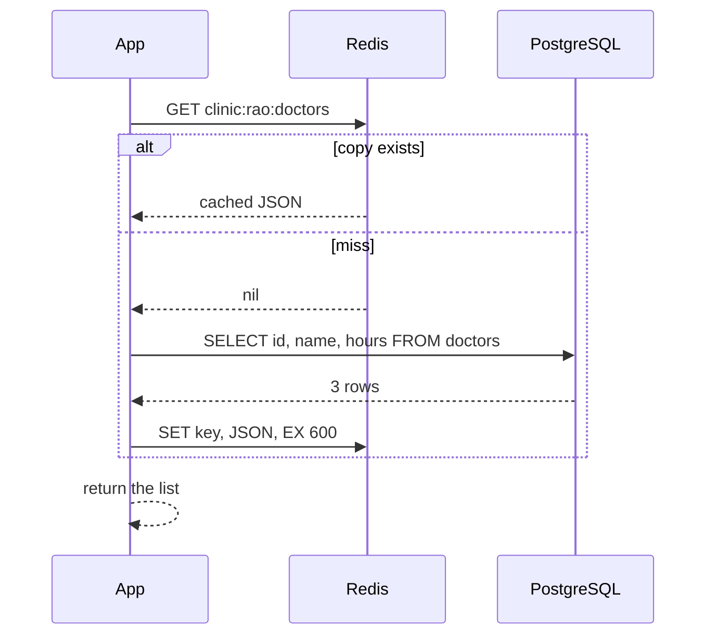

:::mental-model
**A read pattern decides how the copy is filled. A write pattern decides whether the copy is trusted. Write the source of truth first, then make the copy agree.**
:::

## Two paths through the same cache

Meera opens the clinic page at 8:58. The API looks for `clinic:rao:doctors` in Redis, finds it, and answers in 1 ms. That is the read path, and it is the easy half.

At 9:04, Arjun changes Dr. Rao’s Friday hours from 6 p.m. to 7 p.m. The database row is updated in 4 ms. The cache still holds the old list. If nothing else happens, Meera’s next refresh shows 6 p.m. until the TTL expires.

So the cache has two jobs, not one: fill the copy on a miss, and fix or drop the copy on a write. The patterns in this lesson are just different answers to those two jobs. None of them is free, and several of them look safer than they are.

## Cache-aside: the application owns the logic

Cache-aside is the default. The application checks the cache, and on a miss it reads the database and writes the result back.



Why it is popular:

- The application decides what to cache, under what key, for how long.
- A cache outage is recoverable: catch the error, read the database, keep serving.
- The cache holds only data that was actually requested, so cold data does not waste memory.

Why it is not enough:

- Every read is two calls on a miss: cache, then database.
- The application carries the invalidation logic, and every code path that writes must remember it.
- Two concurrent misses both query the database and both write the cache. Harmless here, expensive under load.

**Read-through** is the same shape with the logic moved into the cache client or a library. The application asks the cache for the key; the cache fetches from the database on a miss. It removes duplicated fetch code, but it hides the work: a slow database now looks like a slow cache, and the first request after a flush still pays full price.

## Write-through: update both, synchronously

Write-through writes the database **and** the cache before the request returns. The cache stays warm, and a read immediately after the write sees the new value.

The cost is on the write path. Every write now waits for two systems. If the database takes 4 ms and the cache takes 1 ms, the write goes from 4 ms to 5 ms — usually acceptable. But the cache is now on the critical path of every write, and a cache timeout becomes a write failure unless you handle it.

There is a second cost that surprises people: write-through caches data that may never be read. If 90% of appointments are created and never viewed again, you have filled memory with copies nobody wants, evicting the hot doctor list to make room.

## Write-behind: acknowledge early, flush later

Write-behind (or write-back) writes to the cache and returns immediately. A background process flushes to the database a moment later, or in batches.

Writes become very fast, and repeated updates to the same row collapse into one database write. That is useful for counters, view counts and high-frequency telemetry.

The risk is the one that matters: **the cache is now the source of truth for a window of time.** If the cache process dies before the flush, the acknowledged writes are gone. For a view counter that is acceptable. For a booking confirmation it is not. Write-behind is a durability decision disguised as a performance decision.

## Refresh-ahead: refill before it expires

Instead of waiting for a key to expire and making one unlucky request pay for the refill, refresh-ahead refreshes hot keys shortly before their TTL ends. The next reader always hits a warm copy.

It smooths the latency curve and avoids the small stall at expiry. It also assumes you can predict which keys will be read again. If the prediction is wrong, you spend database time refreshing data nobody asked for. Most teams start without it and add it only when the p99 spike at expiry is measurable.

## The write ordering rule

Here is the rule that prevents most cache bugs:

> **Write the database first. Then delete the cache. Never the other way around.**

Delete, not update. Here is why, in both orders.

**Cache first, database second.** You write the new value to the cache, then the database write fails. The cache now holds a value that was never committed. Every reader sees a lie, and the lie has no TTL unless you set one. If you had written the database first, a failed write would leave both systems unchanged.

**Update the cache instead of deleting it.** Two writers can interleave: writer A updates the database to v2, writer B updates it to v3, then B writes v3 to the cache, then A writes v2 to the cache. The database says v3; the cache says v2, possibly forever. Deleting the key avoids this, because the next read rebuilds from whatever the database currently holds.

So the normal write path is:

```text
BEGIN
  UPDATE doctors SET hours = $1 WHERE id = $2;
COMMIT
DELETE clinic:rao:doctors
```

If the delete fails, the TTL bounds the staleness. That is the entire safety argument: the database is always right, and the cache is a copy that will be corrected by a miss.

:::warning
“Update the cache after the database” is not a safe variant of the rule. It is a race waiting for two concurrent writers. Delete the key and let the next read rebuild it.
:::

## The read-after-write race

Even with the correct order, one race remains. It is rare and worth knowing:

1. Reader R misses the cache and reads the database. It gets the **old** value, v1.
2. Writer W updates the database to v2 and deletes the cache.
3. Reader R, still holding v1, writes v1 into the cache.

The cache now holds v1 while the database holds v2, and it will keep doing so until the TTL expires. The window is milliseconds, but on a busy key it happens more often than intuition suggests.

Four ways to bound it:

- **A short TTL** on the key, so the wrong copy cannot live long.
- **Delete after a short delay** as well as immediately, closing the window at the cost of a second write.
- **Versioned keys**, where the key includes a row version, so an old reader writes to an old key nobody reads.
- **Change data capture**, where a log reader invalidates keys from the database’s own commit stream instead of from application code.

The short TTL is the pragmatic default. The others are worth it when the data is important enough to justify the machinery.

## A worked example: 400 reads, 20 writes

The clinic does 400 reads per second and 20 writes per second on the doctor list.

**Cache-aside with a 600-second TTL and delete-on-write:**

- Hits: 399.5/s at 1 ms.
- Misses: 0.5/s at 41 ms (1 ms cache check + 40 ms database).
- Average: `0.999 × 1 + 0.001 × 41 ≈ 1.04 ms`.
- Database reads: 0.5/s, plus the refill after each write.
- Staleness: near zero on writes that go through the API; up to 600 seconds if an invalidation is missed.

**Write-through:**

- Reads: 400/s, all hits at 1 ms.
- Writes: 20/s at 5 ms instead of 4 ms.
- Cache holds every doctor row ever written, including ones never read.
- Staleness: none on the normal path, but a failed cache write can fail the request.

The cache-aside numbers win for this access pattern: 20 writes per second is not enough traffic to justify write-through’s extra complexity, and the 0.5/s miss rate is trivial. Write-through would be the better choice if reads immediately followed writes and every write was read back — a profile page, for example, where the user saves and is shown the result.

:::note
The right pattern follows the read/write ratio and the cost of staleness, not the popularity of the pattern. Cache-aside is common because it fits most web reads, not because it is universally correct.
:::

:::widget cache-patterns
:::

## What breaks in production

- **A write path that forgets to invalidate.** A new admin endpoint updates the database directly. The cache is never told. This is the most common cache bug, and it is a code-review problem, not a cache problem.
- **Write-through on a cache that is allowed to fail.** A Redis timeout now fails a booking. Decide explicitly whether the cache is required or optional.
- **Write-behind on data that must survive.** The cache acknowledges a write that the database never receives. Reserve write-behind for data whose loss is tolerable.
- **Read-through with no timeout.** The cache library waits on a slow database, and the cache layer looks like the bottleneck. Set timeouts and expose the miss path.

A cache pattern is a promise about where the truth lives and how long a copy may disagree. Write that promise down next to the code.

## Check yourself

:::quiz
[
  {
    "question": "A team updates the cache first, then writes the database. The database write fails. What is the state of the system?",
    "options": [
      "The cache and database both hold the old value",
      "The cache holds a value that was never committed, and readers may see it",
      "The database holds the new value and the cache is empty",
      "Nothing changes, because the database rolled back the cache too"
    ],
    "answer": 1,
    "explanation": "Writing the cache first makes it authoritative for a value that may not exist in the database. Writing the database first ensures a failed write leaves both systems on the old value."
  },
  {
    "question": "Why delete the cache key on a write instead of updating it with the new value?",
    "options": [
      "Deleting is faster than setting",
      "Concurrent writers can write values to the cache out of order, leaving it behind the database",
      "A deleted key cannot be read, so the cache stays consistent",
      "Updates are not supported by most caches"
    ],
    "answer": 1,
    "explanation": "Two writers can update the database in one order and the cache in another. Deleting avoids storing a value that may already be outdated; the next read rebuilds from the current database row."
  },
  {
    "question": "Which workload is the best fit for write-behind?",
    "options": [
      "Confirming a patient’s appointment",
      "Recording a view counter that can lose a few increments",
      "Changing a doctor’s login password",
      "Transferring money between accounts"
    ],
    "answer": 1,
    "explanation": "Write-behind acknowledges before durability, so it fits data whose loss is tolerable. Bookings, passwords and money need the database to commit before the user is told the write succeeded."
  },
  {
    "question": "A cache-aside read misses, reads v1 from the database, then a writer commits v2 and deletes the key, then the reader writes v1 into the cache. What bounds the damage?",
    "options": [
      "Nothing; the cache is permanently wrong",
      "The TTL, which forces a later rebuild from the database",
      "The database will push v2 to the cache automatically",
      "The next writer will update the cache in place"
    ],
    "answer": 1,
    "explanation": "This is the read-after-write race. A TTL ensures the stale v1 copy expires and is rebuilt. Versioned keys or delayed deletes can narrow the window further."
  }
]
:::

## Exercise: trace both paths

For the clinic’s `GET /doctors` and `PATCH /doctors/{id}` endpoints, write:

1. The cache-aside read path, including the key, TTL and what happens on a miss.
2. The write path, including the order of database and cache operations.
3. One race that could still leave the cache stale, and the bound you would put on it.
4. The pattern you would choose if every write were immediately read back, and why.

Then add one line to your design record: “The cache is optional/required, and here is what happens when it is down.”

:::discussion
- Is “delete the key” always better than “update the key,” or are there cases where an update is safe?
- How would you enforce invalidation across a codebase where five services write to the same table?
- Would you rather have a cache that is sometimes stale for 10 seconds, or a write path that fails when Redis is down?
:::

## Key takeaways

- Cache-aside lets the application own filling and invalidating; it is the default for read-heavy data.
- Read-through moves the fetch into the cache layer and hides the database work.
- Write-through keeps the cache warm at the cost of a second write on every request.
- Write-behind is fast and loses acknowledged writes if the cache dies; use it only where loss is tolerable.
- Write the database first, then delete the cache. Never cache first, and usually do not update in place.
- The read-after-write race is real; bound it with a TTL, versioned keys, or change data capture.
- Pick the pattern from the read/write ratio and the cost of staleness, not from what is popular.

## Free references

- [AWS: Cache-aside pattern](https://docs.aws.amazon.com/whitepapers/latest/database-caching-strategies-using-redis/caching-patterns.html) — the canonical patterns side by side.
- [Microsoft: Cache-aside pattern](https://learn.microsoft.com/en-us/azure/architecture/patterns/cache-aside) — includes the concurrency caveats.
- [Redis: Write-behind and write-through](https://redis.io/docs/latest/develop/use/client-side-caching/) — how client-side caching and invalidation interact.
- [Martin Fowler: Cache](https://martinfowler.com/bliki/Cache.html) — why the invalidation problem is structural, not a tooling gap.
