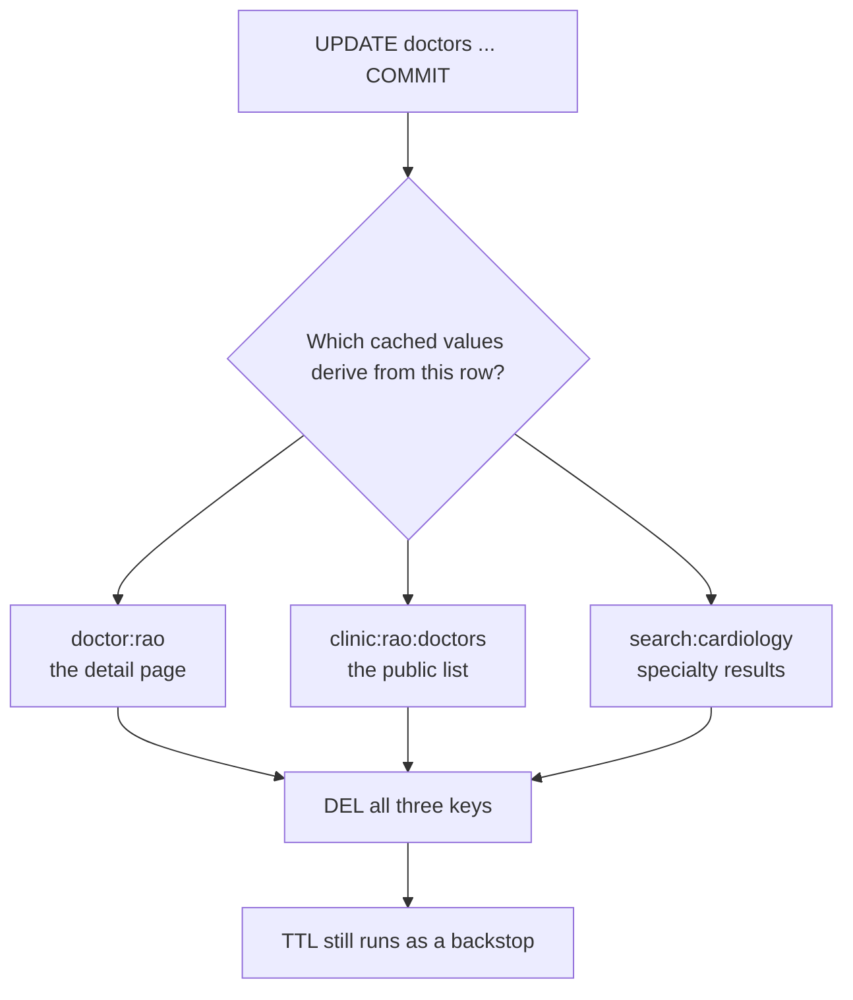

:::mental-model
**Invalidation is the question “which copies did this write make wrong?” You will not answer it perfectly. You need an answer that is correct enough, and a TTL that cleans up the ones you missed.**
:::

## The hour the clinic showed two prices

The clinic adds online payment for consultations. The price is cached with the doctor list, key `clinic:rao:doctors`, TTL ten minutes. On Tuesday, Dr. Rao raises the consultation fee from ₹500 to ₹600.

The admin page updates the `doctors` table. It does not know that the price is also embedded in the cached doctor list, the cached specialty page, and the cached search results. All three keep serving ₹500.

Meera books at ₹500. The payment page re-reads the database, charges ₹600, and she calls the clinic to ask why the screen and the receipt disagree.

The write was correct. The invalidation was incomplete. That is the normal shape of this bug: not a broken cache, but a missing list of keys.

## Why invalidation is hard

A cache key is usually **derived** from more than one row. `clinic:rao:doctors` might contain the doctor’s name, specialty, hours, fee and clinic address. A change to any of those rows changes the cached value, but the write happens in a different table, sometimes in a different service.

So the real question is not “how do I delete a key?” It is:

> For this write, which cached values are now wrong?

There are four honest answers:

1. **A TTL** — I do not know which keys, so I let them all expire.
2. **Explicit deletes** — I know the keys, and every write path deletes them.
3. **Versioned keys** — the key changes when the data changes, so old copies are never read again.
4. **Event-driven invalidation** — a stream of changes tells the cache what to drop.

Most systems use a combination. TTL alone is simple and bounded. TTL plus explicit deletes is the usual production answer.

## TTL: bounded staleness, not correctness

A TTL is a promise: “this copy may be wrong, but not for longer than N seconds.” That is a weaker promise than “this copy is always right,” and it is often enough.

The size of N is a product decision, not a technical one:

| Data on screen | Acceptable staleness | Why |
|---|---:|---|
| Doctor names and specialties | 10 minutes | Nothing is acted on from this screen |
| Opening hours | 5 minutes | A patient may plan around it, but the booking re-checks |
| Consultation fee shown before payment | 60 seconds | The charge is re-read at checkout |
| Free slot count | 5 seconds | It is a hint; the booking re-checks the slot |
| Appointment status for the patient who just changed it | 0 seconds | Read-your-writes must hold |
| Payment status | Do not cache | Money cannot be a guess |

TTL is also your safety net for the invalidation you forgot. If a new admin endpoint skips the delete, the TTL bounds the damage. That is why “we invalidate explicitly” is never a reason to remove the TTL.

:::warning
A cache entry with no TTL is not a cache. It is a second database that never receives writes. If a key can be written, it needs an expiry or a guaranteed invalidation path — preferably both.
:::

## Explicit invalidation: delete after commit

The rule from 3.3 carries over: commit the database write, then delete every key that derives from it.



The hard part is the middle box. In a small codebase, one function can own the mapping. In a larger one, you need a convention:

- **Key by entity, not by query.** `doctor:rao` is a stable object. `doctors?sort=name&page=2` is a query with a combinatorial key space.
- **Keep a dependency list.** Write down which entities feed which cache key. Review it when a new field is added.
- **Invalidate the broad key when unsure.** Deleting a list key causes one rebuild. Leaving it stale causes a wrong screen.
- **Never invalidate before commit.** If the transaction rolls back, you have deleted a valid copy for nothing — and another reader may refill it with the old value while the write is still pending.

## The bulk-write problem

A single-row edit is easy. A bulk operation is where invalidation gets expensive.

Suppose the clinic changes its address. That address appears in every doctor’s cached list, every appointment confirmation, and every invoice PDF link. Deleting ten thousand keys one by one is slow, and doing it inside the request makes the admin wait.

Three approaches:

1. **Namespace or version prefix.** Store keys under `v42:clinic:rao:...`. A bulk change increments the namespace to `v43`, and every old key becomes unreachable. Old entries expire on their own. This is the cleanest answer for broad changes.
2. **Tag-based invalidation.** Some caches let you attach a tag and purge by tag. It is convenient, but purge is often asynchronous and not guaranteed to be immediate.
3. **Short TTL plus a background sweep.** Accept a brief window of staleness and let expiry do the work. This is fine for display data, not for prices or permissions.

The namespace trick is worth remembering because it turns “delete a million keys” into “change one number.”

## Versioned keys and content hashes

If the key includes the version of the data, an old copy can never be mistaken for a new one:

```text
doctor:rao:v7
doctor:rao:v8
```

A write bumps the version, and readers ask for the current one. The old entry is now unreachable and expires or is evicted later. This is the same idea as versioned CSS filenames: instead of purging the copy, you stop pointing at it.

The cost is that you must store and read the current version somewhere — usually the database row itself, or a small version key. That read is cheap and cacheable, but it is still a dependency. If the version lookup is stale, you are back to the same problem one level up.

## Event-driven invalidation

Application code forgets. Databases do not. Change data capture (CDC) reads the database’s commit log — Postgres logical replication, Debezium, a change stream — and publishes “doctor row 42 changed” to a consumer that deletes the affected keys.

The advantage is coverage: a write from any service, any script, any manual `UPDATE` produces the event. The disadvantage is lag and complexity. The cache is invalidated a few hundred milliseconds after the commit, not at commit time, so a short window of staleness remains. And you now operate a log pipeline.

Use CDC when several writers touch the same tables and code-level invalidation keeps missing cases. Do not add it for a single-service clinic with one write path.

## Invalidate what you display; verify what you act on

The most important invalidation rule is not about keys at all:

> **Cached data may decide what you show. It may never decide what you do.**

Meera’s slot screen can be five seconds stale. That is fine: she is choosing a time, not reserving it. The booking request must check the slot in the database — inside a transaction or against a unique constraint — because two patients can both see the same stale slot and both press “Book.”

The same split appears everywhere:

- A cached price can be displayed; checkout re-reads it.
- A cached permission list can render a menu; the action re-checks the permission.
- A cached balance can appear on a dashboard; a transfer reads the ledger.
- A cached inventory count can say “2 left”; the order decrements atomically.

When someone asks “how do we invalidate the cache for bookings?”, the better answer is often: **do not let the cache make the booking decision.** Invalidate for display; verify at the write.

:::reality-check
The worst cache incident is not a stale page. It is a stale check that authorises an action: a double booking, an over-sold item, a permission that was revoked. Those cannot be fixed by a refresh.
:::

## A worked staleness budget

The clinic publishes a staleness budget per screen, and every cache key must fit inside it:

| Screen | Key | TTL | Explicit invalidation | Bound on staleness |
|---|---|---:|---|---|
| Public doctor list | `clinic:rao:doctors` | 600 s | On doctor/clinic write | 600 s worst case, seconds normally |
| Staff roster | `clinic:rao:roster` | 60 s | On shift write | 60 s |
| Patient appointment status | `patient:8812:appointments` | 10 s | On booking/cancel | 10 s, immediate for the writer |
| Slot picker | in-process `slots:rao:2026-11-17` | 3 s | None | 3 s; always re-checked on write |
| Payment status | none | — | — | Must be current |

The budget makes the tradeoff visible. A product owner can say “ten minutes is too stale for the fee” and the number changes in one place. Without a budget, every key gets whatever TTL the first developer typed.

**Read-your-writes** deserves its own line. After Meera cancels, her next screen must not show the appointment as booked. A ten-second TTL would fail that test. The fix is to invalidate her key on write, or to have the write response return the new state and let the client use it until the next read.

:::widget cache-staleness
:::

## What breaks in practice

1. **A write path that bypasses invalidation.** A migration, an admin script, a support tool. The fix is a single write API, or CDC, or a short TTL — ideally all three.
2. **Invalidating before commit.** The transaction rolls back and a reader refills the cache with the old value. Delete after commit.
3. **Deleting the detail key but not the list key.** Two screens disagree. Keep the dependency list.
4. **A TTL so long it is effectively no invalidation.** A one-day TTL on a price is a business decision to be wrong for a day.
5. **Cache stampede after invalidation.** Every server misses at once. That is 3.6.

Invalidation is not a single technique. It is a budget: how wrong, for how long, on which screen, and what action is allowed to trust the copy.

## Check yourself

:::quiz
[
  {
    "question": "Arjun changes a doctor’s consultation fee. The fee appears in the doctor list, the specialty page, and search results. What must the write path do?",
    "options": [
      "Delete only the doctor list key, because that is the screen he edited",
      "Delete every key derived from the doctor row, then rely on a TTL as a backstop",
      "Update the fee in each cached value in place",
      "Nothing; the fee is not cacheable"
    ],
    "answer": 1,
    "explanation": "A derived value can appear under several keys. The write must invalidate all of them, and a TTL must remain for the paths that were missed. Updating in place risks out-of-order writes."
  },
  {
    "question": "A patient cancels an appointment and immediately reloads the page. The status key has a 10-second TTL. What is the likely result, and the fix?",
    "options": [
      "The page shows the old status until the TTL expires; invalidate the patient’s key on write",
      "The page is correct because the database was updated; no fix needed",
      "The cache returns an error; retry the read",
      "The TTL is too short, so the read must be cached longer"
    ],
    "answer": 0,
    "explanation": "A TTL alone does not provide read-your-writes. The writer’s own key must be invalidated, or the write response must return the new state for the client to use."
  },
  {
    "question": "Why is deleting a key after commit safer than deleting it before commit?",
    "options": [
      "Deletes before commit are slower",
      "If the transaction rolls back, a pre-commit delete removed a valid copy and a reader may refill it with the old value",
      "Caches cannot delete keys during a transaction",
      "It makes the TTL unnecessary"
    ],
    "answer": 1,
    "explanation": "A rollback means nothing changed, but the cache was already dropped. A concurrent reader can then repopulate it from the old committed state. Delete after a successful commit."
  },
  {
    "question": "The clinic changes its address, which appears in thousands of cached keys. Which approach scales best?",
    "options": [
      "Delete every key one by one in the admin request",
      "Increment a namespace or version prefix so all old keys become unreachable",
      "Set every TTL to one year",
      "Disable the cache permanently"
    ],
    "answer": 1,
    "explanation": "A namespace or version bump invalidates a whole family of keys with one change. Old entries become unreachable and expire naturally. Per-key deletion inside the request is slow and fragile."
  }
]
:::

## Exercise: write a staleness budget

Pick three screens from an app you use — a public list, a personal status, and something involving money or permission. For each:

1. Write the cache key and the data it derives from.
2. Choose a TTL and justify it in product terms.
3. List the writes that must explicitly invalidate it.
4. Mark whether a cached value may authorise an action, or only display one.
5. Name the worst staleness a user could experience, in seconds.

Then find one screen where the right answer is “do not cache this for the action; re-read it.”

:::discussion
- Is a TTL an admission that invalidation is incomplete, or a deliberate product choice?
- How would you review a pull request to make sure a new write path invalidates the right keys?
- Where is the line between “stale for display is fine” and “stale is a correctness bug” in your own product?
:::

## Key takeaways

- Invalidation asks which cached values a write made wrong; most bugs are missing keys, not broken caches.
- A TTL bounds staleness and catches the invalidations you forgot. It is not optional.
- Delete derived keys after commit, never before, and delete rather than update in place.
- Namespace or version prefixes turn a mass invalidation into a single change.
- Versioned keys and CDC are stronger tools for multi-writer systems; they add lag and operational cost.
- Cached data may decide what you show; it may never decide what you do. Re-check at the write.
- Write a staleness budget per screen so the tradeoff is a product decision, not an accident.

## Free references

- [PostgreSQL: Concurrency control](https://www.postgresql.org/docs/current/transaction-iso.html) — what “after commit” actually guarantees.
- [Debezium: change data capture](https://debezium.io/documentation/reference/stable/architecture.html) — how a commit log becomes an invalidation stream.
- [AWS: Caching best practices](https://aws.amazon.com/caching/best-practices/) — TTLs, invalidation and the anti-patterns.
- [Martin Fowler: Cache](https://martinfowler.com/bliki/Cache.html) — the original “two hard things” framing, briefly.
