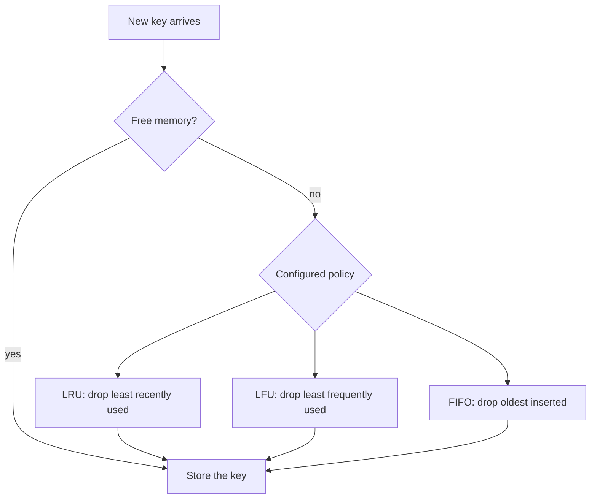

:::mental-model
**Memory is finite, so every cache must choose what to forget. The policy is a guess about the future, and the hit rate tells you whether the guess is working.**
:::

## The cache that got slower as it got fuller

The clinic’s Redis instance is sized at 256 MB. For a year it holds the doctor list, sessions and a few reports, and it never fills.

Then the clinic adds a search page. Every search query gets cached for ten minutes. A busy Monday produces 300,000 distinct queries, most of them read once and never again. Memory hits the limit by 11 a.m.

Redis starts evicting. It does not evict the search results nobody wants; the policy is least-recently-used, and those results were just written. It evicts the doctor list instead, because that key has not been read for a few seconds while the search flood was arriving. The doctor list is rebuilt, evicted again, rebuilt again. Hit rate falls from 96% to 61%, and the database gets a load it has not seen since before the cache existed.

The cache did exactly what it was configured to do. The configuration was wrong for the workload.

## What eviction is

When a cache is full and a new entry must be stored, something has to leave. The **eviction policy** decides which key goes.

Every policy is a bet about which key is least likely to be needed again. Different bets suit different access patterns:

| Policy | Evicts | Good at | Bad at |
|---|---|---|---|
| LRU (least recently used) | The key not read for the longest time | Repeated access to a working set | Scans and one-off floods that push out hot keys |
| LFU (least frequently used) | The key read the fewest times | Protecting long-lived hot keys from bursts | Old popularity that never fades |
| FIFO (first in, first out) | The oldest inserted key | Simple, predictable | Ignoring actual usage entirely |
| Random | Any key | Cheap bookkeeping, no pathological order | No guarantee about the hot set |
| TTL-first | Keys closest to expiry | Data with a natural lifetime | Keys without TTLs |

Most caches combine a policy with TTL expiry. An expired key is removed regardless of how recently it was used.



## LRU: recency as a proxy for usefulness

LRU is the default mental model: keep what was used recently, because the recent past predicts the near future.

The implementation is a hash map plus a doubly linked list. A read moves the key to the front. An insert goes to the front. When memory is full, the key at the back is removed. Both operations are O(1), which is why LRU is everywhere: operating system page caches, CPU caches (approximately), Redis’s `allkeys-lru`, and most application-level caches.

LRU works well when access has **temporal locality**: a set of keys is read repeatedly, and the set changes slowly. The doctor list, the top 1,000 product pages, the current day’s sessions — all fit.

LRU fails in two predictable ways:

**1. A scan destroys the cache.** Read 300,000 search results once each, and every one enters the front of the list, pushing out the keys that were actually hot. The cache is now full of data that will never be read again. This is called **cache pollution**, and it is exactly what happened to the clinic.

**2. A working set larger than the cache thrashes.** If the cache holds three slots and the loop reads A, B, C, D in order, every access misses:

| Access | Cache after | Result |
|---|---|---|
| A | A | miss |
| B | A, B | miss |
| C | A, B, C | miss |
| D | B, C, D | miss (A evicted) |
| A | C, D, A | miss (B evicted) |
| B | D, A, B | miss (C evicted) |

Six accesses, zero hits. The same cache with a working set of A, B, C would hit on everything after the first three. Capacity is not the only variable; the access pattern decides whether the capacity is usable.

## LFU: frequency as a proxy for value

LFU counts how often each key is read and evicts the least frequent. A key read 10,000 times survives a one-off scan, because the scan keys have a count of one.

LFU is better than LRU when popularity is stable and bursts are common. It is worse when popularity changes, because yesterday’s hot key keeps its high count and refuses to leave. The usual fix is **aging**: halve the counts periodically, or use a sliding window, so old popularity fades.

Redis’s `allkeys-lfu` uses a probabilistic counter with decay for this reason. It is not an exact frequency count; it is an approximation that fits in a few bits per key.

## FIFO, random, and why they are not jokes

FIFO evicts the oldest insertion, regardless of use. It is simple and has no bookkeeping, but a key inserted early and read constantly will still be evicted first. That is usually worse than LRU.

Random sounds careless, and for a pure hot-set workload it is. But random eviction has no worst case that is dramatically worse than its average, and it cannot be gamed by a scan in the way LRU can. Some CDNs and CPU caches use random or pseudo-random replacement because the bookkeeping cost of LRU is not worth the small hit-rate gain.

The lesson is not “random is good.” It is that **the policy must match the workload**, and the difference is measurable.

## Redis eviction policies in practice

When Redis reaches `maxmemory`, the configured policy decides what happens:

- `noeviction` — writes that need more memory return an error. Reads still work. This is the safe default if the cache must not silently lose data, but it turns a capacity problem into application errors.
- `allkeys-lru` — evict any key, least recently used first. The usual choice for a pure cache.
- `allkeys-lfu` — evict any key, least frequently used first. Better when a scan would pollute an LRU cache.
- `volatile-lru` / `volatile-lfu` / `volatile-ttl` — only evict keys that have a TTL. Keys without a TTL are pinned, which is useful for a mixed cache and dangerous if you forget to set TTLs.
- `allkeys-random` — evict a random key. Simple, predictable cost.

Two operational rules matter more than the choice:

1. **Set `maxmemory` below the machine’s RAM**, leaving room for the process, replication buffers and the operating system. A cache that triggers the OS out-of-memory killer is worse than one that evicts.
2. **Alert on eviction rate, not just hit rate.** Evictions are normal at a steady rate; a sudden climb means the working set outgrew the cache or a scan arrived.

## The numbers that tell you it is working

Three metrics, read together:

- **Hit rate** = hits / (hits + misses). Falling hit rate means the cache is serving less of the traffic.
- **Eviction rate** = evictions per second. Rising eviction rate with a flat workload means the cache is too small or polluted.
- **Miss latency** = how long the database takes on a miss. If a miss is expensive, the hit rate matters more.

A worked example. The clinic cache holds 200,000 keys at an average of 1 KB, so 200 MB of a 256 MB instance. The working set is 500,000 keys. LRU can hold 40% of it, and because the access pattern is roughly uniform, the hit rate settles near 40%. The database sees 60% of 400 requests per second — 240 queries per second, up from 16 when the working set fit.

Options, in order of cost:

1. **Stop caching one-off searches.** The biggest win is not a bigger cache; it is not putting scan traffic in it. Cache only queries read more than once, or give search its own small cache with a short TTL.
2. **Raise memory to fit the working set** with 20–30% headroom. If the working set is 500 MB, size for 650 MB.
3. **Change the policy** to LFU if the workload has stable hot keys and periodic scans.
4. **Shard the cache** if one machine cannot hold the working set, accepting that keys now live in one shard and a shard failure loses a slice of the cache.

The wrong move is to add a second cache layer in front of the full one. That hides the eviction rate and doubles the invalidation problem.

:::note
A hit rate is only meaningful next to a workload. “99% hit rate” on a cache that serves only the homepage says nothing about the search page. Measure per key family, not just per instance.
:::

:::widget cache-eviction
:::

## Sizing and headroom

A cache should hold the **working set**, not the entire dataset. The working set is the set of keys read often enough that caching them pays for the memory. Everything else is cold data that will be evicted before it is read again.

Practical sizing:

```text
memory needed ≈ working-set keys × average value size × 1.3
```

The 1.3 covers key names, object overhead, allocator fragmentation and the eviction metadata. A cache running at 95% memory is already evicting aggressively, because the next write needs room before the policy runs.

If the working set does not fit, do not assume more memory is the answer. First ask whether the traffic belongs in the cache at all.

## What breaks when eviction is wrong

- **A scan evicts the hot set.** LRU plus a one-off query flood. The fix is a separate cache, a TTL, or LFU.
- **`noeviction` turns capacity into errors.** Writes fail at the worst moment. The fix is to size correctly and choose a policy deliberately.
- **Pinned keys fill the cache.** `volatile-*` policies plus keys without TTLs leave no evictable space. The fix is a TTL on everything, or `allkeys-*`.
- **A stale popularity contest.** LFU keeps a key that was hot last month. The fix is aging or a shorter TTL.
- **Silent eviction of sessions.** Sessions evicted under memory pressure log users out in waves. The fix is a separate instance or a policy that protects them.

The cache is a budget. Eviction is how the budget is enforced, and the hit rate is the receipt.

## Check yourself

:::quiz
[
  {
    "question": "A search feature caches every distinct query for ten minutes. The cache is full and LRU evicts the doctor list repeatedly. What is the best first fix?",
    "options": [
      "Increase Redis memory until the search results fit",
      "Stop caching one-off searches, or give search a separate small cache with a short TTL",
      "Switch the whole cache to FIFO",
      "Remove the doctor list from the cache"
    ],
    "answer": 1,
    "explanation": "The problem is pollution from low-reuse data, not total capacity. Keeping scan traffic out of the hot cache protects the working set. A bigger cache may only delay the same failure."
  },
  {
    "question": "A cache has three slots and the access pattern is A, B, C, D, A, B, C, D under LRU. What happens?",
    "options": [
      "It reaches a 75% hit rate after warmup",
      "It thrashes and gets near-zero hits because each access evicts the next one needed",
      "It gets 100% hits because all four keys are small",
      "It switches automatically to LFU"
    ],
    "answer": 1,
    "explanation": "The working set is four keys but the cache holds three. In sequential order, each new key evicts the one that will be needed three steps later, so almost every access misses. This is capacity thrashing."
  },
  {
    "question": "Which metric most directly shows that the cache is too small for its workload?",
    "options": [
      "A rising eviction rate alongside a falling hit rate",
      "A steady CPU usage on the cache server",
      "A growing number of keys with TTLs",
      "A low number of client connections"
    ],
    "answer": 0,
    "explanation": "Evictions are the cache discarding entries to make room. If they rise while the hit rate falls, the working set no longer fits or has been polluted. CPU alone does not show capacity pressure."
  },
  {
    "question": "Why is `noeviction` risky for a pure cache?",
    "options": [
      "It deletes keys too aggressively",
      "Writes fail when memory is full, turning a capacity problem into application errors",
      "It disables TTLs",
      "It only works with LFU"
    ],
    "answer": 1,
    "explanation": "With `noeviction`, Redis rejects writes that would exceed `maxmemory`. A cache miss that tries to store a value can therefore return an error. Use it only when losing a write is worse than failing it, and size accordingly."
  }
]
:::

## Exercise: pick an eviction policy

Take a cache you operate or would operate, and describe its traffic:

1. The working-set size and the average value size.
2. Whether access has temporal locality, stable popularity, or periodic scans.
3. The policy you would choose, and the failure mode that policy has.
4. The metrics you would alert on, with a threshold.
5. One workload you would move out of this cache entirely.

Then calculate a rough memory size with 30% headroom, and compare it with the machine you would actually rent.

:::discussion
- When is a 60% hit rate better than a 95% hit rate?
- Should a cache ever be allowed to fail writes, or should it always evict?
- How would you detect cache pollution before users notice the latency?
:::

## Key takeaways

- Every full cache must forget something; the policy is a bet about future reads.
- LRU suits temporal locality and suffers when a scan pushes the hot set out.
- LFU protects frequent keys from bursts but needs aging so old popularity fades.
- Redis policies differ mainly in whether they evict everything or only keys with TTLs.
- Size for the working set plus headroom, not for the entire dataset.
- Watch hit rate and eviction rate together; one without the other hides the problem.
- The cheapest fix for a full cache is often to stop caching data nobody reads twice.

## Free references

- [Redis: key eviction](https://redis.io/docs/latest/develop/reference/eviction/) — every policy, with the exact behaviour at `maxmemory`.
- [Redis: memory optimization](https://redis.io/docs/latest/develop/tips/memory-optimization/) — overhead, fragmentation and sizing.
- [Wikipedia: cache replacement policies](https://en.wikipedia.org/wiki/Cache_replacement_policies) — LRU, LFU, ARC and the rest, with comparisons.
- [Varnish: hit-for-pass and cache sizing](https://varnish-cache.org/docs/trunk/users-guide/increasing-your-hitrate.html) — a practical view from the HTTP cache world.
