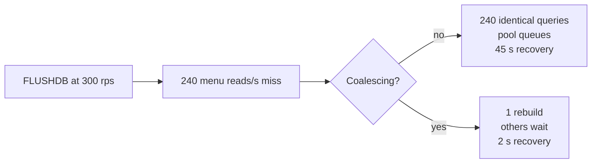

:::mental-model
**A cache is proven twice: once by the throughput it adds, and once by the outage it causes when it is emptied. Measure both, or you have only measured the sales pitch.**
:::

## The page everyone reads

The clinic’s public service menu is the page patients open before they book: three doctors, their specialties, consultation fees, opening hours and the list of services the clinic offers. It is small, it is public, and it changes when Dr. Rao edits a fee or a holiday.

It is also the most-read page in the system. In the Module 2 load test, the menu accounted for about 80% of reads. After the index, the database could carry 350–400 requests per second before the API became the limit. The menu is the obvious next target: the same rows, the same JSON, read thousands of times between edits.

This experiment asks two questions:

1. How much does a cache raise the ceiling on this page?
2. What happens on the day the cache is empty at peak traffic?

## The setup

Same hardware as the Module 2 reference run, so the numbers are comparable:

- **API:** Go 1.22 service on a 2 vCPU / 4 GB VM.
- **Database:** PostgreSQL 16 on the same VM, 500,000 appointments and 50,000 slots.
- **Cache:** Redis 7 on the same VM for this test. In production it would be a separate instance; putting it here keeps the comparison honest about the API's own CPU.
- **Load generator:** `k6` on a separate machine.
- **Mix:** 80% menu reads, 20% booking and cancellation writes.
- **Cache key:** `menu:rao-clinic`, value ≈ 14 KB of JSON, TTL 600 seconds, deleted on any doctor, service or clinic write.

The hypothesis:

> Caching the menu at a 97% hit rate will move the knee from roughly 350–400 requests per second to the API's own CPU limit, and reduce database CPU at every rate. Flushing the cache at 300 requests per second will saturate the database and produce a visible latency spike.

## Phase 1: no cache, for the baseline

The menu reads go straight to the indexed query. These numbers are the shape from Module 2.8, not a new promise:

| Target rate | Achieved | p50 | p95 | p99 | Errors | DB CPU |
|---:|---:|---:|---:|---:|---:|---:|
| 100/s | 100/s | 6 ms | 14 ms | 28 ms | 0% | 19% |
| 200/s | 198/s | 11 ms | 30 ms | 65 ms | 0.1% | 38% |
| 300/s | 262/s | 22 ms | 80 ms | 210 ms | 0.8% | 58% |
| 400/s | 355/s | 28 ms | 95 ms | 240 ms | 1.4% | 72% |

The knee is where achieved throughput stops tracking the target. By 400 requests per second, the API is queueing and the p99 is four times the p95.

## Phase 2: cache on, warmed

The cache is filled before traffic starts, then the same ramp runs. The menu is 80% of traffic, so the other 20% — bookings, cancellations, slot checks — still reaches the database and still matters.

| Target rate | Achieved | p50 | p95 | p99 | Errors | DB CPU | Cache CPU | Hit rate |
|---:|---:|---:|---:|---:|---:|---:|---:|---:|
| 100/s | 100/s | 2 ms | 5 ms | 11 ms | 0% | 9% | 14% | 99.2% |
| 200/s | 200/s | 2 ms | 6 ms | 13 ms | 0% | 12% | 27% | 98.7% |
| 300/s | 300/s | 3 ms | 8 ms | 18 ms | 0% | 17% | 39% | 98.1% |
| 400/s | 398/s | 4 ms | 11 ms | 24 ms | 0.1% | 23% | 51% | 97.4% |
| 500/s | 470/s | 7 ms | 20 ms | 48 ms | 0.4% | 31% | 63% | 96.8% |

At 400 requests per second, p99 falls from 240 ms to 24 ms, and database CPU from 72% to 23%. The database is now doing writes and the 2–3% of reads that miss. The new limit is the API's CPU and the cache's single core, not Postgres.

The hit rate is not 100%, and that is expected:

- The first read after a write misses.
- Slot checks and appointment reads are deliberately not cached.
- A small number of menu reads arrive between the write commit and the cache delete.

A 97% hit rate at 400 requests per second means about 12 menu reads per second reach the database. That is the number to put in the capacity plan, not 400.

## Phase 3: flush the cache at peak

This is the test most teams skip. At 300 requests per second, with the cache warm and the system healthy, run `FLUSHDB`. Every menu key disappears in one command.

Without coalescing, here is what the next 60 seconds look like:

| Seconds after flush | Hit rate | DB CPU | p99 | Errors |
|---:|---:|---:|---:|---:|
| 0–2 | 0% | 99% | 2,400 ms | 6% |
| 3–10 | 62% | 99% | 3,100 ms | 11% |
| 11–25 | 91% | 84% | 900 ms | 3% |
| 26–45 | 97% | 41% | 120 ms | 0.4% |
| 46–60 | 98% | 19% | 22 ms | 0% |

The database did not fail. It absorbed 240 concurrent identical menu queries, filled its connection pool, and spent about 45 seconds working through the queue. Every one of those queries returned the same 14 KB of JSON.

With single-flight enabled — one request rebuilds the key, the rest wait — the recovery is very different:

| Seconds after flush | Hit rate | DB CPU | p99 | Errors |
|---:|---:|---:|---:|---:|
| 0–1 | 0% | 46% | 90 ms | 0% |
| 2–5 | 94% | 28% | 40 ms | 0% |
| 6–60 | 98% | 18% | 20 ms | 0% |

One query did the rebuild. The database saw a small bump instead of a wall.



## What the numbers say

**1. The cache moved the bottleneck.** Before, database CPU was the limit. After, the API's CPU and the cache's single core are. The next optimization is not a bigger cache; it is fewer round trips per request, more API CPU, or a cache tier that can use more than one core.

**2. The hit rate is a capacity number.** At 97%, the database gets 3% of menu reads. At 90%, it gets 10%. The difference between those two numbers is the difference between a calm database and a busy one at peak.

**3. The flush is the real test.** A cache that has never been emptied in a load test has not been tested. The recovery time, not the steady-state p99, tells you whether the database can survive a deploy, a failover, or an eviction wave.

**4. Coalescing is cheaper than a bigger database.** The fix for the flush spike was a few lines of code and one lock per key. The alternative — sizing Postgres for the full uncached load — costs money every hour for a spike that lasts 45 seconds.

:::warning
A cache that is on the same machine as the API competes for CPU with it. The numbers above include that competition. In production, put the cache on its own instance, or at least measure the API's CPU with and without the cache process.
:::

:::widget cache-cliff
:::

## Reproduce it

The shape of the `k6` scenario:

```js
import http from 'k6/http';
import { check, sleep } from 'k6';

export const options = {
  stages: [
    { duration: '5m', target: 50 },   // warm
    { duration: '3m', target: 300 },  // ramp
    { duration: '5m', target: 300 },  // hold
  ],
};

export default function () {
  const res = http.get('http://api.rao-clinic.test/menu');
  check(res, { 'status is 200': (r) => r.status === 200 });
  sleep(0.2);
}
```

Run it three times: cache off, cache on, and cache on with a flush at the start of the hold. Record p50, p95, p99, errors, database CPU, cache CPU and hit rate. The third run is the one that tells you whether the design survives Monday.

## Check yourself

:::quiz
[
  {
    "question": "In the cached run at 400 requests per second, the hit rate is 97.4%. Roughly how many menu reads reach the database per second?",
    "options": [
      "About 2",
      "About 10",
      "About 100",
      "About 400"
    ],
    "answer": 1,
    "explanation": "400 × 2.6% ≈ 10.4 reads per second. The database load follows the miss rate, not the request rate. That number, not 400, is what capacity planning uses."
  },
  {
    "question": "Flushing the cache at 300 requests per second causes a 45-second recovery without coalescing. Why?",
    "options": [
      "Redis takes 45 seconds to restart",
      "Hundreds of identical misses queue on the database connection pool and drain slowly",
      "The TTLs all expire at once",
      "The API loses its in-process cache"
    ],
    "answer": 1,
    "explanation": "Every miss rebuilds the same key. With a 20-connection pool and 40 ms queries, the queue grows faster than it drains until the key is warm. Coalescing collapses the duplicate work."
  },
  {
    "question": "Why is a cache flush test more informative than a steady-state benchmark?",
    "options": [
      "It measures the worst case the database must survive during deploys and failures",
      "It makes the hit rate look better",
      "It removes the need for TTLs",
      "It proves the cache is faster than the database"
    ],
    "answer": 0,
    "explanation": "Steady state shows the benefit. A flush shows the exposure: if the database cannot absorb the full miss load, a cache restart or mass eviction becomes an outage."
  },
  {
    "question": "After caching, the bottleneck moved to the API and cache CPU. What is the next sensible step?",
    "options": [
      "Add another index to the menu query",
      "Reduce round trips per request, add API capacity, or scale the cache tier",
      "Increase the TTL to one day",
      "Remove the cache and buy a bigger database"
    ],
    "answer": 1,
    "explanation": "The database is no longer the limit, so another index will not help. The next constraint is the API's CPU and the cache's single core. Address those, or reduce the work per request."
  }
]
:::

## Exercise: run the three-phase test

Set up a small service with one hot read endpoint and a database. Run:

1. **Baseline:** 50 → 300 requests per second with no cache.
2. **Warm cache:** the same ramp with a cache and a 10-minute TTL.
3. **Flush:** repeat the warm run, but flush the cache at the start of the hold.

Record p50, p95, p99, errors, database CPU and hit rate for each phase. Then add single-flight and repeat phase 3. Write one paragraph explaining the difference between the two recovery curves.

:::discussion
- Is a 45-second recovery after a cache flush acceptable for the clinic? What about for a payment page?
- Would you rather run the cache on the API machine or on a separate instance? What does each choice make harder?
- If the cache is empty and the database cannot absorb the load, what should the system do instead of queueing?
:::

## Key takeaways

- Caching the menu raised sustained throughput and cut p99 from 240 ms to 24 ms at 400 requests per second.
- Database load follows the miss rate: 97% hits means 3% of reads reach Postgres.
- The bottleneck moved to API CPU and the cache's single core; the next fix is different.
- A cache flush at peak exposed the real risk: a 45-second queue and 11% errors.
- Single-flight reduced the same flush to a two-second bump with no errors.
- Test the empty cache, not only the warm one; recovery time is part of the design.

## Free references

- [k6: load testing guide](https://grafana.com/docs/k6/latest/testing-guides/) — how to build the three-phase scenario.
- [Redis: latency and throughput](https://redis.io/docs/latest/develop/reference/optimization/) — why a single core limits a cache node.
- [Google SRE Book: handling overload](https://sre.google/sre-book/handling-overload/) — queueing, load shedding and why recovery is not instant.
- [PostgreSQL: connection pool sizing](https://wiki.postgresql.org/wiki/Number_Of_Database_Connections) — what happens when every miss needs a connection.
