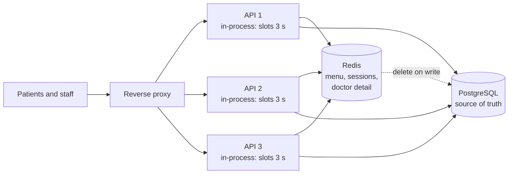

:::mental-model
**A cache decision is a sentence with four parts: what you copy, where the copy lives, how long it may be wrong, and what may never trust it. Write all four, or you have not decided anything.**
:::

## The brief

Dr. Rao’s clinic now runs three API servers, one PostgreSQL database and one Redis instance. The Monday rush peaks at 400 requests per second. The database is at 23% CPU with the menu cached and 72% without it.

The clinic has asked you to answer one question in writing:

> What may we cache, and what must we never cache?

You have the full system from Modules 1 and 2, plus the caching toolkit from this module. The deliverable is a decision document that another engineer could implement without asking you a question.

## The constraints

- **Correctness first.** A double booking or a wrong charge is worse than a slow page.
- **One Redis instance**, 256 MB, no cluster. It can be restarted by a deploy.
- **One part-time developer.** Every moving part you add must be operable by one person.
- **No new vendors.** The budget is $50 a month, and the database is already the largest line item.
- **The clinic closes at 8 p.m.** A batch job may run overnight, but patient-facing reads must recover without one.

## The reads to classify

Start from the traffic, not from the technology. These are the clinic’s current reads:

| # | Read | Shape | Notes |
|---|---|---|---|
| 1 | `GET /menu` | Public page, 14 KB JSON | Three doctors, fees, hours, services |
| 2 | `GET /doctors/{id}` | One doctor, small JSON | Includes bio and photo URL |
| 3 | `GET /doctors/{id}/slots?date=` | 18 rows per doctor per day | Changes on every booking |
| 4 | `GET /appointments/{id}` | One appointment | Owner or staff only |
| 5 | `GET /patients/{id}/appointments` | Up to 50 rows | The patient’s own history |
| 6 | `GET /search?q=` | Full-text search | Long tail of one-off queries |
| 7 | `GET /reports/revenue?month=` | Aggregate over 500k rows | Staff only, run on demand |
| 8 | Session lookup | One row per authenticated request | Must be fast and current |
| 9 | `POST /appointments` | Write, checks a slot | Must never double-book |
| 10 | `GET /payments/{id}/status` | One payment | Money; must be current |

## Deliverable 1: the read inventory

For each of the ten reads, record:

- **Read rate:** requests per second at peak, estimated from the 400 rps mix.
- **Change rate:** how often the underlying rows change.
- **Size:** bytes per cached value.
- **Staleness tolerance:** in seconds, in product terms.
- **Who is harmed by a stale copy:** nobody, the reader, or a third party.

The last column is the one people skip. A stale menu harms nobody. A stale slot harms the patient who arrives for an appointment someone else already booked. A stale permission harms the clinic.

## Deliverable 2: the cache decision table

For each read you decide to cache, write:

| Field | What to write |
|---|---|
| Key | A stable name, e.g. `clinic:rao:menu:v3` |
| Placement | In-process, Redis, CDN, or none |
| Value | What exactly is stored, including the shape |
| TTL | Seconds, with a one-line justification |
| Invalidation | The writes that delete it, and where they live |
| Staleness budget | The worst case a user could see |
| Action safety | May this value authorise a write? Yes or no |

Two answers are already known and must appear in your table:

- **The menu is cacheable.** It is read constantly, changes weekly, and nobody acts on it directly.
- **The free-slot list is not a shared cache.** You may keep a 2–5 second in-process copy for display, but the booking transaction must re-check the slot. A stale slot is a double booking.

The other eight are yours to defend.

## Deliverable 3: one key, designed in detail

Pick the menu key and write the full lifecycle:

1. **Read path:** the cache lookup, the miss path, the database query, the value written back.
2. **Write path:** the admin edit, the commit, the delete, and what happens if the delete fails.
3. **Concurrency:** what happens when two readers miss at once, and whether you need single-flight.
4. **Expiry:** the TTL, the jitter, and why that number.
5. **Versioning:** how a deploy that changes the JSON shape avoids serving old values to new code.

A useful test: hand the section to another engineer and ask them to implement it without reading the rest of your document. If they have to guess, it is not finished.

## Deliverable 4: the failure plan

Write one paragraph and one mitigation for each:

- **Stampede:** the menu key expires at 300 rps. What stops 240 identical queries?
- **Hot key:** the menu key is read by every request. Does it saturate one Redis core?
- **Penetration:** someone requests `/doctors/999999` in a loop. What protects the database?
- **Avalanche:** a deploy writes 10,000 keys with the same TTL. How do you spread expiry?
- **Cold start:** Redis restarts at 9:05 on Monday. What does the system do for the next 60 seconds?
- **Redis down:** the cache is unavailable, not empty. Does the site serve from the database, degrade, or fail?

The cold-start and Redis-down answers must be different. An empty cache is a performance event; a missing cache is an availability event.

## Deliverable 5: the proof plan

You do not get to claim a win without a measurement. Write the load-test plan:

1. **Baseline:** the menu with no cache, ramping to 400 rps.
2. **Warm:** the same ramp with the cache, recording hit rate and database CPU.
3. **Flush:** the same run with `FLUSHDB` at the start of the hold, and single-flight toggled on and off.
4. **Metrics:** p50, p95, p99, errors, database CPU, cache CPU, hit rate, eviction rate.
5. **Pass condition:** a number you would accept, stated before the test.

A reasonable pass condition is: at 400 rps, p99 under 50 ms, errors under 0.1%, and recovery from a flush under 5 seconds.

## A suggested topology

The menu lives in Redis because all three servers need the same copy. The slot list lives in each process for a few seconds because it is a display hint and the write re-checks. Sessions live in Redis because the next request may hit a different server. The database remains the only place a booking is decided.

:::warning
Do not put the free-slot list in Redis with a 60-second TTL and call it “cache-aside.” It will pass every test you run alone and fail the first Monday when two patients pick the same 10:00 slot. The cache may suggest; the transaction decides.
:::

:::widget lab-checklist
:::

## Rubric

| Criterion | Weak (1) | Adequate (2) | Strong (3) |
|---|---|---|---|
| Read inventory | Fewer than eight reads, no rates | Ten reads with rates and sizes | Ten reads with harm analysis and a clear “never cache” list |
| Placement | Everything in Redis | Placement matches sharing needs | Placement justified by who needs the same copy, with cost stated |
| Invalidation | TTL only, no write path | TTL plus deletes for main keys | Deletes, namespace or versioning, and a stated staleness budget |
| Action safety | Cached slots trusted for booking | Slots re-checked, but no rule for other writes | Every read marked display-only or action-safe, with a transaction at the write |
| Failure plan | Names stampede only | Covers four of the six failures | Covers all six with a mitigation and an owner for each |
| Proof | “It feels faster” | Before/after latency | Three-phase test with a pass condition and a flush recovery number |

A strong lab scores at least 14 of 18 and has no criterion at 1. The action-safety row is a hard gate: if a cached value authorises a booking, the lab fails regardless of the total.

## Check yourself

:::quiz
[
  {
    "question": "Which clinic read is the safest first candidate for a shared Redis cache?",
    "options": [
      "The public menu of doctors, fees and hours",
      "The free slot list for today",
      "A payment authorisation status",
      "The availability check inside the booking transaction"
    ],
    "answer": 0,
    "explanation": "The menu is read constantly, changes weekly and is never used to authorise a write. Slots change on every booking and are acted on; payment status must be current; the availability check must read the database."
  },
  {
    "question": "Meera’s slot picker shows 10:00 as free, but another patient books it before she submits. What must her booking request do?",
    "options": [
      "Trust the cached slot list and create the appointment",
      "Re-check the slot in the database and enforce a unique constraint inside the transaction",
      "Delete the slot cache and return success",
      "Shorten the slot TTL to one second and retry the write"
    ],
    "answer": 1,
    "explanation": "The cached list is a display hint. Only a database check plus a constraint can prevent two patients from booking the same slot. A shorter TTL narrows the window but does not close it."
  },
  {
    "question": "Redis restarts empty at 9:05 on Monday. What is the correct response?",
    "options": [
      "Return 503 until the cache is warm",
      "Fall back to the database with coalescing and a circuit breaker, then warm the cache gradually",
      "Disable invalidation so the cache refills faster",
      "Increase the TTL to one day before the restart"
    ],
    "answer": 1,
    "explanation": "An empty cache is a performance event, not an availability event. The system should keep serving from the database while protecting it with coalescing, a circuit breaker and gradual warm-up. Returning 503 turns a slow minute into an outage."
  },
  {
    "question": "Why is negative caching for `/doctors/999999` an acceptable defence against penetration?",
    "options": [
      "A not-found value can never be wrong",
      "It stores the absence briefly, and no action is authorised by knowing a doctor does not exist",
      "It permanently hides any doctor created later",
      "It removes the need for input validation"
    ],
    "answer": 1,
    "explanation": "Negative caching stores “not found” for a short TTL, so repeated lookups do not reach the database. A newly created row becomes visible when the TTL expires. It complements validation rather than replacing it."
  }
]
:::

## Discussion

:::discussion

- Which read would you cache first if you could only cache one, and which would you remove from the cache if memory ran out?
- Is a 60-second TTL on the doctor detail page a product decision or an engineering one? Who should sign it off?
- If Redis is down for ten minutes, should the clinic show a degraded menu, a maintenance page, or read everything from the database? What does each choice cost?
- The lab says “never cache the free slots.” Is there a version of the slot list that is safe to cache? What would have to be true?
:::

## Key takeaways

- Cache by access pattern: read frequency, change rate, size, and staleness tolerance.
- The menu is the easy yes; the free-slot list is the important no.
- Every cached value needs a key, a placement, a TTL, an invalidation path and a staleness budget.
- Action safety is a hard line: cached data may suggest, never decide a booking, payment or permission.
- A failure plan covers stampede, hot key, penetration, avalanche, cold start and cache-down.
- A cache claim needs a three-phase load test, including the flush.
- The best cache design is the smallest one that keeps the database out of the hot read path without ever being trusted for a write.

## Free references

- [AWS: caching strategies](https://aws.amazon.com/caching/best-practices/) — patterns, TTLs and anti-patterns to check your table against.
- [Redis: eviction and memory](https://redis.io/docs/latest/develop/reference/eviction/) — sizing and policy choices for the 256 MB instance.
- [PostgreSQL: transaction isolation](https://www.postgresql.org/docs/current/transaction-iso.html) — why the booking check belongs in the database.
- [Google SRE Book: handling overload](https://sre.google/sre-book/handling-overload/) — what to do when the cache is gone and the database is the only path.
