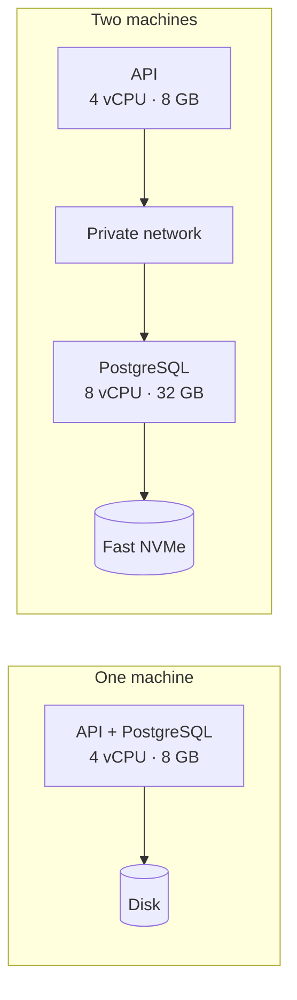

:::mental-model
**Vertical scaling gives one machine more resources. It is the cheapest way to move a limit, and the most expensive way to pretend the limit does not exist.**
:::

## Four seconds on a Monday

At 8:52 on Monday, Arjun opens the reception screen at the clinic’s newest location. The screen shows today’s appointments. It takes four seconds to paint, then another two seconds when he clicks a patient.

He refreshes. Six locations, six reception desks, all doing this at once. The clinic’s monitoring says the booking API is answering in 780 ms at p99. The target was 400 ms.

Dr. Rao looks at the graph and says what most owners say: “Can we just buy a bigger server?”

The honest answer is yes, and it will work for a while. The useful answer is to know exactly what “bigger” buys, what it does not, and when to stop paying for it.

## What vertical scaling is

**Vertical scaling**, or scaling up, means giving one machine more of a resource:

- more vCPUs, for more concurrent work,
- more RAM, for a larger page cache and more in-process state,
- faster local disks, for lower read and write latency,
- a bigger network pipe, for more bytes per second.

The application code does not change. The architecture does not change. You stop the machine, choose a larger instance type, start it again, and the same process now has more room.

That is why it is the first lever. It costs one decision and one maintenance window, not a redesign. When a single resource is saturated and the traffic growth is modest, scaling up is often the correct engineering choice. Teams that skip it and jump straight to a distributed system sometimes add three new failure modes to avoid one resize.

:::note
“Vertical” here means one machine, not one process. A four-core machine can still run one single-threaded application that uses a quarter of it. Adding cores only helps if the work can use them.
:::

## Separate the database before you enlarge anything

In Module 2, the API and PostgreSQL shared a 2 vCPU box. That was the right choice for a first system: one machine to deploy, one bill, no network between the app and its data.

It is the wrong shape once both are busy. The API and the database compete for the same CPU, the same page cache and the same disk. A slow analytical query can starve the booking endpoint. A traffic spike in the API evicts database pages from memory. You cannot tell which component needs more resources because they share one budget.

So the first move in this module is not a bigger box. It is **two boxes**:

Now each component has its own ceiling, its own bill and its own metrics. You can resize the API without touching the database, and you can give the database memory without paying for idle API cores. This is still vertical scaling, applied twice.

The split also adds a network hop, usually under a millisecond inside one region. That is a good trade for independent capacity. It becomes a worse trade if the two machines are in different data centres, so keep them close.

## The arithmetic of a bigger machine

Here is a reference run for the clinic’s API, with the database on its own host. Throughput is the request rate at which p99 crosses 400 ms.

| Instance | vCPU | RAM | Monthly cost | Sustainable rps | Cost per 100 rps |
|---|---:|---:|---:|---:|---:|
| Small | 2 | 4 GB | $12 | 330 | $3.64 |
| Medium | 4 | 8 GB | $24 | 600 | $4.00 |
| Large | 8 | 16 GB | $48 | 1,050 | $4.57 |
| XL | 16 | 32 GB | $96 | 1,700 | $5.65 |
| 2XL | 32 | 64 GB | $192 | 2,400 | $8.00 |

Two things happen at once. Capacity rises, but it rises more slowly than the core count. And cost rises faster than capacity.

Doubling from 2 to 4 vCPU gives about 1.8× the throughput. Doubling from 16 to 32 gives about 1.4×. The reasons are structural:

- **Serial sections.** Some work cannot be split across cores: a single request’s parsing, a lock around a shared structure, a transaction waiting on one row.
- **Contention.** More workers competing for the same mutex, the same connection pool and the same memory bus spend more time waiting.
- **Garbage collection and memory bandwidth.** A bigger heap takes longer to scan, and all cores share one path to RAM.
- **The database is still one primary.** More API cores do not make PostgreSQL commit faster. Writes still go through one WAL, one set of locks, one disk.

:::warning
A bigger box can hide a bad query for a long time. An `O(n)` scan that takes 40 ms on 500,000 rows takes 400 ms on 5 million, and a machine four times larger makes it look fine again. You are buying time, not fixing the shape of the work.
:::

## What the clinic actually buys

The clinic’s current shape is an API at 4 vCPU ($24/month) and a database at 8 vCPU ($64/month), $88 in total.

At 900 requests per second, the API sits at 78% CPU and the database at 88%. p99 is 780 ms.

Try three upgrades:

| Change | New cost | p99 at 900 rps | API CPU | DB CPU |
|---|---:|---:|---:|---:|
| None | $88 | 780 ms | 78% | 88% |
| API to 8 vCPU | $112 | 230 ms | 39% | 88% |
| DB to 16 vCPU | $152 | 310 ms | 78% | 46% |
| Both | $176 | 150 ms | 39% | 46% |

The API upgrade looks like the winner per dollar: $24 more removes most of the latency. But look at the database column. It stays at 88%. The API was queueing behind a database that was already close to its limit. The faster API just waits more efficiently.

The database upgrade gives more headroom, but it costs $64 more and still leaves the API at 78%. One bad Monday — a marketing email, a doctor’s schedule change, a batch of reminders — pushes it back over.

Doing both buys the most comfortable result, $176 per month, twice the original bill for about 1.5× the traffic. That is a fair price for six months, and a poor price for three years.

## The ceiling

Vertical scaling always ends at a ceiling, and the ceiling has several parts.

**The largest instance.** Cloud providers offer very large machines, but not unlimited ones. At some point the next size does not exist, or it exists in a region you do not use.

**The reboot.** Resizing usually requires stopping the instance. Some providers offer live migration for a subset of changes, but you cannot plan on it. A ten-minute reboot at 9 a.m. is an outage, so the resize happens at midnight — which means you are always managing yesterday’s peak.

**The failure domain.** A bigger machine is still one machine. One host failure, one disk failure, one bad kernel update, and the clinic is offline. Vertical scaling improves capacity and does nothing for availability. If the requirement is “the booking page stays up when a server dies,” a bigger server cannot satisfy it.

**The price curve.** The table above shows cost per 100 rps climbing after 8 vCPU. At the top end you are paying a premium for density, not efficiency. Two medium machines usually cost less than one enormous one with the same total cores, and they survive a single failure.

**The coupling.** When every component lives on one box, one noisy neighbour is everyone’s problem. Separating the database helps, but the API is still a single process with a single heap.

## When not to scale up

Do not reach for a bigger machine when:

- **You need redundancy.** Two medium servers beat one large server for availability, even if the large one is faster.
- **The bottleneck is shared.** If the database primary is the limit, a bigger API changes nothing.
- **The work is wasteful.** Fix the N+1 query, add the missing index, cache the repeated read. A code fix removes work; a bigger box only tolerates it.
- **Growth is faster than the hardware tiers.** If traffic doubles every quarter, you will run out of instance sizes before you run out of demand.
- **Cost per request is already rising.** That is the signal to change shape, not size.

:::reality-check
The most expensive sentence in capacity planning is “it’s fine, we’ll just resize.” It is true until the resize is the outage, the instance is the largest available, or the bill arrives before the traffic does.
:::

:::widget scale-vertical
:::

:::widget scale-vertical
:::

## The decision, written down

A resize should be a decision with a number attached, not a reflex.

> At 900 requests per second, p99 is 780 ms against a 400 ms target. The API is at 78% CPU and the database at 88%. Doubling the API removes 550 ms of latency for $24 per month, but leaves the database as the binding constraint. Doubling the database instead costs $64 and leaves less API headroom. Both cost $176 and hold until roughly 1,400 requests per second. We will do both for this quarter, and start the horizontal-scaling work before the next growth spurt.

That paragraph contains the current state, the target, the options, the cost and the trigger for the next decision. It is the minimum a resize deserves.

## Check yourself

:::quiz
[
  {
    "question": "What does vertical scaling change?",
    "options": [
      "The number of machines serving traffic",
      "The resources of one machine",
      "The database schema",
      "The number of availability zones"
    ],
    "answer": 1,
    "explanation": "Vertical scaling, or scaling up, gives one machine more CPU, memory, disk or network. Adding machines is horizontal scaling, and a schema or zone change is a different kind of decision."
  },
  {
    "question": "Why does doubling the vCPU count usually give less than double the throughput?",
    "options": [
      "Cloud providers secretly throttle larger machines",
      "Serial sections, lock contention and shared memory bandwidth consume part of the gain",
      "Larger machines have slower clocks",
      "The database automatically reduces its capacity"
    ],
    "answer": 1,
    "explanation": "Some work cannot be parallelised, and more workers contend for the same locks and memory bus. The result is sublinear scaling, which is why cost per request rises at the top end."
  },
  {
    "question": "At 900 rps the API is at 78% CPU and the database at 88%. You double the API’s cores. What should you expect?",
    "options": [
      "p99 falls to near zero and the database load falls too",
      "p99 improves somewhat, but the database remains the binding constraint",
      "Throughput doubles permanently",
      "The database CPU rises to 100% immediately"
    ],
    "answer": 1,
    "explanation": "A faster API reduces its own queueing, but every request still needs the database. With the database at 88%, the next spike returns the latency. Capacity only improves when the binding constraint moves."
  },
  {
    "question": "When is a bigger machine the wrong first move?",
    "options": [
      "When one resource is saturated and traffic is growing slowly",
      "When you need the service to survive the failure of a single server",
      "When a resize costs less than a redesign",
      "When the application is single-threaded"
    ],
    "answer": 1,
    "explanation": "A bigger machine is still one machine. It cannot provide redundancy. The other options are cases where scaling up may be exactly right, provided the application can use the resources."
  }
]
:::

## Exercise: write a resize memo

Pick a service you run or use. Write a one-page memo with:

1. the current instance size, monthly cost, and the resource at its limit;
2. the next two larger sizes, their cost, and your estimate of their capacity;
3. the measured or expected p99 before and after;
4. the downtime required to resize, and who is affected;
5. the traffic level at which you would stop scaling up and change architecture;
6. one code or query fix that would remove work instead of adding capacity.

End with a single sentence that states the decision and the trigger for revisiting it.

:::discussion
- Would you rather run two medium servers at 55% CPU each, or one large server at 35%? What does the answer depend on?
- How would you measure the benefit of separating the database from the API, if you could only change one thing?
- Is a resize during business hours ever acceptable? What would make it acceptable?
:::

## Key takeaways

- Vertical scaling adds resources to one machine; it is the cheapest first fix when one resource is saturated.
- Separate the API and the database first so each has an independent ceiling and bill.
- Throughput scales sublinearly with cores, while cost scales faster at the top end.
- Fix the binding constraint, not the component that is easiest to resize.
- A bigger machine does not provide redundancy; it is still one failure domain.
- Write the resize down as a decision with a target, a cost and a trigger.

## Free references

- [AWS: EC2 instance types](https://aws.amazon.com/ec2/instance-types/) — the real menu of sizes, cores and memory, including the price curve at the top end.
- [Google Cloud: Machine families](https://cloud.google.com/compute/docs/machine-resource) — how providers define general-purpose, compute-optimised and memory-optimised shapes.
- [Google SRE Book: Handling overload](https://sre.google/sre-book/handling-overload/) — what happens when demand exceeds a single machine’s capacity, and why more capacity is not always the answer.
- [The Tail at Scale](https://research.google/pubs/pub40801/) — why tail latency behaves differently from average latency as systems grow.
