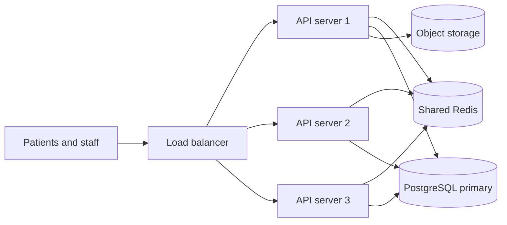

:::mental-model
**Horizontal scaling replaces one large machine with several identical ones. It removes the hardware ceiling and adds a coordination problem: every request may now land anywhere.**
:::

## The campaign that changed the question

The resize bought four months. Then the clinic ran a flu-season campaign with two local pharmacies, and the projection jumped from 900 to 1,800 requests per second.

The next vertical size exists. It costs $384 per month, needs a reboot, and is still one machine.

At the Monday planning meeting, Arjun asks the question that matters more than the bill: “What happens if that machine dies during the campaign?”

Nobody has an answer. The clinic has a bigger server, not a more reliable one.

That is the moment horizontal scaling stops being an abstract topic. The goal is no longer only capacity. It is capacity that survives the loss of a component.

## What horizontal scaling is

**Horizontal scaling**, or scaling out, means running several identical servers behind a load balancer. Each server can handle any request. The balancer chooses one.



The appeal is structural:

- **No hardware ceiling.** When one server is not enough, add another. The unit of growth is smaller than the next instance size.
- **Redundancy.** If one server dies, the others keep serving. The balancer removes the dead one.
- **Incremental cost.** You can add capacity in small steps instead of jumping to a machine that is twice as large and mostly idle.
- **Rolling deploys.** Take one server out, upgrade it, put it back. Repeat. Users see no downtime if the balancer drains connections properly.

The cost is also structural: the system now has more moving parts, more network hops, and a new class of bug where two servers disagree.

## The server-two test

Before adding the second server, run this test: stop server one, start server two, and use the product. Anything that breaks is state that lived on server one.

The usual failures:

| What lived on server one | What happens on server two | Where it must go |
|---|---|---|
| Session in a local map | User is logged out | Shared session store (4.4) |
| Uploaded photo on local disk | Image returns 404 | Object storage (4.6) |
| In-process cache | Different answer per server | Shared cache (Module 3) |
| Rate-limit counter | Twice the allowed requests | Shared counter in Redis |
| Cron job | Two reminders sent | Queue with a lock or idempotency key |
| WebSocket connection | Messages go to the wrong server | Sticky routing or a pub/sub backplane |

This is why “we added a load balancer” is not the same as “we can scale.” The balancer only distributes requests. It does not move the state that makes the requests meaningful.

:::warning
A second server does not double your capacity if the application assumes it is the only server. It doubles the number of places where the same assumption can fail.
:::

## The arithmetic: what actually doubles

Here is a reference run for the clinic’s API, with each server at 4 vCPU and the database on its own 8 vCPU host. The traffic mix is 80% reads and 20% writes.

| API servers | API capacity | Efficiency | System capacity | Database at 900 rps |
|---:|---:|---:|---:|---:|
| 1 | 480 rps | 100% | 480 rps | 82% |
| 2 | 930 rps | 97% | 930 rps | 82% |
| 3 | 1,350 rps | 94% | 1,100 rps | 82% |
| 4 | 1,720 rps | 90% | 1,100 rps | 82% |
| 6 | 2,340 rps | 81% | 1,100 rps | 82% |

The API capacity rises almost linearly. The **system** capacity stops at about 1,100 requests per second, because the database is now the binding constraint. Adding a third, fourth or sixth server does not give the database more capacity. It gives it more clients.

That last column is the trap. At 900 requests per second, the database is at 82% whether there is one API server or six. The API is no longer the problem. If you add servers to fix a database bottleneck, you spend money and add connection pressure without moving the limit.

Efficiency also falls as servers are added. The balancer, shared Redis, logging pipeline, TLS handshakes and database contention all take a small cut. At six servers, about one fifth of the raw capacity is lost to coordination. That is normal. A model that assumes perfect linear scaling is a model that will disappoint you.

## The shared bottleneck

Horizontal scaling works best when the servers are doing independent work. It works worst when every request funnels into one shared resource.

The clinic has three shared resources:

- **PostgreSQL primary.** Every write goes through one WAL and one set of locks. Read replicas can help reads, but they introduce replication lag and cannot accept writes.
- **Redis.** A single cache server has its own CPU, memory and network limit. Module 3 covered hot keys; the same limit applies here.
- **The load balancer and network.** Usually not the first limit, but a single balancer is a single pipe.

Little’s Law explains why the database feels the pressure first:

```text
concurrency = throughput × latency
```

At 900 requests per second and 5 ms of database time per request, about 4.5 database operations are in flight on average. If a lock or a slow query pushes the average to 50 ms, 45 operations are in flight. The database’s connection pool and worker slots fill up, and the API servers queue behind them. More API servers just add more waiters.

:::note
The bottleneck is the resource with the least headroom, not the resource with the most traffic. Measure each component’s utilisation before deciding what to add.
:::

## Redundancy changes the sizing rule

Without redundancy, you size for the peak: 900 requests per second needs about two servers at 480 each, with a little headroom. Three servers give comfortable margin.

With redundancy, you size for the peak **after the largest failure**: N+1. If one server can disappear at any moment, the remaining servers must carry the full load.

At 900 requests per second with 4 vCPU servers:

- **3 servers:** 300 rps each at normal load (62% of capacity). One dies, the other two carry 450 each (94%). p99 crosses 400 ms. The service is up, but the SLO is not met.
- **4 servers:** 225 rps each (47%). One dies, three carry 300 each (62%). p99 stays under 300 ms.

So redundancy at this traffic level costs four servers, not three. That is the price of the guarantee, and it should be written down before the incident, not discovered during it.

Failure domains matter as much as server count. Four servers in one rack share a power supply and a switch. Four servers in one availability zone share a data-centre failure. Real redundancy means spreading across racks or zones, and that decision belongs in the design, not in the autoscaler.

## What it costs in operations

The bill per unit of CPU is roughly the same as vertical scaling. The operational surface is not.

With one server you have one log stream, one configuration file, one deployment target and one clock. With four you have:

- **Four copies of configuration** that can drift. A missing environment variable on server three is a bug that appears one request in four.
- **Four log streams** that need correlation IDs to follow a single request.
- **Four clocks** that can disagree by milliseconds, which matters for token expiry and event ordering.
- **Four deploy targets**, which is why rolling deploys need health checks and connection draining.
- **Four sets of metrics** that must be aggregated correctly. Averaging p99s across servers is wrong; you need the underlying distribution.

Kubernetes, Nomad and cloud autoscaling groups exist to manage this surface. They are useful, and they are also another distributed system with its own failure modes. A team of two running four virtual machines behind a managed load balancer may be better served by a deploy script and a checklist than by a control plane.

:::widget scale-horizontal
:::

## What breaks

The classic failure is “it works on server one.” A feature is tested against a single instance, then deployed behind a balancer, and the state that made it work is now on the wrong machine.

The second failure is **autoscaling thrash**. CPU crosses a threshold, the group adds three servers, they all connect to a database that is already at 90%, latency rises, the group adds three more. The autoscaler is responding to a symptom while the cause is downstream.

The third is **duplicate background work**. Every server starts the reminder cron. At 8 a.m., six servers send six reminders to every patient. The fix is a queue with one consumer group, a leader election, or an idempotency key that makes the sixth send a no-op.

The fourth is **uneven distribution**. Long-lived HTTP/2 or WebSocket connections pin to one server. Round robin counts connections, not work, so one server does most of the labour while the others idle. The fix is a balancer that understands load, or a protocol that does not hold connections open for hours.

:::reality-check
Adding servers is easy. Making them interchangeable is the work. Budget for the work, not just the instances.
:::

:::widget scale-horizontal
:::

## Check yourself

:::quiz
[
  {
    "question": "What is the defining requirement for horizontal scaling to work?",
    "options": [
      "Every server must have the same IP address",
      "Any server must be able to handle any request",
      "The database must be on the same machine as the API",
      "Each user must always reach the same server"
    ],
    "answer": 1,
    "explanation": "Interchangeable servers are the point. If a request only works on one server because of local state, the balancer cannot distribute load or survive a failure."
  },
  {
    "question": "Two API servers each handle 480 rps. Why might the system still cap at 1,100 rps?",
    "options": [
      "The load balancer refuses more than 1,100",
      "A shared resource such as the database primary is the real bottleneck",
      "TCP ports run out",
      "Two servers can never exceed 1,100 rps"
    ],
    "answer": 1,
    "explanation": "API capacity adds up, but system capacity is limited by the least-scalable shared resource. If the database saturates at 1,100, more API servers add clients rather than capacity."
  },
  {
    "question": "At 900 rps, three servers run at 62% each. One dies and the other two reach 94%, pushing p99 over the SLO. What does this show?",
    "options": [
      "Three servers are enough because the service stays up",
      "Redundancy must be sized for the load after the largest failure, not the normal load",
      "The dead server should have been larger",
      "The load balancer should be removed"
    ],
    "answer": 1,
    "explanation": "N+1 sizing means the surviving fleet must carry the full peak. At 94% per server the service is available but the latency target is missed, so four servers are needed at this traffic level."
  },
  {
    "question": "A reminder cron runs on every API server. What is the likely result after scaling from one server to four?",
    "options": [
      "Reminders are sent faster and only once",
      "Each patient may receive up to four duplicate reminders",
      "The cron job stops running",
      "The database deduplicates the messages automatically"
    ],
    "answer": 1,
    "explanation": "Local scheduling is state. Every server believes it owns the job. Use a queue with one consumer group, leader election, or an idempotency key to make duplicates harmless."
  }
]
:::

## Exercise: run the server-two test

Take an application you have built or deployed. Write a table with three columns:

1. every piece of state the request path touches (session, file, cache, counter, scheduled job);
2. what happens if the next request lands on a different server;
3. where that state should live instead.

Then pick the three items that would break first, and write the smallest change that would make each one safe. If you cannot test with a second server, simulate it by clearing process memory between two requests.

:::discussion
- Is four small servers at 47% each better than one large server at 35%? What does the answer depend on?
- How would you decide between read replicas and a cache for the clinic’s read traffic?
- Should autoscaling react to CPU, request rate, or queue depth? What does each signal miss?
:::

## Key takeaways

- Horizontal scaling runs identical servers behind a load balancer; it removes the hardware ceiling and adds coordination.
- Servers must be interchangeable, which means sessions, uploads, caches and jobs cannot live in one process.
- API capacity scales nearly linearly; system capacity stops at the least-scalable shared resource.
- Size for the peak after the largest failure (N+1), not for the normal peak.
- Failure domains matter: four servers in one rack are not four independent failures.
- Adding servers adds operational surface: configuration drift, log correlation, clock skew, duplicate work.

## Free references

- [The Twelve-Factor App: Processes](https://12factor.net/processes) — the canonical argument for stateless, share-nothing processes.
- [Google SRE Book: Load balancing at the frontend](https://sre.google/sre-book/load-balancing-frontend/) — how real systems distribute traffic across a fleet.
- [NGINX: Load balancing](https://docs.nginx.com/nginx/admin-guide/load-balancer/http-load-balancer/) — algorithms, health checks and connection handling in a concrete proxy.
- [AWS Well-Architected: Reliability pillar](https://docs.aws.amazon.com/wellarchitected/latest/reliability-pillar/welcome.html) — failure domains, redundancy and recovery, with checklists.
