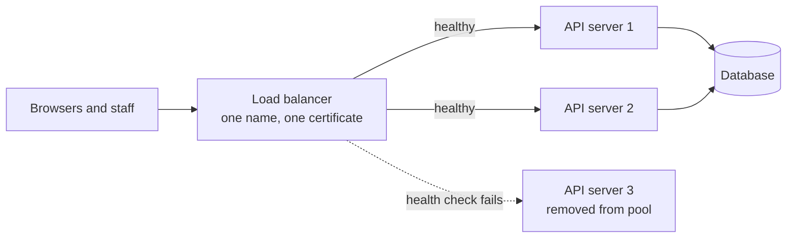

:::mental-model
**A load balancer turns a pool of servers into one address. It chooses where each request goes, and it decides which servers are allowed to receive traffic at all.**
:::

## The login that landed twice

At 9:03 on Monday, three API servers are live behind the clinic’s load balancer.

Arjun signs in at the reception desk. The balancer sends his login to server two, which creates a session and returns a cookie. He clicks “Today’s appointments.” The balancer sends that request to server one. Server one has never heard of his session, so it returns `401` and the screen jumps back to the login page.

On the other side of the clinic, a receptionist sees a `502 Bad Gateway` on every fifth refresh. One backend is failing its health check, but the balancer has not removed it yet.

Both symptoms point at the same component. The load balancer is doing its job — distributing requests — and that is exactly why the application’s assumptions are now visible.

## What a load balancer is

A **load balancer** is a reverse proxy in front of a pool of servers. Clients connect to one address; the balancer opens a connection to one backend and relays the request and response.

It does four jobs:

1. **Distribution.** Choose a backend for each request or connection.
2. **Health.** Stop sending traffic to a backend that is failing.
3. **Abstraction.** Give the fleet one stable name, certificate and IP.
4. **Policy.** Terminate TLS, enforce timeouts, retry safely, and sometimes route by path or header.

There are two broad kinds:

| Layer | Sees | Can do | Typical tools |
|---|---|---|---|
| **L4** (transport) | IP, port, TCP/UDP | Fast forwarding, connection-level balancing | Linux IPVS, cloud NLB, HAProxy in TCP mode |
| **L7** (application) | HTTP method, path, headers, cookies | Path routing, TLS termination, retries, sticky sessions | NGINX, HAProxy, Envoy, cloud ALB |

L4 is simpler and faster. L7 understands the request, which is what you need for path-based routing and useful health checks. Most web systems use L7 at the edge and may use L4 underneath.

## How it chooses

The algorithm is a policy about what “even” means. No algorithm is best for every workload.

| Algorithm | What it equalises | Works when | Fails when |
|---|---|---|---|
| **Round robin** | Request count | Requests cost about the same | A few requests are much slower or heavier |
| **Weighted round robin** | Request count × weight | Servers have different sizes | Weights drift from reality |
| **Least connections** | In-flight requests | Request durations vary a lot | Connections are long-lived and idle |
| **Least response time** | Latency plus in-flight | Backends have different speeds | Measurements are noisy or stale |
| **IP hash** | Client-to-server mapping | You need session affinity without cookies | Many users share one NAT address |
| **Consistent hashing** | Key-to-server mapping | Cache locality matters | The key distribution is skewed |

**Round robin** is the default because it is predictable and stateless. It works well when every request costs roughly the same. It fails when one endpoint takes 2 seconds and another takes 20 ms: each server gets the same count, but not the same work.

**Least connections** looks at how many requests each backend is currently handling and picks the least busy. It adapts to slow requests, but it can be fooled by long-lived connections that are open and idle — an HTTP/2 or WebSocket connection counts as “busy” while doing nothing.

**IP hash** maps a client address to a server. It gives affinity without a cookie, which is useful for legacy applications. It breaks when thousands of users sit behind one corporate NAT and all hash to the same backend.

**Consistent hashing** is the version used by caches and sharded systems. It maps a key to a ring of servers so that adding or removing one server moves only a small fraction of keys. Module 19 covers the ring itself; here the point is that “balance requests” and “keep the same key on the same server” are different goals.

:::note
The balancer can only balance what it can see. If it balances connections but the work happens per request, a single long-lived connection can carry an hour of traffic to one server.
:::

## Health checks: the part that decides availability

A load balancer without health checks is a traffic distributor with no opinion. A load balancer with bad health checks is worse: it confidently sends traffic to a server that cannot serve.

**Passive checks** watch real traffic. Five consecutive `502`s and the backend is marked down. They need no extra endpoint, but they only learn after users have already failed.

**Active checks** probe the backend on a schedule, usually `GET /healthz` every 5–10 seconds. The quality of the check is the quality of the endpoint:

- `return 200` from the process tells you the process is alive. It does not tell you it can reach the database.
- A check that runs `SELECT 1` catches a lost database connection, but every probe now costs a query.
- A check that calls a downstream payment provider can take the whole fleet down when that provider is slow.

The usual compromise is a shallow liveness check for the process and a slightly deeper readiness check that verifies the dependencies needed to serve traffic. Keep the deep check cheap and cache its result for a few seconds.

Two tuning details matter in production:

- **Thresholds.** One failed probe should not remove a server; a transient blip would flap the pool. Three failures at 5-second intervals removes a dead server in about 15 seconds. Too slow, and users see errors; too fast, and a brief GC pause removes a healthy server.
- **Draining.** When a server is removed — by a deploy, a scale-in, or a failed check — the balancer should stop sending new requests but let in-flight ones finish. A 30-second drain during a rolling deploy turns a burst of `502`s into a clean handover.

## The balancer cannot be a single point of failure

The balancer is now on the critical path of every request. If it dies, the fleet behind it is unreachable, no matter how many servers you added.

The common patterns:

- **Active–passive pair.** Two balancers share a floating IP. The passive one takes over when the active one stops answering. Failover takes seconds; the pair must not share a power supply or a rack.
- **DNS with multiple addresses.** Clients choose among several balancer IPs. Simple, but DNS caching and client behaviour make failover uneven.
- **Anycast.** The same IP is announced from many locations; the network routes each user to the nearest healthy one. This is how large CDNs and DNS providers do it.
- **A managed load balancer.** The provider runs the pair, the scaling and the failover. You still depend on the provider, but you no longer operate the failover.

Whichever you choose, ask the same question you asked about the API servers: what happens when this component disappears? If the answer is “everything is down,” it is a single point of failure, even if it is managed.

## A worked example: three servers, one slow

The clinic runs three API servers behind a least-connections balancer. At 900 requests per second, each should carry about 300.

Server three develops a noisy-neighbour problem: its disk is shared with a backup job, and each request takes twice as long. Watch what each policy does.

| Policy | Load on server 1 | Server 2 | Server 3 (slow) | p99 |
|---|---:|---:|---:|---:|
| Round robin | 300 rps | 300 rps | 300 rps | 900 ms |
| Least connections | 330 rps | 330 rps | 240 rps | 280 ms |
| Least connections + health check | 450 rps | 450 rps | 0 rps | 220 ms |

Round robin gives every server the same count, so the slow server accumulates a queue. The p99 is set by that queue, not by the healthy servers.

Least connections notices that server three has more in-flight requests and gives it fewer new ones. Latency improves, but the slow server still handles 240 requests per second and still contributes to the tail.

The health check is the decisive fix: server three fails its readiness probe and leaves the pool. The remaining two servers take 450 each. The p99 is now set by healthy capacity. The clinic has fewer servers, but a better answer.

The order matters. Health checks remove a **broken** server. Load balancing spreads work across **healthy** servers of different speeds. Neither replaces the other.

:::reality-check
A health check that only pings the process will keep a server in the pool while its database connection is dead. The balancer reports a healthy fleet, and every request to that server returns `500`.
:::

:::widget lb-algorithms
:::

## What breaks

**Retry amplification.** The balancer retries a failed request on another server. If the failure was caused by overload, three retries turn one request into four. Cap retries, use a budget, and retry only idempotent requests.

**Connection pinning.** HTTP/2 and WebSockets hold a connection open. A balancer that distributes connections rather than requests sends an hour of work to one server. Use request-level balancing for HTTP/1.1 and HTTP/2, and plan affinity for WebSockets.

**Asymmetric capacity.** Two servers of different sizes behind unweighted round robin get equal request counts. The smaller one saturates first. Either use weights or keep the fleet homogeneous.

**The balancer as a hidden dependency.** TLS termination, authentication, WAF rules and routing all live in one place. A misconfigured rule takes down every service at once. Treat the balancer’s configuration as production code: reviewed, versioned and tested.

**Health-check cascades.** A deep health check that queries the database on every probe, from every balancer, adds load precisely when the database is struggling. Cache the probe result, or check a cheaper dependency.

## Check yourself

:::quiz
[
  {
    "question": "Why did Arjun get logged out after his request moved to a different server?",
    "options": [
      "The load balancer deleted his cookie",
      "His session was stored in the memory of the first server only",
      "The second server had a different TLS certificate",
      "Round robin cannot carry cookies"
    ],
    "answer": 1,
    "explanation": "A local session is state that exists on one machine. The balancer correctly sent the next request elsewhere, and that server had no record of the login. The fix is shared session storage or a signed token, not a different algorithm."
  },
  {
    "question": "Round robin sends 300 rps to each of three servers, but one is twice as slow. What is the likely result?",
    "options": [
      "All three servers have the same latency",
      "The slow server builds a queue that sets the system p99",
      "The fast servers slow down to match",
      "The balancer automatically reweights the servers"
    ],
    "answer": 1,
    "explanation": "Round robin equalises request count, not work. The slow server receives the same number of requests and accumulates a backlog, which dominates the tail."
  },
  {
    "question": "A server’s process is healthy but it cannot reach the database. What should a readiness check do?",
    "options": [
      "Return 200 because the process is alive",
      "Return a failure so the balancer removes it from the pool",
      "Restart the database",
      "Send the request to another server without telling the balancer"
    ],
    "answer": 1,
    "explanation": "Readiness means “able to serve this traffic,” not “the process exists.” A server that cannot reach its dependencies should leave the pool until it recovers."
  },
  {
    "question": "What is the main risk of a single load balancer in front of a healthy fleet?",
    "options": [
      "It doubles the number of servers needed",
      "It becomes a single point of failure for every request",
      "It prevents horizontal scaling",
      "It makes health checks impossible"
    ],
    "answer": 1,
    "explanation": "The fleet is only reachable through the balancer. If it fails and has no redundant pair, failover or managed replacement, all the capacity behind it is unreachable."
  }
]
:::

## Exercise: choose a policy and a health check

For the clinic’s three-server fleet, write a one-page decision:

1. the traffic shape (request rate, duration distribution, long-lived connections);
2. the algorithm you would choose and the workload property it matches;
3. the health-check endpoint, what it verifies, its interval and failure threshold;
4. the drain period during a deploy, and what happens to in-flight requests;
5. how the balancer itself is made redundant;
6. one failure that your health check would not catch.

Then change one assumption — for example, add WebSocket connections for a live queue display — and explain how your choices change.

:::discussion
- Is session affinity ever the right answer? What would make it acceptable?
- Should the load balancer retry a failed `POST /appointments`? What could go wrong?
- How would you test a health check without taking down production?
:::

## Key takeaways

- A load balancer gives a pool of servers one address and decides where each request goes.
- The algorithm must match the workload: request count, request duration, or key locality.
- Health checks decide availability; a shallow process check can keep a broken server in rotation.
- Drain connections during deploys so in-flight work finishes cleanly.
- The balancer is on the critical path and needs its own redundancy.
- Retries, connection pinning and asymmetric capacity are the failure modes to design for.

## Free references

- [NGINX: HTTP load balancing](https://docs.nginx.com/nginx/admin-guide/load-balancer/http-load-balancer/) — algorithms, weights, health checks and keep-alive behaviour.
- [HAProxy: Configuration manual](https://docs.haproxy.org/2.9/configuration.html) — the reference for proxy behaviour, timeouts and health checks.
- [Google SRE Book: Load balancing at the frontend](https://sre.google/sre-book/load-balancing-frontend/) — DNS, anycast and the layers above a single balancer.
- [AWS Elastic Load Balancing: User guide](https://docs.aws.amazon.com/elasticloadbalancing/latest/userguide/what-is-load-balancing.html) — a concrete managed implementation with target groups and health checks.
