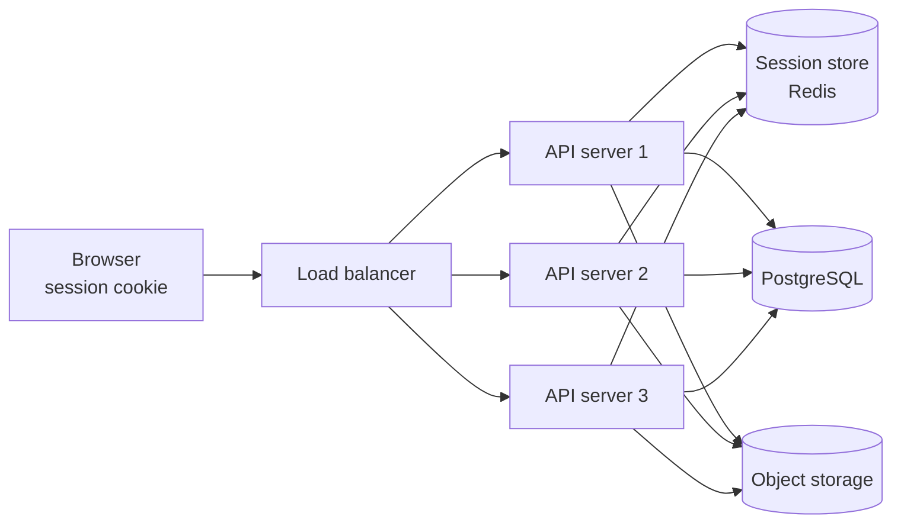

:::mental-model
**A stateless server keeps no per-user memory between requests. Everything a request needs arrives with it, or lives in a shared store that every server can reach.**
:::

## The login that forgot Meera

Meera signs in on her phone at 8:58. The balancer sends her login to server two, which checks her password, creates a session, and returns a cookie. The screen shows her appointment at 10:30.

At 9:01 she taps “Reschedule.” The balancer sends the request to server one. Server one reads the cookie, looks in its own memory, finds nothing, and returns `401`. Meera is back at the login screen. She signs in again. This time she lands on server three.

Nothing is broken. Each server is doing exactly what it was written to do. The application was written when there was one server, and it kept the session in a local map. That map is now one third of the truth.

## What counts as state

**State** is anything a request needs that is not in the request itself. A stateless server can be replaced between two requests without the user noticing. A stateful one cannot.

The obvious state is the session, but it is not the only kind:

| State | Where it usually hides | What breaks on server two |
|---|---|---|
| Session | A map or an in-memory store | The user is logged out |
| Uploaded file | Local disk or a temp directory | The file returns `404` |
| Cache | Process memory | Two servers return different data |
| Rate-limit counter | A local counter | The limit doubles |
| Scheduled job | A local cron | The job runs twice |
| WebSocket connection | A process | Messages reach the wrong user |
| Feature flag | A local config file | Two behaviours in one fleet |

A server can keep **reconstructible** state — a read-only cache that can be rebuilt from the database, a compiled template, a connection pool. That is not the same as **authoritative per-user** state. The distinction is whether losing it changes what the user can do.

:::note
“Stateless” is about the request path, not about the machine. Servers still have an operating system, a cache and a connection pool. The rule is that no request depends on which machine handled the previous one.
:::

## Why statelessness is worth the work

The first reason is scale. If any server can handle any request, adding a server adds capacity. If a user is pinned to one server, adding a server helps only the users who happen to be pinned to it.

The second is deployment. A stateful server cannot be restarted casually; a rolling deploy would log out everyone it hosts. A stateless server can be drained, replaced and returned while the fleet keeps serving.

The third is failure. When a server dies, a stateless fleet loses capacity but not users. A stateful fleet loses the sessions, uploads and in-flight work that lived on that machine.

The fourth is testing. A stateless server is easy to run twice on one laptop and send the same request to both. A stateful server requires a fixture for every piece of hidden memory.



## Sessions: three designs

There are three common ways to keep a user signed in across servers, and each gives up something different.

### 1. A signed cookie

The server puts the user’s identity and claims into a signed cookie, usually a JWT. Every server can verify the signature with a shared key, so no lookup is needed.

- **Good:** no shared store on the read path; any server can verify in microseconds; works across regions.
- **Bad:** revocation is hard. A stolen token is valid until it expires. Changing a role requires issuing a new token. The cookie grows with the claims, and it travels on every request.
- **Use when:** short-lived access tokens, stateless APIs, or a system that can tolerate a revocation delay of minutes.

### 2. A session ID plus a shared store

The cookie contains a random session ID. The server looks up the ID in Redis or the database on each request.

- **Good:** revocation is a delete; roles and permissions can change immediately; the cookie stays small; the session can hold server-side data the client should not see.
- **Bad:** one extra network lookup per request (about 0.5–1 ms inside a region); the store is now a critical dependency.
- **Use when:** a browser app with logins, especially one handling health data.

### 3. Sticky sessions

The balancer pins each user to one server, usually by cookie or IP hash. The session stays in that server’s memory.

- **Good:** no shared store, no extra lookup, minimal code change.
- **Bad:** the server becomes a pet. A deploy or crash logs out its users. Load is uneven when some users are busier. Scaling out does not rebalance existing sessions.
- **Use when:** a legacy application cannot be changed, or a long-lived connection needs a specific process. Treat it as a temporary compromise, not a design.

For the clinic, the session ID plus Redis is the default. The session holds the patient ID, the clinic location, and a role. The cookie is `HttpOnly`, `Secure`, `SameSite=Lax`, and expires after 30 minutes of inactivity. Logout deletes the Redis key, so a stolen cookie stops working immediately.

:::warning
Do not put a diagnosis, a phone number or an insurance number in a signed cookie. Signing proves the value was issued by you; it does not hide it from the user or from anything that logs headers.
:::

## The other state, one by one

**Uploads.** A photo or an insurance card goes to object storage (4.6), not to the server’s disk. The API returns a key or a URL, and the database stores the key. Any server can then serve or sign a URL for the file.

**Cache.** Module 3’s in-process cache is a per-server copy. That is fine for data that is allowed to differ slightly between servers, and dangerous for anything authoritative. Move shared copies to Redis, and keep the local cache only for read-only data with a short TTL.

**Rate limits.** A counter in process memory is multiplied by the number of servers. Move it to Redis with an atomic increment and a TTL, or use a rate-limiting service. The limit must be global, or an attacker gets one budget per server.

**Background jobs.** A cron entry on each server runs N times. Use a queue with one consumer group, a leader election, or an idempotency key that makes duplicate work harmless. The last option is the most robust: design the job so running it twice produces the same result.

**WebSockets.** A live queue display needs a connection to a specific process. Use sticky routing for the connection, and a pub/sub backplane so a message published on server one reaches a socket held by server three.

**Configuration.** A flag read from a local file can differ across servers. Load configuration at startup from a shared source, version it, and roll it out like code.

## A worked example: 12,000 sessions

The clinic has 12,000 daily active users and about 4,000 sessions alive at the Monday peak. Each session is 2 KB: user ID, role, clinic, expiry, CSRF token.

In Redis, that is:

```text
4,000 sessions × 2 KB = 8 MB
```

Eight megabytes. A small Redis instance holds it with room to spare. A lookup takes about 1 ms inside the same region. The clinic’s API already spends 5 ms on the database for a booking, so the session read is not the bottleneck.

Now compare what happens when server two dies at 9:15:

| Design | Sessions lost | Users affected | Recovery |
|---|---:|---|---|
| Local memory, no affinity | All 4,000 on server two | About 4,000 logins | Sign in again |
| Local memory, sticky | All 4,000 on server two | About 4,000 logins | Sign in again, and the balancer re-pins them |
| Shared Redis | 0 | 0 | Requests go to servers one and three |

The shared store is not free: it is another service to run, monitor and back up. But the failure it removes is a user-visible logout during a routine deploy. That is a good trade for a health application.

The shared store also makes deploys boring. Drain server two, deploy, return it. No session is lost because no session was there in the first place.

## What breaks

**The session store becomes a single point of failure.** If Redis is down, every request that needs a session fails. Decide the behaviour in advance: fail closed (return `503` and ask the user to try again) or degrade to a read-only mode that does not require a session. Never fail open by skipping authentication.

**Session fixation.** An attacker sets a session ID before login, then uses it after the victim signs in. Rotate the session ID on login and on privilege change.

**Unbounded sessions.** A session with no TTL lives until Redis runs out of memory. Set an idle timeout and an absolute timeout, and delete on logout.

**The cookie that leaks.** Missing `Secure` sends the cookie over HTTP. Missing `HttpOnly` lets JavaScript read it. A wildcard `SameSite=None` sends it on cross-site requests. These are configuration bugs with the same result as a stolen password.

**The cache that becomes authoritative.** A local cache of a user’s permissions can outlive a role change. If the cache is per-server, two servers can disagree about whether a user is an admin. Keep authorization checks on the source of truth or in a shared store with a short TTL.

:::reality-check
A stateless design does not remove state. It moves state to a place that is built to hold it, and it makes the server disposable. The work is in choosing that place and testing what happens when it is unavailable.
:::

:::widget session-affinity
:::

## When a little state is fine

A single-server system does not need Redis sessions. A read-only public page can keep a local cache. A WebSocket server can hold a connection for hours. A batch worker can keep a progress counter in memory if losing it only means starting the batch again.

The question is not “is there state?” It is “does a user’s next request depend on which machine handled the last one?” If the answer is no, the server is stateless enough. If the answer is yes, write down where that state lives, how it is backed up, and what happens when it disappears.

## Check yourself

:::quiz
[
  {
    "question": "Which of these is authoritative per-user state that must leave a server before it can scale horizontally?",
    "options": [
      "A compiled template",
      "A connection pool",
      "A session stored in a local map",
      "A read-only cache with a TTL"
    ],
    "answer": 2,
    "explanation": "The session determines what the user can do. A template, a pool and a rebuildable cache can be recreated and do not pin a user to one machine."
  },
  {
    "question": "What is the main tradeoff of a signed cookie compared with a server-side session?",
    "options": [
      "It is slower to verify",
      "It cannot be revoked immediately without additional infrastructure",
      "It cannot be used over HTTPS",
      "It requires a database lookup on every request"
    ],
    "answer": 1,
    "explanation": "A signed cookie is verified locally, which is fast, but it stays valid until it expires. Revoking it early requires a denylist or short lifetimes, which adds back the coordination it was meant to avoid."
  },
  {
    "question": "Why is sticky routing a weak answer to the session problem?",
    "options": [
      "It makes cookies illegal",
      "It pins users to a server, so a failure or deploy logs them out and load can become uneven",
      "It prevents the load balancer from doing health checks",
      "It requires object storage"
    ],
    "answer": 1,
    "explanation": "Sticky sessions keep the local-state design and hide it behind the balancer. The server is still a pet, and its failure still loses every session it holds."
  },
  {
    "question": "Redis holding sessions goes down. What is the safest default behaviour?",
    "options": [
      "Skip authentication until Redis recovers",
      "Fail closed with a clear error and ask the user to retry",
      "Create a new session for every request",
      "Write sessions to local disk on each server"
    ],
    "answer": 1,
    "explanation": "Failing open turns an availability incident into a security incident. Failing closed keeps the data safe; the system can then recover when the store returns."
  }
]
:::

## Exercise: find the hidden state

Take an app you know and trace one user journey from login to a completed action. For each step, list every piece of state the server touches.

For each item, mark it:

- **request** — carried in the request or cookie,
- **shared** — stored where every server can read it,
- **local** — lives in one process or on one disk.

Then answer:

1. What happens if the next request goes to a different server?
2. What happens if that server dies?
3. Which local item would you move first, and to where?

Close with a one-sentence definition of “stateless enough” for this application.

:::discussion
- Is a JWT with a five-minute lifetime effectively stateless? What does revocation cost?
- Should a health app use the same session store for staff and patients? What could go wrong?
- How would you migrate from sticky sessions to shared sessions without logging everyone out?
:::

## Key takeaways

- Stateless means no per-user memory between requests; any server can handle any request.
- Sessions, uploads, caches, counters and scheduled jobs are the usual hidden state.
- Session ID plus a shared store is the default for browser apps; signed cookies trade revocation for locality.
- Sticky sessions hide local state rather than removing it, and they fail with the server.
- A shared store is a new critical dependency; decide how to fail before it fails.
- Keep authorization on the source of truth, not in a per-server cache.

## Free references

- [The Twelve-Factor App: Processes](https://12factor.net/processes) — stateless, share-nothing processes and why they enable scaling.
- [OWASP: Session management cheat sheet](https://cheatsheetseries.owasp.org/cheatsheets/Session_Management_Cheat_Sheet.html) — cookie flags, rotation, timeouts and fixation.
- [MDN: Set-Cookie](https://developer.mozilla.org/en-US/docs/Web/HTTP/Headers/Set-Cookie) — the exact attributes that decide where a cookie travels.
- [RFC 8725: JWT best current practices](https://www.rfc-editor.org/rfc/rfc8725) — what a signed token does and does not guarantee.
