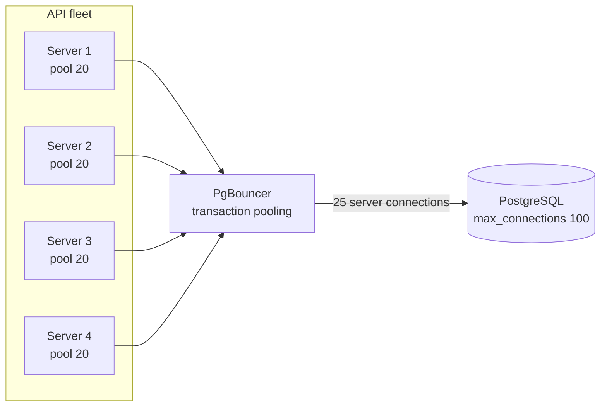

:::mental-model
**A database connection is a small, expensive session. Pooling reuses a few of them per process; the total across the fleet is what the database actually has to accept.**
:::

## The fourth server that broke the database

The clinic adds a fourth API server on a Thursday afternoon. It passes its health check. The balancer starts sending it traffic.

Ninety seconds later, Arjun cannot book an appointment. The API returns `500`, and the log says:

```text
FATAL: sorry, too many clients already
```

The database CPU is at 41%. Memory is fine. The database is not overloaded with work. It is overloaded with **connections**.

Each API server runs one process with a pool of 20 connections. Four servers is 80 connections. A reporting pool, a backup agent, two monitoring agents and an administrator add another 25. PostgreSQL’s `max_connections` is 100, with three reserved for superusers. The next client is the one that gets refused.

## Why a connection is expensive

Opening a database connection is not a function call. It is a small session:

1. **TCP handshake** — one round trip.
2. **TLS handshake** — two more round trips if the connection is encrypted.
3. **Authentication** — password or certificate verification, plus a look at `pg_hba.conf`.
4. **Backend process** — PostgreSQL forks a process for the connection.
5. **Memory** — each backend has its own stack, catalog caches and work memory. Budget roughly 5–10 MB per connection, more under load.

A local connection might take 5 ms. A connection across a region with TLS can take 50 ms or more. Doing that per request wastes time and CPU on both sides.

A **connection pool** keeps a fixed set of open connections and lends them out:

```text
request → checkout a connection → run the query → return it to the pool
```

If all connections are busy, the request waits in a queue. If the wait exceeds the checkout timeout, it fails with a clear error instead of hanging forever.

The pool belongs to the **process**, not the machine. Two API processes on one server have two pools. Four servers with one process each have four pools. That multiplication is the source of the arithmetic that broke the clinic.



## The arithmetic that matters

The total number of clients the database sees is:

```text
total clients = servers × processes per server × pool size per process
```

For the clinic before the fourth server:

```text
3 servers × 1 process × 20 = 60 connections
```

After the fourth:

```text
4 × 1 × 20 = 80
```

Add the 25 background clients, and the fleet reaches 105. Nothing about the application changed. The fleet grew by one machine, and the database’s connection limit became the binding constraint.

The fix can be smaller pools, fewer processes, a proxy, or a higher `max_connections`. The last one is tempting and often wrong: every connection is a process with memory and scheduling overhead. Raising the limit to 500 does not give the database 500 cores. It gives it 500 clients competing for the same CPU and locks.

:::note
`max_connections` is a ceiling, not a target. A database with 100 active backends on 8 cores spends a measurable amount of time context-switching between them.
:::

## How large should a pool be?

The honest answer is “large enough to keep the database busy without queueing, and no larger.” Two calculations get you close.

**From concurrency.** Little’s Law:

```text
connections in use = queries per second × time per query
```

At 900 requests per second, with 5 ms of database time per request:

```text
900 × 0.005 = 4.5 concurrent queries
```

Across four API servers, that is about 1.1 concurrent queries per server on average. A pool of 5 would cover the average; a pool of 10–20 covers bursts. A pool of 100 per server would be almost entirely idle and still consume the database’s connection budget.

**From cores.** A common starting point is:

```text
pool size ≈ (CPU cores × 2) + effective disk spindles
```

For a 4-core API server with one SSD, that is around 9. Round to 10. The formula is a starting point, not a law; the point is that a pool much larger than the work the database can do in parallel adds contention rather than throughput.

Measure two numbers after changing the pool:

- **Checkout wait time.** If requests wait for a connection, the pool is too small or the queries are too slow.
- **Database CPU and active sessions.** If the database is saturated with a small pool, a larger pool will not help.

## PgBouncer: multiplexing clients onto fewer backends

A **database proxy** sits between the application and PostgreSQL and multiplexes many client connections onto a small number of server connections.

PgBouncer is the common open-source choice. It supports three pooling modes:

| Mode | A server connection is held for | Works with | Watch out for |
|---|---|---|---|
| **Session pooling** | The whole client session | Everything | Little multiplexing benefit |
| **Transaction pooling** | One transaction | Most web apps | Session-level features break |
| **Statement pooling** | One statement | Simple autocommit workloads | Multi-statement transactions break |

Transaction pooling is the usual default for a web API. A client checks out a server connection for the duration of a transaction, then returns it. Between transactions, the client holds only a lightweight PgBouncer connection.

The clinic’s fleet:

```text
4 API servers × 20 client connections = 80 clients
PgBouncer default_pool_size = 25 server connections
PostgreSQL max_connections = 100
```

The database now sees 25 connections instead of 80. The API still has 20 per server, so bursts are absorbed by PgBouncer’s queue rather than by a `FATAL` error.

Transaction pooling has rules:

- **No session state.** `SET`, `LISTEN`, advisory locks and temp tables may not survive to the next transaction.
- **Prepared statements** need support enabled in PgBouncer, or they must be avoided. The protocol-level details differ by driver.
- **`pool_mode` is a contract.** Test the application against it; do not switch it in production and hope.

:::warning
PgBouncer is now on the critical path. Run it as a redundant pair, monitor its pool saturation and queue time, and give it a timeout shorter than the API’s request timeout so failures surface as clear errors.
:::

## Timeouts form a hierarchy

A pool without timeouts turns a slow database into a fleet-wide hang. Set them from the inside out:

```text
database statement timeout   <   pool checkout timeout   <   request timeout   <   load balancer timeout
       2,000 ms                      3,000 ms                   5,000 ms              10,000 ms
```

The inner timeout fires first, so the caller receives a specific error and can decide whether to retry. If the load balancer times out first, the API keeps working on a request nobody is waiting for, and the retry adds more load.

For booking, use a short statement timeout and a small number of retries. A request that has already waited three seconds for a connection is unlikely to succeed by waiting three more.

## A worked example: four servers, one limit

The clinic’s database host has 8 vCPU, 32 GB of RAM and `max_connections = 100`.

| Configuration | Clients seen by Postgres | Result at 900 rps |
|---|---:|---|
| 4 servers × pool 20 | 80 + 25 background = 105 | Over the limit; new connections get `FATAL` |
| 4 servers × pool 12 | 48 + 25 = 73 | Stable; checkout wait under 3 ms |
| 6 servers × pool 12 | 72 + 25 = 97 | Stable, but little headroom |
| 6 servers × pool 12 + PgBouncer | 25 server connections | Stable; room for two more API servers |

The third row is the trap. It works today, and the next server breaks it. The fourth row changes the shape: the number of API servers no longer multiplies the number of database backends. That is what lets the fleet scale independently.

The cost is honest: PgBouncer adds a hop (well under a millisecond locally), a service to monitor, and a set of compatibility rules. For a fleet that expects to grow, it is usually cheaper than raising `max_connections` until the database melts.

## What breaks

**Connection leaks.** A code path checks out a connection and never returns it — an exception before `finally`, a stream that is not closed. The pool drains slowly, and the first symptom is a checkout timeout hours later. Instrument pool usage and alert on a steady climb.

**Thundering herd.** Every server restarts after a deploy and opens its full pool at once. PgBouncer or a connection delay smooths the spike; without it, the database refuses connections exactly when the fleet is trying to come back.

**Idle in transaction.** A transaction opens, does one query, then waits on an HTTP call. The connection is held but idle, blocking vacuum and consuming a backend. Keep transactions short and never call a remote service inside one.

**Pool exhaustion under retries.** The load balancer retries a slow request, the API queues for a connection, the queue grows, and the retry adds another waiter. Cap retries and shed load before the pool is full.

**A proxy that becomes a single point of failure.** Two PgBouncer instances behind a TCP load balancer, or one per database host, with health checks. The same redundancy question applies to every new component.

:::reality-check
The database refusing connections is a good failure: it is loud, fast and easy to diagnose. The alternative — accepting every connection and letting them all compete — is a slow, quiet collapse where every query is slow and nobody knows why.
:::

:::widget pool-math
:::

## Check yourself

:::quiz
[
  {
    "question": "Four API servers each run one process with a pool of 20 connections. How many database clients does the fleet create before background jobs?",
    "options": [
      "20",
      "24",
      "80",
      "100"
    ],
    "answer": 2,
    "explanation": "The pool is per process. Four processes × 20 connections = 80. Background jobs and monitoring add more, which is how a fleet crosses a limit that looked safe per server."
  },
  {
    "question": "The database CPU is at 40% but new connections are refused. What is the most likely cause?",
    "options": [
      "The CPU is too slow",
      "The connection limit is exhausted by the fleet’s pools",
      "The disk is full",
      "The cache has expired"
    ],
    "answer": 1,
    "explanation": "Connections are a separate resource from CPU. Each pool holds connections open, so many servers can exhaust max_connections while the database is mostly idle."
  },
  {
    "question": "What does PgBouncer’s transaction pooling change?",
    "options": [
      "It makes every query faster",
      "It multiplexes many client connections onto fewer server connections per transaction",
      "It removes the need for indexes",
      "It stores query results in memory"
    ],
    "answer": 1,
    "explanation": "A client holds a server connection only for a transaction, then returns it. The database sees fewer backends, while the application can still have many client connections."
  },
  {
    "question": "Why is raising max_connections to 500 not a free fix?",
    "options": [
      "PostgreSQL charges per connection",
      "Each connection is a process with memory and scheduling cost, and more clients compete for the same CPU and locks",
      "It disables the query planner",
      "It requires a larger disk"
    ],
    "answer": 1,
    "explanation": "The limit exists for a reason. More backends consume memory and context switches without adding cores, so throughput can fall while the connection count rises."
  }
]
:::

## Exercise: size the fleet’s pools

For a service with:

- 6 API servers, one process each,
- 600 requests per second at peak,
- 6 ms of database time per request,
- a database with 8 vCPU and `max_connections = 120`,
- 12 background or monitoring clients,

calculate:

1. the average concurrent database queries;
2. a pool size that covers twice the average;
3. the total clients with that pool, including background;
4. whether the fleet fits, and what you would change if it does not;
5. the timeout hierarchy you would configure.

Then add one server and repeat. Write a sentence that states the trigger for introducing PgBouncer.

:::discussion
- Is a pool of 50 per server ever justified? What workload would need it?
- What should happen to a booking request that waits three seconds for a connection and then gets one?
- Would you put PgBouncer in front of a single-server app? Why or why not?
:::

## Key takeaways

- A connection is an expensive session; a pool reuses a small number per process.
- The database sees servers × processes × pool size, plus background clients.
- Size pools from concurrency and cores, not from the maximum the database allows.
- PgBouncer multiplexes clients onto fewer backends, at the cost of session-level features.
- Set timeouts from the database outward so the innermost failure is the one that fires.
- Leaks, restart herds and retry storms exhaust pools at the worst moment.

## Free references

- [PostgreSQL: Connection settings](https://www.postgresql.org/docs/current/runtime-config-connection.html) — `max_connections`, reserved slots and the cost of each backend.
- [PgBouncer: Configuration](https://www.pgbouncer.org/config.html) — pool modes, sizes and timeouts.
- [HikariCP: About pool sizing](https://github.com/brettwooldridge/HikariCP/wiki/About-Pool-Sizing) — the cores-and-spindles starting point, with the reasoning behind small pools.
- [PostgreSQL wiki: Number of database connections](https://wiki.postgresql.org/wiki/Number_Of_Database_Connections) — why more connections are not free.
