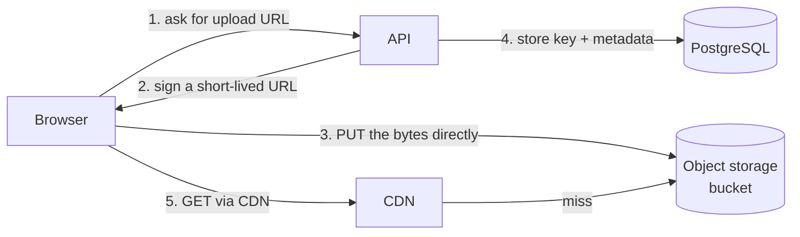

:::mental-model
**Object storage is a durable, shared bucket addressed by key. The application stores metadata and permissions; the bucket stores bytes.**
:::

## The photos that lived on one machine

Dr. Rao hires a photographer for the clinic’s new location. Two hundred photos — reception, consultation rooms, the garden — are uploaded through the admin screen.

The upload endpoint writes each file to `/var/uploads` on whichever API server handled the request. The database stores the filename. For a week, everything works.

On Friday, server two’s disk fails. It is replaced, and the new machine has an empty `/var/uploads`. Forty of the photos are gone. The database still has rows pointing at filenames that no longer exist. The backup job copied the database every night; it never copied the disk.

The clinic did not have a storage problem. It had a state problem wearing a storage costume.

## Why not local disk, and why not the database

**Local disk** looks simple because it is a filesystem call. It fails the moment there is more than one server:

- The file is on one machine; the next request may go to another.
- A disk failure loses the file, and the database row survives to point at nothing.
- Backups must cover every machine separately, and a restore must put files back in the same paths.
- Capacity is tied to the server; a photo library can fill the disk that also holds logs and the OS.
- A deploy that replaces the machine replaces the disk.

**The database** is the other tempting place: a `bytea` or `BLOB` column next to the metadata. It keeps everything transactional and backed up together. It also:

- bloats every backup and replication stream with binary data,
- puts large objects in the buffer cache, evicting the rows queries need,
- makes the API stream megabytes through the same process that handles bookings,
- couples storage growth to the most expensive resource in the system.

A small avatar or a PDF receipt can live in the database if it is genuinely small and rarely read. A photo library cannot.

## What object storage is

**Object storage** is a service that stores opaque blobs under a key:

```text
bucket: clinic-media
key:    locations/pune-kalyani-nagar/2026/11/reception-01.jpg
value:  4.1 MB of JPEG bytes
metadata: content-type, size, checksum, owner, uploaded-at
```

The namespace is flat. The slashes in a key look like folders, but there are no directories; the key is just a string. Listing by prefix is how you simulate a folder view.

The API is small:

```text
PUT    /bucket/key      upload an object
GET    /bucket/key      download it
HEAD   /bucket/key      read metadata
DELETE /bucket/key      remove it
LIST   ?prefix=...      enumerate keys
```

The properties that matter:

- **Durability.** Large providers replicate objects across devices and availability zones, and publish durability figures around eleven nines. That is not the same as backup: a delete is replicated too.
- **Availability.** The service is designed to answer even when a disk or a zone fails. You still need a plan for the provider’s control plane being unavailable.
- **Scalability.** No capacity planning per server. You pay per GB stored and per request.
- **Versioning.** Optional; keeps previous versions when an object is overwritten or deleted.
- **Lifecycle rules.** Move old objects to cheaper storage or delete them after a period.
- **Immutability.** Objects are replaced whole, not edited in place. A new version is a new `PUT`.



## Two upload paths

**Through the API.** The browser sends the file to your endpoint, and your code writes it to the bucket.

- Simple to authorise and validate in one place.
- The API process handles every byte: memory, CPU, bandwidth and timeouts.
- A 4 MB file is fine; two hundred 4 MB files at once is a denial-of-service you built yourself.

**Direct to the bucket with a presigned URL.** The API authenticates the user, checks the declared type and size, and returns a short-lived URL that permits one `PUT` to one key. The browser uploads straight to the bucket.

- The API handles a few hundred bytes per upload instead of gigabytes.
- The URL carries the permission; it expires in minutes.
- The API still records the metadata, and a background job can verify the object after upload.
- Validation must happen twice: on the signed request (type, size, key prefix) and on the stored object (magic bytes, dimensions, virus scan).

For the clinic, the second path is the default for photos and documents. The API signs, the browser uploads, and a worker checks the object and marks the row `ready`.

:::warning
A presigned URL is a capability. Anyone who has it can use it until it expires. Keep the lifetime short, restrict the key and the method, and never sign a URL for a bucket prefix the user should not control.
:::

## Serving the bytes

The bucket should usually be **private**. The API checks whether the user may see the object, then returns a short-lived presigned `GET` URL, or redirects to a CDN URL signed with the same idea.

Public images — the clinic’s menu photos, the location gallery — can be served through a CDN with a long TTL and a versioned key. Private images — an insurance card, a consultation note — must never sit at a shared edge without a signed URL and a short lifetime.

Never enable public bucket listing. A public object is fine when you intend it; a public index of every object is a data breach with a search box.

## A worked example: 1,200 photos

The clinic has six locations, each with 200 photos at 4 MB:

```text
1,200 × 4 MB = 4.8 GB stored
```

At $0.023 per GB-month, storage costs about **$0.11 per month**. The bytes are not the expensive part.

Now suppose the gallery gets 50,000 views per day, and each view downloads one 4 MB photo:

```text
50,000 × 4 MB = 200 GB per day
200 GB × $0.09 per GB = $18 per day
        ≈ $540 per month
```

That is 5,000 times the storage bill. Egress, not storage, is what you design for.

Put a CDN in front with a 95% edge hit rate:

```text
origin egress = 200 GB × 0.05 = 10 GB per day
CDN egress    = 200 GB per day at the CDN’s rate
```

The origin sees one twentieth of the traffic, and users get the photo from a nearby edge. Module 4.7 covers the CDN itself; the storage lesson is that the bucket should be the origin, not the thing users hit directly.

If the API proxied every download instead, it would also carry 200 GB per day through the process that handles bookings. The bandwidth bill might be similar; the coupling is not.

## What breaks

**Orphaned objects.** The database row is deleted, but the object remains. Storage grows silently. Use a lifecycle rule, a periodic reconciliation job, or delete the object first and tolerate a missing file for a moment.

**Dangling rows.** The object is deleted or the upload fails, but the row remains. Serve a clear placeholder, mark the row `missing`, and reconcile.

**The public bucket.** A misconfigured policy exposes every object. Test the policy from outside the account, not from the console where you are already an administrator.

**Wrong content type.** A browser that receives `application/octet-stream` downloads the image instead of displaying it. Store and serve the correct `Content-Type`, and set `Content-Disposition` deliberately.

**Unbounded uploads.** Without a size limit, one user uploads a 2 GB video and the bucket bill and the virus scanner both notice. Enforce a maximum at the signed URL and again at the object.

**Eventual consistency assumptions.** Some object stores are strongly consistent now; others are not, and listing may lag. Do not build a workflow that requires a `LIST` immediately after a `PUT`. Store the key in the database and read it directly.

**Deletion is not a transaction.** Deleting a database row and an object are two operations. Decide which order fails safely: delete the row first and let the object be garbage-collected, or mark the row deleted and remove the object asynchronously.

:::reality-check
Object storage gives you durability, not backup. A replicated delete is still a delete. Use versioning, a second bucket or a separate backup product if the photos must survive an operator mistake.
:::

:::widget upload-path
:::

## Check yourself

:::quiz
[
  {
    "question": "Why does storing photos on an API server’s local disk fail after horizontal scaling?",
    "options": [
      "Local disks are always slower than buckets",
      "The next request may reach a different server that does not have the file",
      "Databases cannot store filenames",
      "The load balancer deletes local files"
    ],
    "answer": 1,
    "explanation": "A local file is state on one machine. With several servers, the request that needs the file may land elsewhere, and a failed server takes its disk with it."
  },
  {
    "question": "What is the main advantage of a presigned upload URL?",
    "options": [
      "It encrypts the file automatically",
      "The browser uploads directly to the bucket, so the API does not carry the bytes",
      "It removes the need to store metadata",
      "It makes the bucket public"
    ],
    "answer": 1,
    "explanation": "The API signs a short-lived permission and the client sends the bytes to storage. The API keeps the metadata and the authorisation decision without proxying the payload."
  },
  {
    "question": "For 4.8 GB of photos viewed 50,000 times a day at 4 MB each, which cost dominates?",
    "options": [
      "Storage, because objects are replicated",
      "Egress, because the bytes leave the provider on every view",
      "The database, because it stores the metadata",
      "TLS certificates"
    ],
    "answer": 1,
    "explanation": "Storage is a few cents per month; 200 GB per day of downloads dominates the bill. A CDN reduces origin egress and improves latency."
  },
  {
    "question": "A bucket is private and the API returns a short-lived signed URL. What should you still avoid?",
    "options": [
      "Serving images through a CDN",
      "Signing a URL for any key the user asks for without an authorisation check",
      "Storing the object key in the database",
      "Using a content type"
    ],
    "answer": 1,
    "explanation": "The signature proves the URL came from you; it does not prove this user may see this object. Check ownership or role before signing, and scope the key."
  }
]
:::

## Exercise: design the media path

For an app that lets users upload a profile photo and a PDF document:

1. choose the bucket layout and the key format;
2. decide which files go through the API and which use a presigned URL;
3. write the metadata you will store in the database;
4. define the validation at signing time and after upload;
5. decide who can read each file, and how a signed URL enforces it;
6. describe what happens when the upload succeeds but the database write fails.

Then estimate storage and monthly egress for 10,000 users, one photo each, viewed twice a week.

:::discussion
- Should the clinic keep the original photo, a compressed version, or both? Who decides?
- Is a public bucket ever acceptable for a health app? What would have to be true?
- How would you delete a patient’s documents when they ask, without breaking audit requirements?
:::

## Key takeaways

- Object storage is a durable shared bucket addressed by key; the app owns metadata and permissions.
- Local disk is per-server state and breaks under horizontal scaling; large blobs bloat the database.
- Presigned URLs let clients upload and download directly, keeping bytes out of the API.
- Keep buckets private, sign short-lived URLs, and never enable public listing.
- Storage is cheap; egress is not. Put a CDN in front of public media.
- Deletes are not transactional across the database and the bucket; design the failure order.

## Free references

- [Amazon S3: User guide](https://docs.aws.amazon.com/AmazonS3/latest/userguide/Welcome.html) — buckets, keys, durability, versioning and lifecycle rules.
- [Amazon S3: Presigned URLs](https://docs.aws.amazon.com/AmazonS3/latest/userguide/using-presigned-url.html) — how a short-lived capability replaces proxying bytes.
- [Google Cloud Storage: Consistency](https://cloud.google.com/storage/docs/consistency) — what is strong and what is not, per operation.
- [OWASP: File upload cheat sheet](https://cheatsheetseries.owasp.org/cheatsheets/File_Upload_Cheat_Sheet.html) — validation, storage and serving rules that survive contact with attackers.
