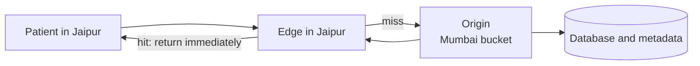

:::mental-model
**A CDN is a cache at the edge of the network. It turns one origin into many copies, so the bytes travel a short distance and the origin sees only the misses.**
:::

## Three seconds for a photo

Meera opens the clinic’s location page from Jaipur. The page lists the new branch, with six photos of the reception and the garden.

The images are stored in a bucket in Mumbai. Her phone is on a 4G connection with a 40 ms round trip. The first image takes 3.2 seconds to appear. The bytes are not lost; they are travelling.

The clinic now has locations in three states. Every patient outside Mumbai pays the same distance tax, and the origin bucket pays for every view. The photos did not get bigger. The audience moved.

## What a CDN is

A **content delivery network** is a set of servers distributed across cities and networks. Each **edge** caches copies of your content. When a user requests a file, DNS or anycast routing sends them to a nearby edge.



The edge does four things:

1. **Terminates TLS close to the user**, so the handshake is short.
2. **Serves a cached copy** without crossing the country.
3. **Forwards a miss to the origin**, then caches the response.
4. **Applies a cache policy** — what may be stored, for how long, and for whom.

Distance matters because of round trips, not only bandwidth. A TLS handshake takes two round trips; TCP slow start ramps up the transfer window over the first few round trips; packet loss triggers retransmits. A 40 ms path with 1% loss feels much worse than the raw bandwidth suggests. An edge 8 ms away removes most of that.

## What belongs at the edge

The safest content is **public and identical for everyone**:

- images, fonts, CSS and JavaScript with a content hash in the filename,
- video segments and audio,
- public PDFs and menus,
- downloadable assets that change rarely.

API responses can be cached at the edge only when they are public and the staleness budget is explicit. A public list of clinic locations with a 60-second TTL is a reasonable candidate. A patient’s appointment list is not, even for one second, unless the URL is unguessable and the response is marked private.

The HTTP headers decide it:

| Header | Meaning |
|---|---|
| `Cache-Control: public, max-age=31536000, immutable` | Browsers and edges may keep it for a year; the filename changes when the content does |
| `Cache-Control: public, s-maxage=60, stale-while-revalidate=30` | Edges keep it for 60 seconds and may serve stale for 30 while refreshing |
| `Cache-Control: private, no-store` | Never store it in a shared cache |
| `ETag` | A validator; the client can ask “has this changed?” and get a cheap `304` |
| `Vary` | The response depends on a request header; use sparingly, because it fragments the cache |

The strongest pattern for static assets is a **content hash in the filename**:

```text
/app.7f3c9a.js
/hero-4b21e0.jpg
```

The file can be cached for a year because a new version has a new name. The HTML that references it is short-lived and points at the new names. There is no purge to wait for, and no edge can serve yesterday’s JavaScript with today’s HTML.

:::note
`max-age` applies to browsers and shared caches; `s-maxage` applies only to shared caches such as a CDN. Use `s-maxage` when you want the edge to hold a copy longer or shorter than the browser.
:::

## Hit ratio and origin offload

The **edge hit ratio** is the fraction of requests served without contacting the origin:

```text
hit ratio = edge hits / total requests
```

At 100,000 views per day of a 2 MB image:

```text
total egress = 100,000 × 2 MB = 200 GB per day
```

With a 97% edge hit ratio:

```text
origin egress = 200 GB × 0.03 = 6 GB per day
```

The origin sees 3,000 requests instead of 100,000. The CDN carries the rest. That is the entire economic argument.

A low hit ratio usually has one of four causes:

- **Long tail.** Most requests are for objects nobody else asks for. Caching them wastes edge space; the origin still sees them.
- **Short TTL.** The copy expires before it can be reused. A 10-second TTL on a photo viewed once a minute is close to no cache.
- **Query strings.** `?v=123` and `?utm_source=x` create different cache keys for the same file. Normalise or ignore tracking parameters.
- **Uncacheable responses.** `private`, `no-store` or a `Set-Cookie` header prevents shared caching.

Measure the hit ratio per content type, not as one number. A 90% overall ratio can hide a 20% ratio on the images that consume most of the bytes.

## Invalidation: prefer new names to purges

A **purge** tells every edge to drop a key. It sounds simple and is operationally awkward:

- Propagation takes seconds to minutes and is not always global.
- Providers rate-limit purges, especially wildcard purges.
- A purge during a deploy can race with caches that refill from an origin that is still serving the old version.
- You cannot purge what you cannot name; dynamic keys and query strings multiply the work.

**Versioned filenames** avoid the problem. The deploy writes `app.7f3c9a.js`, the HTML references it, and the old file can stay cached until it falls out of use. A rollback is another filename, not another purge.

Use a **short TTL** as the backstop for content that must change in place, such as a public JSON endpoint. Use a purge only for the rare object whose name cannot change and whose staleness is unacceptable.

## A worked example: Jaipur to Mumbai

The gallery image is 2 MB. The origin is in Mumbai; the user is in Jaipur.

Without a CDN:

| Step | Cost |
|---|---|
| DNS | 20–80 ms |
| TCP + TLS handshake (2 RTT) | 80 ms |
| First byte from origin | 40 ms |
| Transfer 2 MB at 20 Mbps | 800 ms |
| Slow start and loss | 200–600 ms |
| **Total** | **about 1.2–1.6 s** |

The earlier 3.2 seconds included a cold connection, a slower mobile link and a larger image. The shape is the same: distance and handshake dominate before the bytes even start.

With an edge in Jaipur:

| Step | Cost |
|---|---|
| DNS (cached) | 0–20 ms |
| TCP + TLS to edge (1 RTT) | 8 ms |
| Edge hit | 2 ms |
| Transfer 2 MB from edge | 600–900 ms |
| **Total** | **about 0.7–0.9 s** |

The transfer still takes time; the speed of light and the mobile link have not changed. What disappears is the cross-country handshake and the origin’s queue. On a fast connection the difference is smaller; on a lossy mobile connection it is the difference between a page that feels instant and one that feels broken.

## What breaks

**Caching something personal.** A response with `Cache-Control: public` and a patient’s name is now on a shared edge. The next user who requests the same URL may receive it. Mark authenticated responses `private, no-store`, and never put personal data in a URL that a shared cache can key on.

**Deploying HTML before assets.** Users receive new HTML that references files the edge has not seen. The origin serves them, which is fine, unless the deploy also removed the old files and a cached HTML still points at them. Keep old hashed assets for a window, or deploy assets first.

**The purge that did not reach everywhere.** An edge in another region keeps serving the old image. Versioned names make this a non-event.

**A CDN outage becomes an origin outage.** When the edge layer fails, every request goes to the origin at once. The origin must be able to serve the traffic it was built for, or the CDN must fail closed with a cached fallback. Test the origin’s capacity without the CDN.

**Cache poisoning.** If the cache key ignores a header that changes the response — `Host`, `X-Forwarded-Host`, a language cookie — an attacker can fill the edge with a response for the wrong site or the wrong user. Keep the cache key aligned with the response’s actual inputs.

**Stale API data.** A 5-minute TTL on a public “doctors available today” endpoint may be fine at 9 a.m. and wrong at 9 p.m. Choose the TTL from the staleness budget, not from the hit-rate chart.

:::reality-check
A CDN improves latency and absorbs traffic. It does not make your origin highly available, and it does not fix a slow origin on a miss. The first user after a purge still waits for the origin.
:::

:::widget cdn-offload
:::

## When not to use a CDN

- **Private, per-user content** should not sit in a shared cache. Signed URLs and short TTLs can make it safe, but the default is no.
- **Very low traffic** in one region may not justify the configuration and the extra dependency.
- **Rapidly changing data** with no staleness budget belongs at the origin, behind a cache you control.
- **A single-region internal tool** used by staff in one building gains little from a global edge.

The CDN is a tool for distance and volume. If neither is a problem, it adds a vendor and a cache policy without removing a bottleneck.

## Check yourself

:::quiz
[
  {
    "question": "What makes a versioned filename such as app.7f3c9a.js safe to cache for a year?",
    "options": [
      "The hash makes the file smaller",
      "A new version gets a new name, so no cached copy becomes stale",
      "The CDN automatically deletes the old file",
      "Browsers ignore long TTLs for JavaScript"
    ],
    "answer": 1,
    "explanation": "The URL changes when the content changes. Cached copies of the old URL remain valid for anyone still requesting them, and no purge is required."
  },
  {
    "question": "A CDN reports a 97% hit ratio. What does that mean for the origin?",
    "options": [
      "The origin sees 97% of requests",
      "The origin sees about 3% of requests and the rest are served from edges",
      "The origin is 97% faster",
      "The origin can be shut down"
    ],
    "answer": 1,
    "explanation": "The hit ratio is the fraction served at the edge. The origin sees the misses, which is 3% here — though a single large object can still dominate origin egress."
  },
  {
    "question": "Why is a purge a weaker invalidation strategy than a new filename?",
    "options": [
      "Purges are always ignored by browsers",
      "Propagation is not instant or guaranteed everywhere, and purges are rate-limited",
      "Purges delete the origin file",
      "A purge changes the content type"
    ],
    "answer": 1,
    "explanation": "A purge has to reach every edge, and some copies may survive or refill from a stale origin. A new name sidesteps the race entirely."
  },
  {
    "question": "Which response must never be stored in a shared CDN cache?",
    "options": [
      "A public logo with a hashed filename",
      "A patient’s appointment list behind a login",
      "A public clinic location page",
      "A versioned CSS file"
    ],
    "answer": 1,
    "explanation": "Personal data in a shared cache can be served to another user. Authenticated responses need private, no-store, or a per-user signed URL with a very short life."
  }
]
:::

## Exercise: write a cache policy

Choose a public page and list every asset it loads. For each one, write:

1. the URL pattern and whether it contains a content hash;
2. the `Cache-Control` header you would send;
3. the expected edge hit ratio and the reason;
4. what happens on a deploy, and how the old version stops being used;
5. one asset that must never be cached publicly.

Then estimate origin egress per day for 50,000 page views, before and after the CDN.

:::discussion
- Is a 60-second TTL on a public doctor list a product decision or an engineering one?
- How would you test that a private response is not being cached at the edge?
- What would you do if the CDN provider had an outage during the Monday rush?
:::

## Key takeaways

- A CDN caches content at edges near users, cutting distance, handshakes and origin load.
- Cache public, identical content; keep private responses out of shared caches.
- Versioned filenames plus long TTLs beat purges for deployable assets.
- The hit ratio determines origin offload; measure it per content type.
- A CDN does not fix a slow origin on a miss, and its outage sends everything home.
- Use cache headers deliberately: `s-maxage`, `stale-while-revalidate`, `private`, `no-store`.

## Free references

- [MDN: HTTP caching](https://developer.mozilla.org/en-US/docs/Web/HTTP/Caching) — the full header semantics, including shared caches and revalidation.
- [Cloudflare: Cache-control](https://developers.cloudflare.com/cache/concepts/cache-control/) — how an edge interprets `max-age`, `s-maxage` and `stale-while-revalidate`.
- [Fastly: Cache control tutorials](https://www.fastly.com/documentation/guides/full-site-delivery/caching/cache-control/) — versioning, purging and edge behaviour in practice.
- [AWS CloudFront: Managing content](https://docs.aws.amazon.com/AmazonCloudFront/latest/DeveloperGuide/WorkingWithObjects.html) — invalidation, TTLs and origin fetch behaviour.
