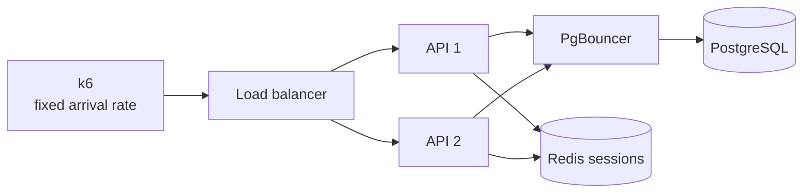

:::mental-model
**Adding a server is an experiment with two possible results: the bottleneck moves, or it does not. The load test tells you which.**
:::

## The same test, one variable changed

On Thursday at 14:00, the clinic takes a maintenance window. The Module 2 load test is ready: the same k6 script, the same dataset, the same 80/20 read/write mix.

The hypothesis has three parts:

1. Two API servers will raise sustainable throughput from about 480 to about 930 requests per second.
2. p99 at 900 requests per second will fall below 400 ms.
3. The database will become the next bottleneck, so a third server will add little.

The first two are the claims the team wants to believe. The third is the one that decides what to buy next.

## The setup

| Component | Before | After |
|---|---|---|
| API | 1 × 4 vCPU, 8 GB | 2 × 4 vCPU, 8 GB |
| Load balancer | none | L7, least connections, 10 s health checks |
| Sessions | local memory, sticky | Redis, 30-minute idle timeout |
| Database | 8 vCPU, 32 GB, direct connections | same, behind PgBouncer |
| Pools | 20 per process | 12 per process, 24 total clients |
| Object storage | local disk | bucket, presigned uploads |
| Load generator | separate 8 vCPU machine | same |
| Dataset | 20 doctors, 500k appointments | same |

Two changes are not part of the scaling test: the session store and object storage. They are prerequisites for the second server to work at all. Without them, a fraction of requests would fail for reasons unrelated to capacity, and the test would measure a broken application.

:::warning
Change one variable at a time, but do not test a fleet that cannot serve a single user correctly. Move the state first, verify with a smoke test, then run the capacity test.
:::

## The method

1. Warm up for 60 seconds at 200 requests per second.
2. Use an **open model**: a fixed arrival rate, not a fixed number of users waiting for responses. This avoids coordinated omission.
3. Hold each step for two minutes: 200, 400, 600, 900, 1,200 requests per second.
4. Record p50, p95, p99, error rate, API CPU per server, database CPU, active connections and pool wait.
5. Stop a step if p99 exceeds 2 seconds or errors exceed 5%.
6. Run the same script against one server, then two.



## Reference results

These numbers come from a reference run on the hardware above. Treat them as a shape, not a guarantee.

### One API server

| Offered | Achieved | p50 | p95 | p99 | Errors | API CPU | DB CPU |
|---:|---:|---:|---:|---:|---:|---:|---:|
| 200/s | 200/s | 18 ms | 42 ms | 65 ms | 0% | 38% | 32% |
| 400/s | 398/s | 45 ms | 120 ms | 180 ms | 0% | 76% | 61% |
| 600/s | 540/s | 180 ms | 380 ms | 520 ms | 0.3% | 94% | 88% |
| 900/s | 610/s | 620 ms | 1,400 ms | 1,800 ms | 4.1% | 99% | 99% |

The knee is around 450–500 requests per second. Beyond it, the API cannot accept work fast enough, the queue grows, and the p99 is set by the wait rather than by the query.

### Two API servers

| Offered | Achieved | p50 | p95 | p99 | Errors | API CPU each | DB CPU |
|---:|---:|---:|---:|---:|---:|---:|---:|
| 200/s | 200/s | 14 ms | 32 ms | 52 ms | 0% | 22% | 34% |
| 400/s | 400/s | 22 ms | 52 ms | 90 ms | 0% | 43% | 58% |
| 600/s | 600/s | 30 ms | 78 ms | 140 ms | 0% | 64% | 76% |
| 900/s | 900/s | 48 ms | 130 ms | 260 ms | 0% | 92% | 88% |
| 1,200/s | 1,080/s | 240 ms | 720 ms | 1,400 ms | 2.4% | 99% | 99% |

The first three claims are now measurable:

1. **Throughput:** the knee moved from about 480 to about 930 requests per second. That is close to double, slightly below because of shared database and balancer overhead.
2. **Latency:** p99 at 900 requests per second fell from 1,800 ms to 260 ms. The 400 ms target is met.
3. **The new bottleneck:** the database is at 88% at 900 requests per second and pins at 99% at 1,080. The API servers are also near their limit at that point, but the database reached saturation first.

## What doubled

- **API capacity:** 480 → 930 requests per second, a 1.94× gain.
- **API CPU headroom at 900 rps:** from 99% on one server to 92% on two, and each server handles about 450.
- **Database clients:** from 20 to 24, held in check by PgBouncer. Without it, the second server would have added 20 more direct connections.
- **Monthly cost:** from $24 to $48 for the API tier.
- **Failure tolerance:** one API server can die and the service keeps serving, at reduced capacity.

## What did not double

- **Database capacity.** The primary still commits every write through one WAL and one set of locks. At 1,080 requests per second it is at 99% CPU, and no number of API servers changes that.
- **p99 at saturation.** At 1,200 offered, the p99 is 1,400 ms with two servers, not half of the one-server 1,800 ms. Queueing at the database dominates.
- **Cache hit rate.** The same keys, the same TTLs, the same misses. More servers do not make a cache warmer.
- **Operational simplicity.** Two log streams, two deploy targets, two sets of metrics, and a balancer that must be configured, monitored and made redundant.

## The third server

The team tries a third server at 1,200 offered. The API tier could handle 1,350 requests per second, but the database still saturates at about 1,100. The result:

| Servers | Achieved at 1,200 offered | p99 | DB CPU | DB clients |
|---:|---:|---:|---:|---:|
| 1 | 610 | 1,800 ms | 99% | 20 |
| 2 | 1,080 | 1,400 ms | 99% | 24 |
| 3 | 1,100 | 1,500 ms | 99% | 36 |

The third server adds twelve database clients and no throughput. The p99 is slightly worse because the database has more clients competing for the same CPU. This is the concrete version of Module 4.2’s lesson: **find the binding constraint before adding capacity to something else.**

The next move is not a fourth API server. It is one of:

- reduce database work per request (fewer queries, a better index, a cache),
- move reads to a replica and accept replication lag,
- partition writes across more than one primary,
- or accept the current ceiling and shed load above it.

## Reproduce it

The core of the k6 scenario:

```javascript
export const options = {
  scenarios: {
    rush: {
      executor: 'constant-arrival-rate',
      rate: 900,
      timeUnit: '1s',
      duration: '2m',
      preAllocatedVUs: 200,
      maxVUs: 800,
    },
  },
  thresholds: {
    http_req_failed: ['rate<0.01'],
    'http_req_duration{endpoint:slots}': ['p(99)<400'],
  },
};
```

Watch `pg_stat_activity` during the run. The number of active sessions, the wait events and the pool queue tell you whether the database is working or waiting. A load test without the database’s view is a black box with a chart.

:::reality-check
A load test that stops at the first healthy step proves only that the system can handle that step. The knee is the result you need: the point where more offered load produces more latency instead of more throughput.
:::

:::widget two-server-proof
:::

## Check yourself

:::quiz
[
  {
    "question": "In the two-server run, what was the first resource to saturate at 1,080 rps?",
    "options": [
      "The load balancer",
      "The database primary",
      "The network interface",
      "The load generator"
    ],
    "answer": 1,
    "explanation": "The database pinned at 99% while the API servers were near but not past their limit. The primary is the shared resource that does not scale with API servers."
  },
  {
    "question": "Why did the third server fail to raise throughput at 1,200 offered?",
    "options": [
      "The balancer only supports two servers",
      "The database was already the binding constraint, so more API clients only added contention",
      "The third server had a different CPU",
      "k6 cannot generate enough load"
    ],
    "answer": 1,
    "explanation": "API capacity was no longer the limit. Adding a third server multiplied database clients without adding database capacity, and the p99 slightly worsened."
  },
  {
    "question": "Why did the test use a constant arrival rate instead of a fixed number of virtual users?",
    "options": [
      "It is easier to configure",
      "It avoids coordinated omission, where slow responses reduce the request rate and hide the tail",
      "It uses less memory",
      "It guarantees zero errors"
    ],
    "answer": 1,
    "explanation": "An open model keeps sending at the target rate even when the server slows, so the measured p99 reflects what a real arriving user would experience."
  },
  {
    "question": "Which change was a prerequisite for the second server, rather than part of the capacity test?",
    "options": [
      "Doubling the API CPU",
      "Moving sessions to Redis and uploads to object storage",
      "Adding more load generators",
      "Increasing the database’s max_connections"
    ],
    "answer": 1,
    "explanation": "Without shared sessions and object storage, requests would fail because of local state, not capacity. The test would measure a broken application rather than the effect of a second server."
  }
]
:::

## Exercise: write the test report

Using the tables above, write a one-page report for Dr. Rao:

1. the hypothesis, in one sentence;
2. the offered load and the achieved throughput for each configuration;
3. the p99 before and after, and whether the SLO was met;
4. the resource that became the new bottleneck;
5. one thing that doubled and one thing that did not;
6. your recommendation for the next $100 per month.

Then state the result that would have proved the hypothesis wrong, and whether it happened.

:::discussion
- Would you add the third server for redundancy even if it does not add throughput? What does it protect against?
- How would you test the failure case — killing one server at 900 rps — without taking down the clinic?
- Is 1,080 rps a real ceiling, or an artifact of the test mix? What would you change to find out?
:::

## Key takeaways

- Two servers moved the knee from about 480 to about 930 rps and cut p99 at 900 rps from 1,800 to 260 ms.
- The database became the binding constraint at about 1,100 rps.
- A third API server added connections and contention, not throughput.
- Sessions and uploads had to move before the second server could work at all.
- Measure achieved throughput, p99 and the saturation of every shared resource, not just the API.
- The next optimization follows the new bottleneck, not the original plan.

## Free references

- [k6: Constant arrival rate executor](https://grafana.com/docs/k6/latest/using-k6/scenarios/executors/constant-arrival-rate/) — how to generate an open-model load with a fixed request rate.
- [Google SRE Book: Handling overload](https://sre.google/sre-book/handling-overload/) — what saturation looks like and why more capacity can make it worse.
- [PostgreSQL: Monitoring database activity](https://www.postgresql.org/docs/current/monitoring.html) — the views behind the connection and wait numbers.
- [AWS: Health checks for your target groups](https://docs.aws.amazon.com/elasticloadbalancing/latest/application/target-group-health-checks.html) — how a real balancer removes an unhealthy server.
