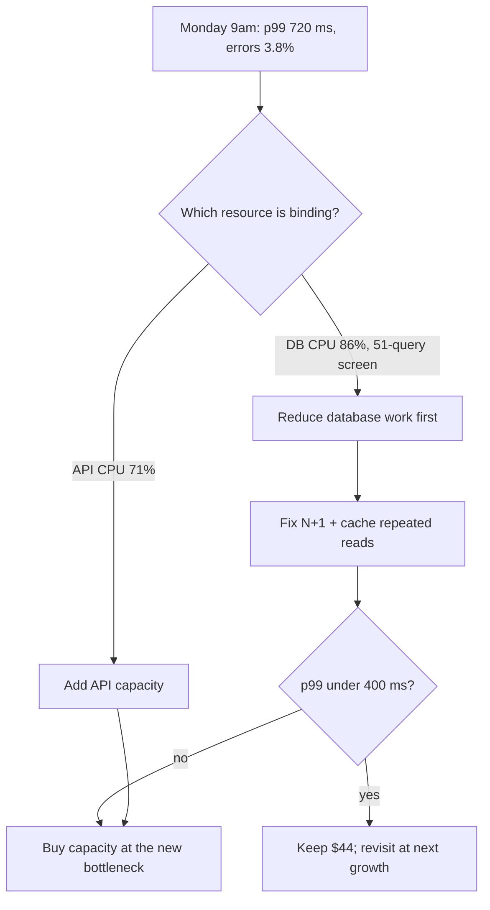

:::mental-model
**A second server is a purchase with two possible justifications: more capacity, or surviving a failure. The numbers must say which one you are buying.**
:::

## The Monday meeting

It is 9:10 on Monday. The original clinic — one location, three doctors, 200 appointments a week — is in the middle of its busiest hour.

Arjun’s reception screen takes seven seconds to load the day view. Meera tries to book a 10:30 slot and gets a spinner, then a timeout. Dr. Rao has the billing spreadsheet open on the same laptop.

The clinic spends **$44 per month** on infrastructure:

| Component | Size | Monthly cost |
|---|---|---:|
| API server | 2 vCPU, 4 GB | $12 |
| Database | 4 vCPU, 16 GB | $32 |
| Backups and monitoring | — | included |
| **Total** | | **$44** |

Dr. Rao has approved **$50 per month**, not a dollar more. The clinic’s bank balance is real, and so is the $6 gap.

The monitoring from last Monday says:

| Metric | Value | Target |
|---|---:|---:|
| Peak requests | 260 rps | — |
| p99, slot list | 720 ms | under 400 ms |
| p99, booking | 1,900 ms | under 800 ms |
| API CPU | 71% | under 70% |
| Database CPU | 86% | under 70% |
| Errors | 3.8% | under 1% |
| Double bookings | 0 | 0 |

Two proposals are on the table:

- **A second API server:** +$12, total $56. Over budget by $6.
- **A bigger API server:** +$12, total $56. Also over budget, and the database stays at 86%.

Dr. Rao asks the only question that matters: “Which one fixes Monday?”

## The brief

Decide whether the clinic should buy a second server this quarter. If yes, defend the $6 budget exception. If no, explain what to do instead and what would change your mind.

The lab is not a vote for “scale out” because this module is about scaling out. The correct answer may be **no**. You are expected to follow the numbers, including the ones that point away from a new machine.

## The constraints

- **Budget:** $50 per month, all-in. A budget exception is possible but must be justified in business terms.
- **Team:** one developer, four hours a week for operations. Every new component must be operable by that person.
- **Data:** patient records are regulated. No new storage location may be added without a retention and access review.
- **Downtime:** the clinic loses about **$180 per hour** of reception time when booking is down. A Monday outage of 30 minutes costs about $90 in staff time, before counting lost bookings.
- **SLO:** p99 under 400 ms for viewing slots, under 800 ms for booking, errors under 1%.

## Deliverable 1: baseline and gap

Write a table with the baseline above and a column for the gap to target. Then answer:

1. Which resource is closest to its limit?
2. Which SLO is furthest from target?
3. Is the API or the database the binding constraint? Use the CPU numbers and the query count, not intuition.
4. What does the error rate tell you that the latency does not?

:::note
The reception screen makes 51 queries to render 50 appointments. The booking endpoint makes 8 queries where 3 would do. Both are in the request path, and both multiply database work by the request rate.
:::

## Deliverable 2: the capacity model

Build a small model with three rows:

```text
database work per second = requests per second × queries per request × time per query
API work per second      = requests per second × CPU time per request
```

Use these reference numbers:

- a slot-list request spends 6 ms of database time across 3 queries;
- the reception screen spends 51 queries and 90 ms of database time;
- the booking endpoint spends 8 queries and 30 ms of database time;
- at 260 rps with the current mix, the database is at 86% of its capacity.

Then calculate:

1. the database CPU if the reception screen went from 51 queries to 4;
2. the database CPU if booking went from 8 queries to 3;
3. the combined effect of both fixes;
4. the API CPU after the fixes, assuming the API work stays the same.

State whether the fixes alone bring p99 under target, and what uncertainty remains.

## Deliverable 3: options table

Compare at least five options. For each, give the monthly cost, the expected effect on the binding constraint, the effect on redundancy, and the operational burden.

| Option | Cost | Capacity effect | Redundancy | Ops burden |
|---|---:|---|---|---|
| Do nothing | $0 | None; fails at next growth | None | None |
| Fix the N+1 queries | $0 | Cuts database work by roughly half | None | One developer, two days |
| Add a second API server | +$12 | Helps only if the API is binding | One server can fail | Balancer, sessions, deploys |
| Upgrade the database | +$32 | Raises the database ceiling | None | A reboot window |
| Cache the doctor list and slot list | $0–$6 | Removes repeated reads | None | Invalidation rules |
| Move to a managed database with pooling | +$20 | Raises connection headroom | Provider-managed | Migration risk |

Add one option of your own. Explain why you rejected it, or why it belongs in the shortlist.

## Deliverable 4: the decision rule

Write the rule in the form:

> Add a second API server when **\_\_\_\_**, and only if **\_\_\_\_**. Until then, do **\_\_\_\_**.

The rule must use measurements, not opinions. For example, “when p99 is above 400 ms for 15 minutes and database CPU is below 70%.” A rule that says “when it feels slow” fails the lab.

Then state the trigger for revisiting the budget. A good trigger has a metric, a threshold and a time window.

## Deliverable 5: the failure test

The current system has one API server. If it dies at 9 a.m., booking is down until it restarts. A cold boot plus a health check takes about four minutes. At $180 per hour, that is roughly $12 of lost reception time per incident, plus lost bookings and trust.

Answer:

1. How many four-minute outages per year would justify $12 per month for a standby server?
2. Does a second API server remove the database as a single point of failure? What would?
3. What is the cheapest way to reduce the blast radius of an API failure without a second server?
4. Would you buy redundancy before performance, or performance before redundancy? Why?

## Deliverable 6: rollout and rollback

If you recommend the second server, write the sequence:

1. move sessions to Redis;
2. move uploads to object storage;
3. add the load balancer and health checks;
4. deploy the second API server;
5. run the Monday test at 260 rps;
6. keep the old server as the rollback target for one week.

If you recommend optimizing first, write the sequence for the query fixes and the cache, including how you will prove the improvement with the same load test.

## Deliverable 7: the memo

Write one page to Dr. Rao. No jargon without a definition. Include:

- what is slow and who feels it;
- what the numbers say the cause is;
- the options, their cost and their expected effect;
- your recommendation and the $6 question;
- what you will measure to know whether it worked;
- what would make you change your mind.

The memo is part of the lab. A correct design that cannot be explained to the person paying for it is not finished.



:::widget lab-checklist
:::

## Rubric

Score each criterion from 1 to 3. A strong lab scores at least 12 of 18.

| Criterion | 1 — weak | 2 — adequate | 3 — strong |
|---|---|---|---|
| **Baseline** | Copies the table without interpreting it | Names the slow journey | Connects each metric to a user impact and a target |
| **Bottleneck** | Guesses “the server” | Notices the database is high | Uses query count and CPU to prove which resource binds |
| **Capacity model** | No numbers | Estimates one fix | Models both fixes, states assumptions and uncertainty |
| **Options** | Lists tools | Costs the options | Compares cost, capacity, redundancy and operational burden |
| **Decision rule** | “When it is slow” | Gives a threshold | Gives metric, threshold, window and a review trigger |
| **Failure analysis** | Ignores redundancy | Mentions one server | Quantifies outage cost and separates performance from availability |
| **Memo** | Jargon and no recommendation | Clear but incomplete | Plain language, honest tradeoff, measurable follow-up |

The **bottleneck** row is a hard gate. If the memo recommends a second API server while the database is the proven constraint, the lab fails regardless of the total.

## Check yourself

:::quiz
[
  {
    "question": "The database is at 86% CPU and the API at 71%. A second API server is proposed. What is the strongest objection?",
    "options": [
      "A second server always costs more than a bigger one",
      "It adds API capacity but leaves the binding database constraint unchanged",
      "Load balancers cannot run on a $50 budget",
      "Sessions cannot be shared"
    ],
    "answer": 1,
    "explanation": "The database has less headroom and more work per request, so it is the likely binding constraint. Adding API capacity may improve queueing slightly but does not remove the database limit."
  },
  {
    "question": "What does fixing the 51-query reception screen change?",
    "options": [
      "It raises the API’s CPU limit",
      "It reduces database work per request, which lowers the database’s utilisation at the same traffic",
      "It removes the need for a load balancer",
      "It makes the database highly available"
    ],
    "answer": 1,
    "explanation": "Fewer queries per screen means less database work for the same user action. That moves the bottleneck without buying hardware, and it is the cheapest option to test first."
  },
  {
    "question": "A second API server costs $12/month. The clinic loses about $12 per four-minute outage. How should that enter the decision?",
    "options": [
      "It is irrelevant because the budget is $50",
      "It is an availability argument separate from the performance argument",
      "It proves the second server will double throughput",
      "It means the database should be removed"
    ],
    "answer": 1,
    "explanation": "The server may be justified by failure tolerance even if it does not fix the database bottleneck. The two arguments need to be evaluated separately, and the $6 exception defended on its own terms."
  },
  {
    "question": "Which decision rule is testable?",
    "options": [
      "Add a server when the clinic feels busy",
      "Add a server when p99 exceeds 400 ms for 15 minutes and database CPU is below 70%",
      "Add a server every quarter",
      "Add a server when a competitor does"
    ],
    "answer": 1,
    "explanation": "A testable rule names a metric, a threshold and a window. It also includes the condition that makes the purchase useful: the current bottleneck must not be the database."
  }
]
:::

## Discussion

:::discussion
- Is a $6 budget exception for redundancy easier or harder to justify than a $6 exception for performance? Why?
- If the clinic fixes the queries and the p99 drops, when should it revisit the second server?
- Would you rather have one reliable server or two unreliable ones? What makes a server reliable?
- How would you explain “the database is the bottleneck” to Dr. Rao without using the word bottleneck?
:::

## Key takeaways

- A second server can buy capacity, redundancy, or both. State which one you are buying.
- The binding constraint decides whether more API servers help; at 86% database CPU, they probably do not.
- Fixing wasteful queries is the cheapest capacity upgrade and should be tested before new hardware.
- Redundancy has its own value: a single API server is a single outage.
- A decision rule needs a metric, a threshold, a window and a review trigger.
- The memo to the person paying is part of the design.

## Free references

- [Google SRE Workbook: Implementing SLOs](https://sre.google/workbook/implementing-slos/) — turning a reliability target into a decision with consequences.
- [AWS Well-Architected: Cost optimization pillar](https://docs.aws.amazon.com/wellarchitected/latest/cost-optimization-pillar/welcome.html) — how to compare capacity, redundancy and spend.
- [PostgreSQL: Using EXPLAIN](https://www.postgresql.org/docs/current/using-explain.html) — proving where the database time goes before buying a bigger database.
- [k6 documentation](https://grafana.com/docs/k6/latest/) — rerunning the Monday test after each change.
