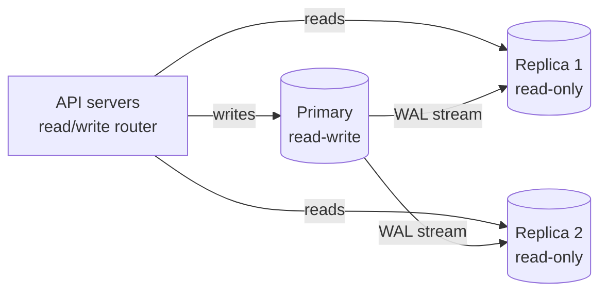

:::mental-model
**A read replica is a continuously updated copy of the database that can answer reads. It adds read capacity and a failover candidate, never write capacity.**
:::

## The Monday wall

At 09:05 on Monday, the clinic's six locations generate 900 requests per second. The API fleet is comfortable: two servers, 42% CPU each, p99 at 210 ms. PostgreSQL is not comfortable. It is at 94% CPU, and the booking endpoint's p99 has climbed to 1,100 ms.

Dr. Rao asks the reasonable question: "Can we buy a bigger database?" Yes — for a while. A 16-vCPU primary would move the wall, at twice the price, with a reboot to install it. It would still be one machine, and it would still do every read and every write.

Then Arjun points at the query dashboard. Eighty percent of the database's work is reads: slot lists, appointment history, doctor schedules, reports. The writes — booking, cancelling, updating a patient record — are a minority. The clinic is paying a write-capable primary to do mostly read work.

That is the case for a read replica. Keep one primary as the only node that accepts writes. Copy its data to one or more replicas. Send read-only queries to the copies. The primary keeps the writes and the truth; the replicas take the read traffic.

## What a replica actually is

PostgreSQL records every change in a **write-ahead log (WAL)** before the change reaches the data files. A physical replica receives that WAL stream from the primary and replays it continuously. The result is a block-for-block copy of the primary, usually running as a **hot standby**: it applies changes while serving read-only queries.



The replication connection is not a client connection pool. The primary runs a **walsender** per replica; the replica runs a **walreceiver** and a startup process that replays the log. The replica does not need to ask the primary for each query, and the primary does not execute the read queries on the replica's behalf.

There are two common flavours:

| Type | What crosses the network | Best for | Cost |
|---|---|---|---|
| **Physical / streaming** | WAL blocks | An exact standby, same major version | Simple, whole-cluster copy |
| **Logical** | Row-level changes for selected tables | Reporting across versions, partial copies | More configuration, conflicts possible |

Most read-scaling starts with physical streaming replication. It is the closest thing to "the same database, on another machine."

A replica is read-only for a reason. If two nodes accepted writes, they could assign the same appointment slot twice or produce two different versions of the same row. The primary is the single writer; the replicas are followers. Enforce it with `default_transaction_read_only = on`, not just with application discipline.

## Routing reads without breaking writes

The hard part is not creating the replica. It is deciding which queries may leave the primary.

Classify every database call into one of three buckets:

1. **Write.** Booking, cancelling, payment, patient updates. Always primary.
2. **Read that must be current.** "Show me the appointment I just booked." Primary, or a replica proven to be caught up.
3. **Read that can be slightly stale.** Slot search, doctor list, historical reports, dashboard counts. Replica.

A read/write router can live in the application, in the data-access layer, or in a proxy. Wherever it lives, it needs an explicit rule, not a guess based on the SQL verb. `SELECT` is not automatically safe: a `SELECT` inside a booking transaction may need to see the row the same transaction just wrote.

```text
BEGIN;
INSERT INTO appointments ...;
SELECT * FROM appointments WHERE id = ...;  -- must stay on the primary
COMMIT;
```

Two traps are common. An ORM may open a transaction on a replica for a read, then try to write through the same connection and fail. And a read-only route may be applied to a query that calls a function with side effects. Test the router with the application's real query set, not with a toy `SELECT 1`.

:::warning
A replica is not a free read pool. It has its own CPU, disk, connections and locks. A reporting query that scans two million rows can pin a replica just as easily as it pinned the primary. Put expensive analytics on a dedicated replica, or run them off-peak.
:::

## What replicas do not fix

Replicas do not increase write throughput. Every booking still commits through one primary, one WAL and one set of row locks. Offloading reads can free enough CPU for the primary to handle more writes, but the write path remains singular.

They also do not remove the primary as a single point of failure. A replica gives you a candidate to promote, not an automatic recovery. Promotion needs detection, a decision, a redirect and a plan for the writes that were in flight. Those are the subjects of units 5.2 and 5.3.

And they do not replace backups. A replica applies the same `DELETE` that a tired developer ran without a `WHERE` clause. It is a copy of the present, not a copy of last Tuesday. Unit 5.4 handles that distinction.

## A worked example: 80/20, then 70/30

Use the Module 4 numbers. The primary can do about **1,100 mixed requests per second** at an 80/20 read/write mix, which is **220 writes and 880 reads** per second. With reads offloaded, the primary can commit about **360 writes per second** before its own CPU saturates. Each replica can serve about **1,200 simple reads per second**.

Now the arithmetic depends on the mix:

| Read/write mix | Write ceiling | Read ceiling (2 replicas) | System knee | Binding resource |
|---|---:|---:|---:|---|
| 80/20 | 360 writes/s | 2,400 reads/s | **1,800 rps** | Primary writes |
| 90/10 | 360 writes/s | 2,400 reads/s | **2,667 rps** | Replica reads |
| 70/30 | 360 writes/s | 2,400 reads/s | **1,200 rps** | Primary writes |

At 1,800 requests per second and an 80/20 mix, the split is 1,440 reads and 360 writes. Each replica handles 720 reads, or 60% of its capacity. The primary is at its write ceiling. Adding a third replica adds read headroom, not throughput.

At 90/10 the write path has room for 3,600 requests per second, but the two replicas run out of read capacity first: 2,400 reads per second is 90% of 2,667. At a 70/30 mix, the same cluster tops out near 1,200 requests per second because 30% of 1,200 is 360 writes. The replicas are mostly idle. This is the sentence to remember: **the mix decides whether replicas help.**

## What breaks

**Replica lag.** The copy is behind by milliseconds or seconds. A read-after-write returns yesterday's state. Unit 5.2 is entirely about this.

**A routing bug sends writes to a replica.** The query fails with `cannot execute INSERT in a read-only transaction`, or worse, a write is silently retried against the primary after a confusing error. Test the router, and make the failure loud.

**A reporting query eats the replica.** One dashboard refresh scans the appointment table and pushes replica CPU to 100%, so every slot search on that replica slows down. Isolate analytics or cap their resources.

**Replication slots fill the primary's disk.** A replica that stops consuming WAL can make the primary retain logs indefinitely. Monitor slot lag and set a limit; a broken replica must not take down the writer.

**Cost and operations grow quietly.** Each replica is another server to patch, monitor, back up and secure, plus another connection pool for the application. Two replicas are not twice as simple; they are a small distributed system.

:::reality-check
The first replica often feels disappointing: it adds capacity, but the primary still owns every write and every failure. That is not a bug in the replica. It is the shape of the problem. Replicas buy read scale and a standby; they do not turn one writer into many.
:::

:::widget replica-routing
:::

## Check yourself

:::quiz
[
  {
    "question": "A clinic has an 80/20 read/write mix and adds one read replica. What does the replica remove from the primary?",
    "options": [
      "All write work",
      "Read work that the router sends to it",
      "The need for backups",
      "The primary's single point of failure"
    ],
    "answer": 1,
    "explanation": "The replica can answer read-only queries, freeing primary CPU and I/O. Writes still commit on the primary, and the primary remains a single point of failure until failover is designed."
  },
  {
    "question": "Why must a SELECT immediately after an INSERT usually stay on the primary?",
    "options": [
      "Replicas cannot run SELECT statements",
      "The replica may not have replayed the INSERT yet, so the read could miss the new row",
      "SELECT statements always take write locks",
      "The primary is always faster"
    ],
    "answer": 1,
    "explanation": "Replication is asynchronous by default. A read on a lagging replica can miss a write that the user just made, which is the read-your-writes problem covered in 5.2."
  },
  {
    "question": "The primary handles 360 writes per second at saturation. The workload is 70/30 read/write. What is the system's approximate knee with two replicas?",
    "options": [
      "360 rps",
      "1,200 rps",
      "1,800 rps",
      "2,400 rps"
    ],
    "answer": 1,
    "explanation": "Thirty percent of total requests are writes. At 1,200 rps, writes are 360 per second, which saturates the primary. The replicas still have read capacity, but the writer is the wall."
  },
  {
    "question": "Which workload is the best candidate for a dedicated reporting replica?",
    "options": [
      "The booking transaction",
      "A monthly revenue report that scans millions of rows",
      "The payment callback",
      "A password change"
    ],
    "answer": 1,
    "explanation": "Large scans consume CPU and I/O without needing the freshest data. Isolating them on a replica protects the primary's write path and the latency of small read queries."
  }
]
:::

## Exercise: build the routing table

Take these twelve operations and classify each as **primary write**, **primary read**, **replica read**, or **needs a freshness rule**:

1. Create an appointment.
2. List available slots for tomorrow.
3. Show the confirmation for the appointment just created.
4. Cancel an appointment.
5. Show a patient's visit history.
6. List doctors and their working hours.
7. Monthly revenue report.
8. Update a phone number.
9. Search patients by name.
10. Check whether a slot is still free before booking.
11. Load the reception day view.
12. Export all appointments to a spreadsheet.

Then:

- Write the routing rule for each bucket in one sentence.
- Calculate the system knee for an 85/15 mix with two replicas, using the numbers above.
- State one query you would never route to a replica, and why.
- Name the metric that would tell you a replica is overloaded.

:::discussion
- If reads are 95% of the workload, does a replica help more or less than if reads are 60%? Explain with the write ceiling.
- Should the application or a proxy decide where a query runs? What does each choice make easier to debug?
- Is it acceptable to run reports on the same replica that serves patient reads at peak time? What would you measure first?
:::

## Key takeaways

- A read replica is a continuously updated, read-only copy of the primary.
- Writes still go through one primary; replicas add read capacity and a failover candidate.
- Route by query intent and freshness requirement, not by whether the SQL starts with SELECT.
- The read/write mix decides the benefit: more writes means the primary's ceiling arrives sooner.
- Replicas have their own CPU, disk, connections and failure modes.
- A replica is not a backup and not an automatic failover.

## Free references

- [PostgreSQL: Warm standby and streaming replication](https://www.postgresql.org/docs/current/warm-standby.html) — how WAL shipping and hot standby work.
- [PostgreSQL: Hot standby](https://www.postgresql.org/docs/current/hot-standby.html) — read-only queries on a replica and the conflicts that can occur.
- [Amazon RDS: Read replicas](https://docs.aws.amazon.com/AmazonRDS/latest/UserGuide/USER_ReadRepl.html) — a managed implementation, including lag and promotion behaviour.
- [PostgreSQL: Write-ahead logging](https://www.postgresql.org/docs/current/wal-intro.html) — why the WAL exists and what durability means at commit.
