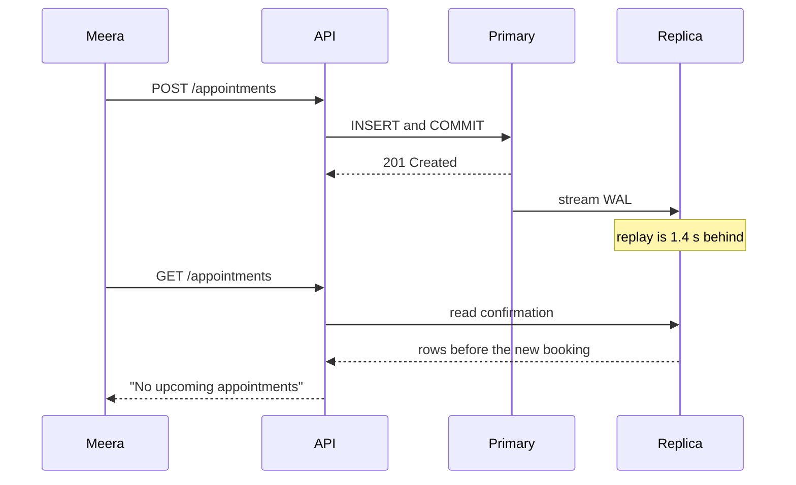

:::mental-model
**Replication lag is the gap between a commit on the primary and that commit becoming visible on a replica. Read-your-writes is the rule that keeps a user from falling into that gap.**
:::

## The appointment that vanished

At 09:12, Meera books an 18:30 appointment for her son. The booking request commits on the primary and returns `201 Created`. The confirmation screen immediately loads "your upcoming appointments" from a read replica.

The replica is 1.4 seconds behind. It has not replayed the booking yet. The screen says: **No upcoming appointments.**

Meera assumes the booking failed. She submits again. The second request creates another appointment for the same slot, because the booking endpoint's uniqueness check also read from the lagging replica and saw nothing. Arjun now has two identical appointments, one angry parent, and a support ticket that says "the system lost my booking" — when the system actually kept it twice.

The primary was correct. The replica was honest. The routing rule was wrong.

## Why copies fall behind

With asynchronous streaming replication, a commit is durable on the primary before the replica sees it:



Every step takes time. Normal lag on a healthy local network is **50–200 ms**. It grows when any part of the chain slows down:

- **Network delay or packet loss** between primary and replica.
- **Replica CPU or disk saturation** — replay competes with read queries.
- **A long primary transaction.** The replica cannot make the transaction's changes visible until it commits, so every later change waits behind it. A ten-minute bulk update produces a ten-minute lag cliff.
- **Bursts of writes.** Replay is limited by one startup process in standard PostgreSQL; a burst can take longer to apply than it took to generate.
- **Bulk imports, `VACUUM`, index builds and DDL.** These generate large WAL volumes or hold locks that delay replay.
- **A replica restart or a network partition.** When it reconnects, it must catch up on everything it missed.

Lag is a distribution, not a number. An average of 180 ms can hide a p99 of four seconds and a maximum of forty. Alert on the tail and on the duration above a threshold, not on the mean.

## Three promises, not one

"Consistency" is too vague to implement. Name the promise:

| Promise | What the user is guaranteed | Typical use |
|---|---|---|
| **Read-your-writes** | After I write, my next read sees my write | Booking confirmation, profile edit, payment |
| **Monotonic reads** | I never see time go backwards across reads | A dashboard that refreshes |
| **Causal consistency** | If I see a reply, I also see the message it replies to | Messaging, comments, audit trails |

Most clinic screens only need the first. Meera must see her own booking; she does not need every other patient's booking to be current. Arjun's reception day view needs monotonic reads so a refresh does not make an appointment disappear and reappear.

Global strong consistency — every read on every replica sees every committed write — is expensive. It usually means synchronous replication, which adds write latency and can stop writes when a replica is slow or unavailable. Pay for it only where the product needs it.

## Four ways to read your own writes

**1. Pin the user to the primary for a short window.** After a successful write, set a session flag or cookie for five seconds. Reads from that user go to the primary until the window expires.

```text
POST /appointments  → 201, set sd_read_primary_until = now + 5s
GET  /appointments  → primary while the flag is active, replica afterwards
```

At 1,800 requests per second and a 5% write rate, a five-second pin sends roughly 90 extra reads per second to the primary. That is affordable. A thirty-second pin sends about 540, which is not.

**2. Wait for the replica to catch up.** Return the write's LSN (log sequence number) with the response. On the next read, ask the replica to wait until its replay LSN is at least that value, with a short timeout. If the timeout fires, read from the primary or return a retryable error.

This is precise, but it adds a wait to the user's request and needs driver or proxy support. Use it for critical reads, not for every page.

**3. Render from the write response.** The booking response already contains the appointment. Show it immediately instead of re-reading the list from a replica. This removes the race for the confirmation screen, but not for the next page the user opens.

**4. Route critical reads to the primary permanently.** Confirmation screens, payment status and "my next appointment" can stay on the primary. The volume is small, and the correctness is easy to explain.

:::warning
Do not fix lag by making every read hit the primary. That is a valid emergency lever, but it recreates the original bottleneck and removes the reason the replicas exist. Measure how much read traffic each rule moves before you ship it.
:::

## Measure it properly

PostgreSQL exposes replication state in `pg_stat_replication` on the primary. The useful columns include `write_lag`, `flush_lag`, `replay_lag` and the corresponding LSN positions. Compare the primary's current WAL position with the replica's last replayed position to measure the gap in bytes, then convert to time using the write rate.

Track, per replica:

- **p50 and p99 replay lag**, not just the average.
- **Maximum lag** in the last hour.
- **Seconds spent above the freshness budget** for each screen.
- **Replica CPU, disk latency and read-query latency.**
- **Replication slot retained bytes**, so a broken replica cannot fill the primary's disk.

Then test the promise directly: write a unique marker, poll the replica until it appears, and record the convergence time. Do it at peak traffic, not on an idle Tuesday.

## A worked example: 220 writes per second

The primary commits 220 writes per second. Lag is 400 ms. The number of writes not yet visible on the replica is approximately:

```text
220 writes/s × 0.4 s = 88 writes
```

Eighty-eight recent changes are invisible. If the clinic books 220 appointments per second — a busy Monday — then 88 of the last second's bookings could be missing from a replica read.

| Lag | Writes not yet visible at 220/s | What a user may see |
|---:|---:|---|
| 100 ms | 22 | Almost nothing; a fast refresh may miss one row |
| 400 ms | 88 | Confirmation screen can miss the booking |
| 1.8 s | 396 | Duplicate bookings become likely |
| 5 s | 1,100 | Whole conversations of changes missing |

The fix is not always "reduce lag." The fix is to stop asking a lagging copy a question that requires the primary's latest answer.

## What breaks

**A long transaction creates a lag cliff.** A reporting job updates a million rows in one transaction; the replica cannot show any of it until commit, and every unrelated change behind it waits. Break large writes into batches, or run them off-peak.

**The replica restarts during a deploy.** It comes back cold, replays a backlog, and serves stale reads while it catches up. Remove it from the read pool until its lag is inside the budget.

**A cache sits on top of the replica.** A five-minute TTL can serve data that is older than the replica itself. Invalidation and replication are separate layers; both need a freshness budget.

**The lag alert uses the average.** The dashboard looks healthy while one replica is eight seconds behind for thirty seconds. Alert on p99 and on consecutive breaches.

**Synchronous replication is added as a reflex.** It reduces the read-your-writes gap but adds latency to every commit and can block writes if the standby is slow. Use it deliberately, with a timeout and a fallback plan.

:::reality-check
Users do not experience "replication lag." They experience a booking that disappears, a payment that looks failed, or a profile edit that reverts. Measure the mechanism, but design the rule around the screen.
:::

:::widget replica-lag
:::

## Check yourself

:::quiz
[
  {
    "question": "A user books an appointment and the confirmation page reads from a replica with 1.4 seconds of lag. What is the most likely result?",
    "options": [
      "The booking is lost on the primary",
      "The confirmation page omits the booking, even though the commit succeeded",
      "The replica rejects the booking",
      "The primary rolls back the commit"
    ],
    "answer": 1,
    "explanation": "The write is durable on the primary, but the replica has not replayed it yet. The confirmation read sees an older state, which can prompt the user to submit again."
  },
  {
    "question": "Which rule directly guarantees that a user sees their own recent write?",
    "options": [
      "Monotonic reads",
      "Read-your-writes",
      "Eventual consistency",
      "Read from any replica"
    ],
    "answer": 1,
    "explanation": "Read-your-writes pins the user's reads to a source that includes their write, usually the primary for a short window or a replica that has caught up to the write's LSN."
  },
  {
    "question": "Why can a single long-running transaction cause a large replication lag spike?",
    "options": [
      "It disables the WAL",
      "Its changes are not visible on the replica until it commits, and later changes wait behind it",
      "It deletes the replica's indexes",
      "It forces all reads to the primary"
    ],
    "answer": 1,
    "explanation": "Replay is ordered. A long transaction holds back visibility of its own changes and everything after it, so a ten-minute batch update can produce a ten-minute lag cliff."
  },
  {
    "question": "At 200 writes per second, a replica is 1.5 seconds behind. About how many writes are not yet visible?",
    "options": [
      "30",
      "150",
      "300",
      "2,000"
    ],
    "answer": 2,
    "explanation": "200 writes/s × 1.5 s = 300 writes. This is why a lag figure in seconds must be translated into user-visible changes before deciding whether it matters."
  }
]
:::

## Exercise: set a freshness budget

For each screen, write the promise it needs, the maximum acceptable staleness, and the routing rule:

1. Booking confirmation.
2. Reception day view.
3. Patient visit history.
4. Doctor schedule for next week.
5. Monthly revenue report.
6. "My next appointment" on the patient home page.

Then:

- Design the read-your-writes rule for booking. State how long the primary pin lasts and how much extra primary traffic it creates at 1,800 rps with a 5% write rate.
- Write a test that measures convergence time at peak load.
- Choose one screen where stale data is acceptable and defend it.
- Name the alert threshold for each replica, including the window.

:::discussion
- Is a five-second primary pin a technical rule or a product decision? Who should own it?
- Would you rather have 200 ms of lag with a read-your-writes rule, or 5 ms of lag with synchronous replication? What does each cost?
- How would you explain to Arjun why the confirmation screen was wrong but the booking was not lost?
:::

## Key takeaways

- Replication lag is the delay between a primary commit and its visibility on a replica.
- Lag is a distribution; watch p99 and the duration above the freshness budget.
- Name the promise: read-your-writes, monotonic reads, or causal consistency.
- Pin a user to the primary briefly, wait for an LSN, or render from the write response.
- Long transactions and bulk writes create lag cliffs, not just gradual delay.
- A cache on top of a replica can make staleness worse; design both layers together.

## Free references

- [PostgreSQL: Monitoring replication](https://www.postgresql.org/docs/current/monitoring-stats.html) — `pg_stat_replication` and the lag columns used in production.
- [PostgreSQL: Hot standby](https://www.postgresql.org/docs/current/hot-standby.html) — how replay works and why conflicts can delay queries.
- [Jepsen: Consistency models](https://jepsen.io/consistency) — a precise map of read-your-writes, monotonic reads and stronger guarantees.
- [AWS: Troubleshooting read replica lag](https://docs.aws.amazon.com/AmazonRDS/latest/UserGuide/USER_ReadRepl.Troubleshooting.html) — common causes of lag on a managed replica.
