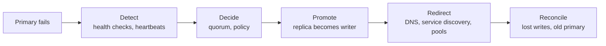

:::mental-model
**Failover is a sequence: detect the failure, decide with quorum, promote one replica, redirect traffic, and reconcile what was lost. Skipping a step creates either a long outage or two primaries.**
:::

## The evening the database disappeared

At 19:40 on a Tuesday, the clinic is in its evening rush. The primary database's host loses its disk controller. The process does not return an error; the machine simply stops answering.

Arjun's reception screen freezes on a spinner. Meera's booking request hangs for thirty seconds and then shows a network error. The on-call dashboard turns red.

Forty-five seconds later, booking works again. Most patients never notice. But two appointments from the last 1.8 seconds are gone: they committed on the old primary, never reached the replica that was promoted, and were never replayed. The patients received success messages. The new primary has no record of them.

Dr. Rao asks the question that separates a demo from a production system: "It came back. Why did it lose bookings?"

## Failure is a sequence

A database failover is not a single event. It is five steps, each with its own failure mode:



**Detect.** A health check, a missed heartbeat, or a failed write. Detection takes time; a timeout that is too short produces false alarms, and one that is too long produces a long outage.

**Decide.** Is the primary really dead, or just slow? Is there a network partition? Which replica is most current? Automatic systems use a quorum or a distributed consensus store; manual systems use a human with a runbook.

**Promote.** One replica stops recovery, becomes writable, and starts accepting connections. The other replicas must follow the new primary, not the old one.

**Redirect.** Applications must find the new writer. That may mean a DNS change, a service-discovery update, a proxy reconfiguration, or a connection-pool failover. Old connections are broken and must be discarded.

**Reconcile.** Writes that committed on the old primary but never reached the promoted replica are missing. Find them, decide whether to replay them, and prevent the old primary from accepting writes if it comes back.

## Quorum and split-brain

The most dangerous failover is the one where the old primary is still alive.

Imagine a network partition at 19:40. The old primary can still reach two API servers, but not the replicas or the monitoring system. The failover tool sees a dead primary and promotes a replica. Now two databases accept writes. A booking on the old primary and a booking on the new primary can claim the same 18:30 slot. When the network heals, there is no automatic way to merge the two histories.

This is **split-brain**, and it is why promotion needs a quorum: a majority of voting nodes must agree that the old primary is gone. A two-node cluster has no majority when the network splits; add a witness or use a three-node consensus store. The old primary must also be **fenced** — stopped, isolated, or stripped of its credentials — before the new one accepts writes.

```text
Without fencing:  old primary + new primary = two writers
With fencing:     old primary is stopped before promotion completes
```

Fencing can be a power-off command, a revoked network route, a database credential change, or a load-balancer rule. It must be automatic enough to run during an incident, and it must be tested. A runbook that says "remember to fence" is not a control.

:::warning
If the cluster cannot establish quorum, the safe action is usually to stop accepting writes. An outage is visible and recoverable. Two primaries can silently corrupt appointment history.
:::

## RPO and RTO

Two numbers describe the promise:

- **Recovery point objective (RPO):** how much data you can lose, measured in time. "Up to 1.8 seconds of writes."
- **Recovery time objective (RTO):** how long the service can be unavailable. "45 seconds" or "12 minutes."

With asynchronous replication, RPO is the replication lag at the moment of failure. At 900 requests per second and a 20% write share, the primary commits 180 writes per second. A 1.8-second lag means up to:

```text
180 writes/s × 1.8 s = 324 writes
```

Most of those are updates, not bookings, but the clinic cannot tell which ones mattered until it reconciles.

Synchronous replication can reduce RPO to zero: the primary waits for a standby to acknowledge the WAL before returning success. The cost is added commit latency and a new availability dependency. If the standby is slow or unreachable, writes may block. That is a reasonable trade for a payment ledger; it is usually the wrong default for a clinic's slot search.

| Mode | RPO | Typical RTO | Write latency | Main risk |
|---|---|---:|---|---|
| Async + automatic | Seconds of lag | ~45 s | Normal | Lost recent writes |
| Async + manual | Seconds of lag | ~12 min | Normal | Human delay, longer outage |
| Sync + automatic | 0 | ~45 s | +1–5 ms | Writes block if standby is unavailable |
| Sync + manual | 0 | ~12 min | +1–5 ms | Same, plus human delay |

## The availability budget

"Three nines" sounds generous until you divide it by twelve months:

| Availability | Downtime per month | Downtime per year |
|---:|---:|---:|
| 99.9% | 43.2 minutes | 8.77 hours |
| 99.95% | 21.6 minutes | 4.38 hours |
| 99.99% | 4.32 minutes | 52.6 minutes |

A manual failover that takes 12 minutes consumes 28% of a three-nines monthly budget in one incident. Two of them and the month is gone. An automatic 45-second failover consumes 1.7%. That difference is the reason teams automate, even though automation is harder to build and test.

## What the application must do

Failover is not finished when the database is writable. The application has to survive the transition:

- **Retry with idempotency.** A booking request that timed out may have committed. Retry with an idempotency key so the second attempt returns the first result instead of creating a duplicate.
- **Discard broken connections.** Pools must detect closed sockets and reconnect, with a bounded retry and jitter.
- **Cap the retry storm.** Every API server reconnecting at once can overwhelm the new primary. Stagger reconnects and shed load while the cluster is recovering.
- **Use a short DNS TTL or service discovery.** A 300-second TTL turns a 45-second database failover into a five-minute outage.
- **Serve a clear 503 during the gap.** A fast "try again in a few seconds" is better than a request that hangs until the client gives up.
- **Reconcile lost writes.** Keep an application-side record of successful writes, or an outbox, so you can compare it with the promoted primary.

:::note
PostgreSQL does not provide automatic failover by itself. Tools such as Patroni, pg_auto_failover and repmgr add leader election, promotion and fencing. The database gives you replication; the tool gives you a cluster.
:::

## A worked timeline

At 19:40:00 the primary's host dies. The reference automatic failover:

| Time | Event | Elapsed |
|---|---|---:|
| 19:40:00 | Primary stops responding | 0 s |
| 19:40:15 | Three health checks fail | 15 s |
| 19:40:20 | Quorum confirms the leader is gone | 20 s |
| 19:40:25 | Replica promoted; old primary fenced | 25 s |
| 19:40:35 | Service discovery points to the new primary | 35 s |
| 19:40:45 | API pools reconnect; first booking succeeds | 45 s |

RTO is 45 seconds. RPO is the 1.8 seconds of lag at failure, or up to 324 writes. The API saw about 2.8% errors during the gap, almost all retryable. The team's job after the incident is not finished: those 324 writes need a reconciliation pass, and the old primary must not be allowed back as a writer without a full rewind.

## What breaks

**Promoting the most convenient replica, not the most current one.** The result is a larger RPO than necessary. Choose by replay position, not by hostname.

**A failover loop.** The new primary fails health checks, the cluster promotes another node, and the old one rejoins as a replica. Add hysteresis: require a stable period before another promotion.

**An old primary returns as a writer.** Fencing failed, or the old node was restored from a snapshot with the same identity. Force it to rejoin as a replica and rewind to the new timeline.

**Connection storms.** Thousands of clients reconnect at once. Use pool backoff, connection limits and load shedding.

**Lost writes are never reconciled.** The service looks healthy, but a few patients hold confirmations for appointments that do not exist. Compare application success logs with database rows after every failover.

:::reality-check
The goal of failover is not "the database is back." It is "the database is back, only one node is writing, and we know exactly what was lost." Measure all three.
:::

:::widget failover-timeline
:::

## Check yourself

:::quiz
[
  {
    "question": "Why must the old primary be fenced before a replica is promoted?",
    "options": [
      "To make the new primary faster",
      "To prevent two nodes from accepting writes and diverging",
      "To reduce replication lag",
      "To free the old primary's disk"
    ],
    "answer": 1,
    "explanation": "If the old primary is alive but isolated, it can still accept writes. Promotion without fencing creates split-brain, where two histories cannot be merged safely."
  },
  {
    "question": "A primary commits 180 writes per second and replication lag is 1.8 seconds at failure. What is the approximate RPO?",
    "options": [
      "0 writes",
      "18 writes",
      "324 writes",
      "1,800 writes"
    ],
    "answer": 2,
    "explanation": "RPO in writes is the write rate multiplied by the lag: 180 × 1.8 = 324. Those writes may have been acknowledged to users but are absent from the promoted replica."
  },
  {
    "question": "A manual failover takes 12 minutes. How much of a 99.9% monthly availability budget does one incident consume?",
    "options": [
      "About 3%",
      "About 28%",
      "About 50%",
      "It exceeds the whole budget"
    ],
    "answer": 1,
    "explanation": "99.9% allows 43.2 minutes per month. Twelve minutes is 12 / 43.2, or about 28%. Two such incidents would use more than half the month's budget."
  },
  {
    "question": "Which application change makes a retried booking safe during failover?",
    "options": [
      "A longer request timeout",
      "An idempotency key that identifies the original attempt",
      "Reading from a replica",
      "Disabling connection pooling"
    ],
    "answer": 1,
    "explanation": "A timeout does not tell the client whether the commit succeeded. An idempotency key lets a retry return the original result instead of creating a duplicate appointment."
  }
]
:::

## Exercise: write the runbook

For a primary with two replicas, asynchronous replication and a 30-second health-check timeout:

1. Write the failover sequence as numbered steps, with an owner and a maximum time for each.
2. Calculate RTO for automatic and manual promotion, using the timings in this lesson as a starting point.
3. Calculate RPO in writes at 1,500 requests per second with a 20% write share and 1.6 seconds of lag.
4. Decide whether the clinic should use automatic or manual failover. Defend the choice against its monthly availability budget.
5. Write the reconciliation query or process that finds writes present in the application log but missing from the new primary.
6. List three things that must be true before the old primary may rejoin.

:::discussion
- Is it better to lose 324 writes or to stop accepting writes for two minutes? Who should make that decision?
- Should a two-node cluster ever run automatic failover? What would you add?
- How would you test this runbook without risking real appointments?
:::

## Key takeaways

- Failover is detect, decide, promote, redirect and reconcile — not just promotion.
- Quorum and fencing prevent split-brain; without them, two primaries can accept writes.
- RPO is data loss; RTO is downtime. Both must be stated in user terms.
- Asynchronous replication trades a small RPO for normal write latency.
- Three nines allows only 43.2 minutes per month; a manual failover is a large share of it.
- Idempotent retries, short DNS TTLs and connection backoff make the application survive the transition.
- Reconcile lost writes after every failover, even when the service looks healthy.

## Free references

- [Patroni documentation](https://patroni.readthedocs.io/en/latest/) — leader election, fencing and failover for PostgreSQL.
- [PostgreSQL: Warm standby and failover](https://www.postgresql.org/docs/current/warm-standby.html) — the replication primitives a failover tool builds on.
- [pg_auto_failover](https://pg-auto-failover.readthedocs.io/en/latest/) — a smaller automatic failover system with a clear architecture.
- [Google SRE Book: Embracing risk](https://sre.google/sre-book/embracing-risk/) — how availability targets turn into engineering decisions.
