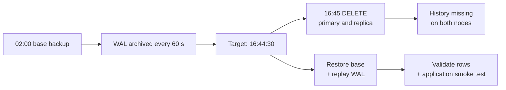

:::mental-model
**A backup is an independent copy of the past that you can restore without trusting the primary or its replicas. If you have never restored it, you have a hope, not a backup.**
:::

## The DELETE without a WHERE clause

At 16:45 on a Friday, a developer runs a cleanup script against the clinic database. The script was supposed to remove test appointments older than a year. A missing `WHERE` clause removes **every appointment older than a year** — 18 months of patient history.

The command commits in 40 milliseconds. The replica applies the same change 300 milliseconds later. By the time Arjun notices that the reception day view is empty, both the primary and the replica agree: the history is gone.

This is the moment teams discover the difference between high availability and recovery. A replica keeps the service running when a database host dies. It does not keep yesterday's data when someone deletes it. In fact, a replica is very good at deleting it everywhere, quickly and consistently.

## A replica is not a backup

A replica shares too much with the primary to be a backup:

- It applies the same writes, including mistakes.
- It usually uses the same credentials and network.
- It often lives in the same account or region.
- It has the same retention: whatever is deleted on the primary is deleted on the replica.

A backup is different by design. It is a copy at a **past point in time**, stored independently, preferably immutable for its retention period. Restoring it must not require the primary, the replica, or the credentials that caused the incident.

| Property | Replica | Backup |
|---|---|---|
| Purpose | Availability and read scale | Recovery from loss or corruption |
| Contains | Current state, continuously | A past state, at a chosen time |
| Deletes | Applies them | Preserves the pre-delete state |
| Independence | Same system, often same region | Separate storage and credentials |
| Restore speed | Promotion in seconds or minutes | Minutes to hours, depending on size |

## What a backup must survive

List the failures, then check the design against each one:

- **Accidental deletion or a bad migration.** You need a point before the change.
- **Storage corruption.** You need a copy that does not share the same disk or filesystem.
- **Ransomware or a compromised account.** You need an immutable or offline copy that the attacker cannot delete.
- **Region or provider outage.** You need a copy in another location.
- **A failed restore.** You need a tested procedure, not just a successful backup job.

The common rule is **3-2-1**: three copies, on two different media or systems, with one offsite or immutable. For a small clinic, a practical version is:

```text
primary + replica          (2 copies, same region)
nightly base backup        (separate object storage, versioned)
continuous WAL archive     (same bucket, object lock for 30 days)
monthly archive copy       (different region, 12-month retention)
```

## Three ways to back up PostgreSQL

**Logical dump (`pg_dump` / `pg_dumpall`).** Reads the database and writes SQL or a custom archive. It is portable across versions and lets you restore one table. It is slow for large databases, does not support point-in-time recovery by itself, and can miss changes made during the dump unless you use a consistent snapshot.

**Physical base backup plus WAL archiving.** Copy the data directory (or use `pg_basebackup`), then continuously archive the write-ahead log. To restore, put the base backup in place and replay WAL up to a target time. This is **point-in-time recovery (PITR)**. It is the standard for a production database because it gives you a precise RPO and a full-cluster restore.

**Storage snapshots.** The provider copies blocks at the storage layer. Snapshots are fast to take and fast to restore, but they are only as consistent as the snapshot mechanism and the filesystem. Use a provider that guarantees database-consistent snapshots, and still archive WAL if you need a precise recovery point.

| Method | RPO | Restore speed | Best for | Watch out for |
|---|---|---|---|---|
| Logical dump | Time of dump | Slow for large data | Small databases, single-table restore | No PITR; long locks |
| Base backup + WAL | Seconds | Medium | Production PITR | Archive failures, storage size |
| Storage snapshot | Time of snapshot | Fast | Large databases, fast rollback | Consistency and portability |
| Managed PITR | Seconds | Provider-dependent | Teams without a backup specialist | Cost, retention limits, restore testing |



## The arithmetic of RPO and RTO

Suppose the clinic's database is **400 GB**, the nightly base backup runs at 02:00, and WAL is archived every **60 seconds**.

- **RPO with nightly backups only:** up to 24 hours. A deletion at 16:45 loses everything since 02:00.
- **RPO with WAL archiving:** at most about 60 seconds, plus the time for the archive command to upload the final segment. The deletion at 16:45 can be restored to 16:44:30.
- **Restore time:** a 400 GB base backup at 200 MB/s takes about 33 minutes. Replaying 12 hours of WAL might add 10 minutes. Verification adds 5. That is a **48-minute RTO**, before download contention or decompression.

A storage snapshot can cut the base-restore portion. If the snapshot restores in 18 minutes, the same recovery is about 33 minutes. The point is not the exact number; it is that RTO is a calculation you can do before an incident, not a surprise you discover during one.

| Design | RPO | RTO | Monthly cost | Comment |
|---|---|---:|---:|---|
| Nightly dump, same region | 24 h | 2–4 h | Low | Fails the clinic's 5-minute RPO |
| Nightly base + WAL, same region | ~1 min | ~48 min | Medium | Good default, but one region |
| Snapshot + WAL, cross-region copy | ~1 min | ~33 min | Higher | Meets a 45-minute RTO |
| Sync replica only | ~0 | Seconds | High | Not a backup; deletes replicate |

## Test the restore, not the backup

A backup job that reports success proves only that bytes were written. It does not prove that the bytes can become a working database. Run a restore drill on a schedule:

1. **Pick a target time.** Use a real incident scenario: "restore to 16:44:30, thirty seconds before the delete."
2. **Provision a clean environment.** Never restore over the primary. Use a separate account or network.
3. **Restore the base backup.** Measure the time from start to a running instance.
4. **Replay WAL to the target.** Confirm the recovery stops at the requested time.
5. **Validate the data.** Row counts for critical tables, checksums, referential integrity, and a known appointment from before the incident.
6. **Run an application smoke test.** Point a staging API at the restored database and book, cancel and list.
7. **Record the RTO and destroy the environment.** Untracked restore environments become security liabilities.

Do this quarterly, and after any change to storage, retention or encryption. Put the restore time in the incident runbook; a number you measured is worth more than a vendor's promise.

:::warning
A backup encrypted with a key stored only in the production account is not recoverable after that account is compromised. Store the key separately, test key recovery, and document who can use it.
:::

## What breaks

**The backup and the primary share a fate.** The bucket is in the same account, the snapshot is in the same region, and the attacker or the billing failure removes both. Use a separate account, region or immutable storage.

**Retention is shorter than the detection time.** A corrupted import is noticed three weeks later, but backups are kept for seven days. Match retention to how long it takes to discover the class of failure you fear.

**WAL archiving stops silently.** The archive command fails, WAL accumulates on the primary, and the RPO quietly grows. Alert on archive age and on the gap between current WAL and the last archived segment.

**The backup contains the corruption.** A physical backup taken after a bad migration preserves the bad state. PITR is what lets you go before it; a full backup alone does not.

**Restore is slower than expected.** Download, decompression, WAL replay and index rebuild all add time. Measure on production-sized data, not a 1 GB sample.

**The backup process hurts production.** A base backup reads the whole data directory and competes with queries. Take it from a replica, throttle it, or use storage snapshots.

:::reality-check
High availability answers "the server is gone." Backup and recovery answer "the data is gone." The clinic needs both, and they are not substitutes.
:::

:::widget backup-restore
:::

## Check yourself

:::quiz
[
  {
    "question": "A developer deletes 18 months of appointments. Why does the replica not save the clinic?",
    "options": [
      "The replica is read-only and cannot store deletes",
      "The replica applies the same delete, usually within seconds",
      "The replica only stores backups",
      "The replica has a different schema"
    ],
    "answer": 1,
    "explanation": "Replication copies every committed change, including mistakes. The replica is a current copy, not a past copy, so it cannot restore data that was deleted on the primary."
  },
  {
    "question": "What does WAL archiving every 60 seconds do to the RPO?",
    "options": [
      "Makes it 24 hours",
      "Makes it at most about one minute, plus archive lag",
      "Makes it zero",
      "Removes the need for a base backup"
    ],
    "answer": 1,
    "explanation": "With a base backup and continuous WAL archiving, you can replay to a point shortly before the failure. The RPO is bounded by the archive interval and the upload delay, not by the nightly backup."
  },
  {
    "question": "Why is a successful backup job not proof that recovery works?",
    "options": [
      "Backup jobs always lie",
      "It proves bytes were written, not that they can be restored into a working database",
      "Backups are always encrypted",
      "Only replicas can be tested"
    ],
    "answer": 1,
    "explanation": "A restore drill validates the full path: storage access, decryption, base restore, WAL replay, data integrity and application behaviour. The job status covers only the first step."
  },
  {
    "question": "Which backup design best survives a compromised production account?",
    "options": [
      "A snapshot in the same account",
      "A replica in the same region",
      "An immutable copy in a separate account or region",
      "A longer retention on the primary"
    ],
    "answer": 2,
    "explanation": "Separation and immutability matter. An attacker with production credentials can delete snapshots and replicas in the same account; an object-locked copy elsewhere survives."
  }
]
:::

## Exercise: design the recovery plan

For a 400 GB PostgreSQL database with a 5-minute RPO target, a 45-minute RTO target and a 30-day retention requirement:

1. Choose the backup method and schedule. State the expected RPO and RTO with numbers.
2. Draw the storage topology: primary, replica, backup storage, WAL archive, offsite copy.
3. Write the restore drill as numbered steps, including validation queries and an application smoke test.
4. Decide where the encryption key lives and who can use it.
5. List three alerts that would catch a silently failing backup.
6. Explain why the replica is not counted as one of the three copies.

:::discussion
- Is a 5-minute RPO worth the cost of continuous WAL archiving for a clinic? What would you give up instead?
- Who should be allowed to run a restore to production? What approval is needed at 02:00?
- How would you test a restore without exposing real patient data in a staging environment?
:::

## Key takeaways

- A replica copies mistakes; a backup preserves a past state.
- RPO is how much data you can lose; RTO is how long recovery takes.
- A base backup plus archived WAL enables point-in-time recovery.
- 3-2-1 means separate copies, separate media and an offsite or immutable copy.
- A restore drill is the only proof that the backup works.
- Retention must outlast the time it takes to detect the failure you fear.
- Encryption keys and backup credentials need their own recovery plan.

## Free references

- [PostgreSQL: Continuous archiving and point-in-time recovery](https://www.postgresql.org/docs/current/continuous-archiving.html) — base backups, WAL archiving and recovery targets.
- [pgBackRest](https://pgbackrest.org/) — a widely used PostgreSQL backup tool with PITR and retention.
- [PostgreSQL: Backup and restore](https://www.postgresql.org/docs/current/backup.html) — the tradeoffs between logical and physical backups.
- [AWS Well-Architected: Back up data](https://docs.aws.amazon.com/wellarchitected/latest/reliability-pillar/back-up-data.html) — RPO/RTO planning and restore testing in a cloud environment.
