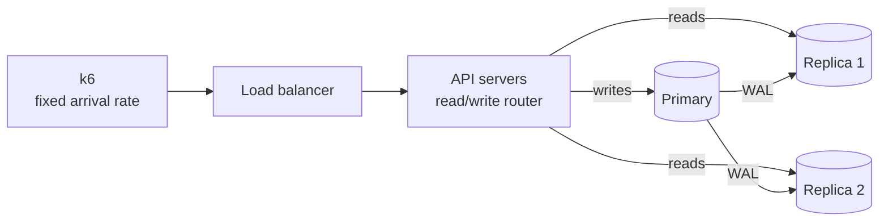

:::mental-model
**Replicas move the read ceiling, not the write ceiling. The load test tells you which one you just bought — and the failover drill tells you what the copy is worth when the writer dies.**
:::

## The same test, with copies

The clinic takes a maintenance window on Sunday at 02:00. The Module 4 load test is ready: the same k6 script, the same 500,000-appointment dataset, the same 80/20 read/write mix. The only changes are the database topology and the read router.

The hypothesis has four parts:

1. Two replicas will move the database knee from about 1,100 to about 1,800 requests per second.
2. p99 at 1,800 will stay under 300 ms.
3. The primary's write path will become the binding constraint around 360 writes per second.
4. A third replica will add read headroom but almost no throughput.

The first two are the sales pitch. The third and fourth decide what the clinic should actually buy.

## The setup

| Component | Configuration |
|---|---|
| API | 2 servers, 4 vCPU, 8 GB each |
| Primary | 8 vCPU, 32 GB, PostgreSQL 16 |
| Replicas | 2 servers, 8 vCPU, 32 GB each, streaming replication |
| Read routing | Application router: writes and fresh reads to primary, lists and reports to replicas |
| Pooling | PgBouncer in front of the primary; one pool per replica |
| Load generator | Separate 8 vCPU machine |
| Dataset | 20 doctors, 500,000 appointments |
| Mix | 80% reads, 20% writes |

## The method

1. Warm up for 60 seconds at 300 requests per second.
2. Use an **open model**: a fixed arrival rate, not a fixed number of users waiting for responses.
3. Hold each step for two minutes: 600, 1,200, 1,800 and 2,400 requests per second.
4. Record p50, p95, p99, error rate, API CPU, primary CPU, replica CPU, replication lag and pool wait.
5. Stop a step if p99 exceeds 2 seconds or errors exceed 5%.
6. Run a separate failover drill at 1,500 requests per second with the primary killed at a known moment.

The read router sends slot lists, doctor lists, appointment history and reports to the replicas. It sends booking, cancellation and the confirmation read that follows a booking to the primary. That last rule is the read-your-writes fix from 5.2, and it is part of the test, not an afterthought.

## Reference results: two replicas

| Offered | Achieved | p50 | p95 | p99 | Errors | Primary CPU | Replica CPU (each) | Lag p99 |
|---:|---:|---:|---:|---:|---:|---:|---:|---:|
| 600/s | 600/s | 22 ms | 55 ms | 90 ms | 0% | 33% | 20% | 120 ms |
| 1,200/s | 1,200/s | 31 ms | 88 ms | 150 ms | 0% | 67% | 40% | 180 ms |
| 1,800/s | 1,800/s | 48 ms | 150 ms | 280 ms | 0% | 99% | 60% | 320 ms |
| 2,400/s | 1,820/s | 310 ms | 1,150 ms | 2,300 ms | 4.2% | 99% | 61% | 2.8 s |

The CPU columns follow the model from 5.1: the primary is saturated at 360 writes per second, and each replica can serve about 1,200 reads per second. The latency, error and lag columns are from the reference run.

At 1,800 requests per second the split is 1,440 reads and 360 writes. Each replica handles 720 reads, or 60% of its capacity. The primary is at its write ceiling — 99% CPU — and its queue wait is just beginning to rise.

At 2,400 offered, the system achieves only 1,820. The extra 580 requests per second do not become bookings; they become queue time. The primary's write path is saturated. Lag climbs to 2.8 seconds because each replica's replay process shares CPU with read traffic, and the primary is now writing faster than a replica can apply.

## One replica versus two

The team repeats the run with zero, one and three replicas. The API tier is unchanged.

| Replicas | System knee | Achieved at 1,800 offered | p99 at 1,800 | Binding resource |
|---:|---:|---:|---:|---|
| 0 | 1,100 rps | 1,100 | 2,400 ms | Primary CPU (reads + writes) |
| 1 | 1,500 rps | 1,500 | 1,100 ms | Replica read CPU |
| 2 | 1,800 rps | 1,800 | 280 ms | Primary write CPU |
| 3 | 1,800 rps | 1,800 | 280 ms | Primary write CPU |

The first replica is the big win: it removes most reads from the primary and moves the knee by about 400 requests per second. The second replica adds another 300 because the primary can now use its CPU for writes and the read tier still has headroom. The third adds no throughput and no p99 gain at this mix; it only reduces read CPU per replica from 60% to 40%.

This is the non-linear result that a simple "replicas scale reads" slogan hides. At an 80/20 mix, the write path catches up quickly. If the mix were 90/10, the read tier would bind later and the second replica would matter more. If it were 70/30, the primary would bind at about 1,200 and the replicas would be mostly idle.

## What doubled, and what did not

**What improved:**

- Read capacity: one primary's read work spread across two independent servers.
- System knee: about 1,100 to about 1,800 requests per second at this mix.
- p99 at 1,800: 2,400 ms with no replica to 280 ms with two.
- Failure options: two promotion candidates instead of none.
- Reporting isolation: large scans can run on a replica without touching the booking path.

**What did not:**

- Write capacity. The primary still commits every write through one WAL and one set of locks.
- The primary as a single point of failure. Promotion is a process, not a property.
- Backup coverage. The replicas apply every mistake.
- Operational simplicity. Two more servers, two more pools, lag monitoring and a failover runbook.
- Cost. The database tier triples.

## The failover drill

At 20:00, with the system steady at 1,500 requests per second, the team stops the primary's host. The automatic failover tool has a 15-second health-check timeout and a three-node quorum.

| Time | Event |
|---|---|
| 20:00:00 | Primary stops responding |
| 20:00:15 | Health checks fail |
| 20:00:20 | Quorum confirms the leader is gone |
| 20:00:26 | Replica 1 promoted; old primary fenced |
| 20:00:35 | Service discovery updated |
| 20:00:45 | First successful booking on the new primary |

Results:

- **RTO:** 45 seconds.
- **Errors during the gap:** 3.1%, almost all retryable.
- **Replication lag at failure:** 1.6 seconds.
- **Writes at risk:** 300 writes per second × 1.6 s = **480 writes**.
- **Bookings lost:** 12, identified by comparing the application success log with the new primary.
- **p99 during failover:** 900 ms, then back under 300 ms within two minutes.

The 480 writes are not all recoverable automatically. Some are updates that can be replayed from the application log; some are bookings that need a human to confirm with the patient. The drill's most valuable output is the reconciliation list, not the 45-second number.

:::warning
A failover drill that stops at "the new primary is up" misses the data loss. Always compare the application's success log with the promoted database. A booking that the patient saw as confirmed but the database never received is worse than an error the patient can retry.
:::

:::reality-check
The clinic's current peak is about 900 requests per second, and the single primary is already at 94% CPU with booking p99 at 1,100 ms. Two replicas fix today's read pressure, not just tomorrow's. But they do not double capacity: the third replica adds no throughput. Buy the second replica for headroom and a standby; do not sell it as twice the system.
:::

:::widget replica-proof
:::

## Check yourself

:::quiz
[
  {
    "question": "With two replicas and an 80/20 mix, what limited the system at 1,800 requests per second?",
    "options": [
      "The load balancer",
      "The primary's write path",
      "The replica's network card",
      "The API servers' CPU"
    ],
    "answer": 1,
    "explanation": "At 1,800 rps the workload is 1,440 reads and 360 writes. The replicas are at 60% CPU, while the primary is at its write ceiling (99%) and its queue is growing. Writes are the binding constraint."
  },
  {
    "question": "Why did the third replica add almost no throughput?",
    "options": [
      "The router only supports two replicas",
      "The primary was already saturated on writes, so more read capacity could not raise total requests",
      "The third replica had less memory",
      "k6 could not generate more load"
    ],
    "answer": 1,
    "explanation": "Additional replicas add read capacity, but the system knee was set by the primary's write ceiling. With writes saturated, extra read capacity sits idle."
  },
  {
    "question": "What is the most important output of the failover drill?",
    "options": [
      "The 45-second RTO alone",
      "The list of writes that were acknowledged but missing from the promoted replica",
      "The new primary's hostname",
      "The number of replicas left running"
    ],
    "answer": 1,
    "explanation": "RTO tells you how long the outage lasted. The reconciliation list tells you which patients or records were affected. Both matter, but the data loss is the part that can silently harm users."
  },
  {
    "question": "At the clinic's current 900 rps, what is the honest justification for two replicas?",
    "options": [
      "They are required to reach 900 rps",
      "They double write capacity",
      "They relieve today's read pressure and provide a standby for the 1,800-rps projection",
      "They remove the need for backups"
    ],
    "answer": 2,
    "explanation": "At 900 rps the single primary is at 94% CPU, so offloading reads helps now. The replicas also give a promotion candidate for the projected 1,800 rps, but they do not add write capacity and the third replica adds no throughput."
  }
]
:::

## Exercise: write the experiment report

Using the tables above:

1. State the hypothesis and whether each of the four claims was supported.
2. Explain the difference between the one-replica and two-replica knees using the write ceiling.
3. Calculate the system knee for a 90/10 mix with two replicas. State which resource binds.
4. Calculate the writes at risk in the failover drill if lag had been 4 seconds instead of 1.6.
5. Recommend whether the clinic should add a third replica. Give one metric that would change your answer.
6. Write the first three steps of the reconciliation process for the 12 lost bookings.

:::discussion
- Is a 45-second automatic failover worth the operational complexity for a clinic at 900 requests per second?
- Should the read router send reports to the same replicas that serve patient reads? What would you measure?
- If the write ceiling is 360 per second, what are the options for going beyond it? Which one belongs in a later module?
:::

## Key takeaways

- Two replicas moved the knee from about 1,100 to about 1,800 rps at an 80/20 mix.
- The primary's write path, not read capacity, became the binding constraint.
- One replica gave most of the first gain; the second added less; the third added only headroom.
- A failover drill must measure RTO, data loss and the reconciliation list.
- At 900 rps, replicas are a read-pressure, availability and growth-headroom decision; they still do not add write capacity.
- Replicas do not replace backups, and they do not make the primary highly available by themselves.

## Free references

- [k6: Constant arrival rate executor](https://grafana.com/docs/k6/latest/using-k6/scenarios/executors/constant-arrival-rate/) — the open-model load behind these numbers.
- [PostgreSQL: Monitoring replication](https://www.postgresql.org/docs/current/monitoring-stats.html) — measuring lag during the run.
- [Patroni documentation](https://patroni.readthedocs.io/en/latest/) — the failover mechanics used in the drill.
- [Google SRE Book: Handling overload](https://sre.google/sre-book/handling-overload/) — why adding capacity to a saturated dependency does not help.
