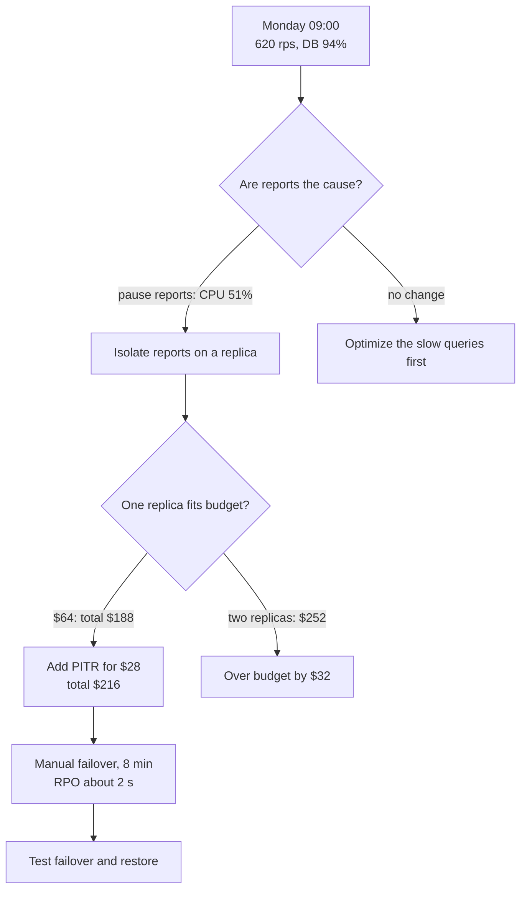

:::mental-model
**The replica is not the decision. The decision is which workload leaves the primary, what freshness each screen needs, and what you will do when the writer dies.**
:::

## A second clinic group

Fourteen months after the replica work, Dr. Rao buys a small group of three clinics in the coastal district. They come with their own database, their own budget and no replicas. Monday is still the busiest morning: 620 requests per second at 09:00, with an 88/12 read/write mix. The two API servers are at 68% CPU. PostgreSQL is at 94%.

The pain is specific. The reception day view takes 1,300 ms at p99. Booking takes 2,100 ms. Errors are 2.1%. When the finance team pauses its Monday revenue and occupancy reports, database CPU falls from 94% to 51% at the same request rate. The reports are not optional: the group uses them to staff the week.

The current infrastructure costs **$124 per month**:

| Component | Configuration | Monthly cost |
|---|---|---:|
| API servers | 2 × 4 vCPU, 8 GB | $48 |
| Primary database | 8 vCPU, 32 GB | $64 |
| Monitoring and logs | — | $12 |
| Backups | Nightly snapshot, no PITR | included |
| **Total** | | **$124** |

Dr. Rao has approved **$220 per month** for database reliability at the coastal group. The group loses about **$180 per hour** when booking is down, and the team has **six hours a week** for operations.

The targets:

| Target | Value |
|---|---:|
| p99, slot list | under 400 ms |
| p99, booking | under 800 ms |
| Error rate | under 1% |
| RPO | 5 minutes |
| RTO | 45 minutes |
| Availability | 99.9% per month (43.2 minutes) |

## The brief

Design the next database step for the coastal group. You must decide:

- whether to add zero, one or two read replicas;
- which queries leave the primary and which must stay;
- how the clinic will handle replication lag;
- how failover works with the replica count you chose;
- how backups and point-in-time recovery meet the RPO and RTO;
- what the whole design costs, and what you are giving up.

The lab is not a vote for "add replicas" because this is the replication module. A strong answer may recommend one replica, a scheduled report job, and a tested restore instead of a larger cluster. Follow the numbers.

## The constraints

- **Budget:** $220 per month, all-in. No exceptions without a business case.
- **Team:** one developer, six hours a week for operations.
- **Data:** patient records are regulated. Backups must be encrypted, access-controlled and retained for 30 days.
- **Reports:** the Monday finance reports must run between 08:00 and 11:00. Moving them to Sunday night is not acceptable to the finance team.
- **Downtime:** $180 per hour of reception time, before counting lost bookings and trust.
- **Traffic mix:** 88% reads, 12% writes. At 620 rps, that is about 546 reads and 74 writes per second.
- **Existing capacity:** the primary can do about 1,100 mixed requests per second with no replicas, but the reports consume a large share of its CPU at peak.

## Deliverable 1: baseline and bottleneck

Write a table with the current metrics and the gap to each target. Then answer:

1. Which resource is binding at 09:00: API CPU, database CPU, or a specific query?
2. What evidence shows the reports are the cause rather than the booking traffic?
3. If the reports were isolated, what would database CPU be at 620 rps? What would that do to p99?
4. Is the primary near its request-rate ceiling, its CPU ceiling, or both? Explain the difference.

:::note
The primary is at 94% CPU while handling only 620 requests per second — well below its 1,100 mixed-request ceiling. That gap is the clue: the cost per request has risen because the reporting queries are competing for CPU, buffer cache and I/O.
:::

## Deliverable 2: workload routing table

Classify these operations and write the routing rule for each:

| Operation | Primary or replica? | Freshness requirement |
|---|---|---|
| Create an appointment | | |
| Show the confirmation for that appointment | | |
| List open slots for tomorrow | | |
| Reception day view | | |
| Patient visit history | | |
| Monday finance report | | |
| Cancel an appointment | | |
| Doctor schedule for next week | | |
| Monthly occupancy export | | |
| Search patients by name | | |

Then state the rule in one sentence for each category: write, fresh read, stale-tolerant read, and expensive report. Name one query you refuse to send to the replica and why.

## Deliverable 3: topology and capacity

Choose zero, one or two replicas. Draw the topology with Mermaid or on paper. Include:

- the primary, replicas, API servers and read router;
- where PgBouncer or another pooler sits;
- which workloads use which node;
- the replication path and whether it is asynchronous or synchronous.

Then calculate:

1. the read and write rates at 620 rps with an 88/12 mix;
2. the primary's write CPU after reports leave, using the measured drop from 94% to 51% as a starting point;
3. the read CPU per replica if all 546 reads go to your chosen replica count;
4. the headroom for the next growth step to 900 rps.

State whether one replica is enough for both reports and standby duty. If it is not, say what you would drop or defer.

## Deliverable 4: lag and freshness

Define the freshness budget for each screen:

- Booking confirmation: how stale can it be?
- Reception day view: how stale can it be?
- Patient history: how stale can it be?
- Finance report: how stale can it be?

Then:

1. Choose the read-your-writes rule for booking. State the window, where the flag lives and how much extra primary traffic it creates at 620 rps with a 12% write share.
2. Explain what happens if the report replica is 30 seconds behind during a Monday run.
3. Name two lag alerts: one for patient-facing reads and one for the report replica.
4. Decide whether synchronous replication is appropriate with one replica. Defend the availability tradeoff.

## Deliverable 5: failover runbook

With your chosen replica count, write the failover sequence:

1. How failure is detected, and after how long.
2. Who or what decides to promote.
3. How the old primary is fenced.
4. How applications find the new primary.
5. How lost writes are reconciled.
6. How the old primary rejoins.

Then calculate:

- RTO for automatic and manual promotion, using 15 seconds for detection and 10 seconds for promotion as a starting point;
- RPO in writes at 74 writes per second and 2 seconds of lag;
- the share of the 43.2-minute monthly budget consumed by an 8-minute manual failover;
- whether the clinic should automate with one developer and six operations hours per week.

## Deliverable 6: backup and recovery

The database is 400 GB. Design the backup plan:

1. Choose base backup or snapshot, WAL archive interval, retention and offsite copy.
2. Calculate RPO and RTO. Show the arithmetic: restore time, replay time and verification time.
3. State whether the design meets the 5-minute RPO and 45-minute RTO.
4. Write the quarterly restore drill, including the target timestamp, validation queries and application smoke test.
5. Explain why the replica is not counted as a backup.
6. Name the encryption-key recovery plan.

## Deliverable 7: cost and memo

Build a cost table with every component and the monthly total. Stay at or under $220. Compare at least four options:

| Option | Monthly cost | Capacity effect | Redundancy | Ops burden |
|---|---:|---|---|---|
| Do nothing | $124 | Reports keep competing | None | None |
| One replica + PITR | | | | |
| Two replicas, no PITR | | | | |
| Bigger primary + PITR | | | | |
| Optimize reports + PITR | | | | |

Then write a one-page memo to Dr. Rao:

- what is slow and who feels it;
- why the reports are the cause;
- what you recommend, and what it costs;
- what redundancy and recovery you are buying;
- what you are deliberately not buying;
- how you will prove it worked;
- what would make you change your mind.

:::widget lab-checklist
:::

## Rubric

Score each criterion from 1 to 3. A strong lab scores at least 14 of 21.

| Criterion | 1 — weak | 2 — adequate | 3 — strong |
|---|---|---|---|
| **Bottleneck** | Blames the API | Notices database CPU | Proves reports are the cause with the pause experiment and query evidence |
| **Routing** | Sends all reads to replicas | Separates reads and writes | Handles read-your-writes, reports and transaction boundaries explicitly |
| **Capacity** | No numbers | Estimates one rate | Models reads, writes, CPU and headroom at 620 and 900 rps |
| **Lag** | Ignores it | Mentions lag | Sets a freshness budget per screen and a tested rule |
| **Failover** | "Promote the replica" | Lists the steps | Includes fencing, RTO/RPO numbers, reconciliation and a manual/auto decision |
| **Backups** | "We have snapshots" | Adds WAL archiving | Calculates RPO/RTO, includes offsite copy, keys and a restore drill |
| **Cost and memo** | Over budget, no tradeoff | Fits budget | Fits budget with a clear tradeoff and a measurable follow-up |

The **bottleneck** and **backups** rows are hard gates. A design that adds replicas without isolating the reports, or claims a replica is a backup, fails regardless of the total.

## Check yourself

:::quiz
[
  {
    "question": "Pausing the Monday reports drops database CPU from 94% to 51% at the same 620 rps. What is the strongest first move?",
    "options": [
      "Add two API servers",
      "Isolate or reschedule the reporting workload",
      "Increase max_connections",
      "Buy a bigger load balancer"
    ],
    "answer": 1,
    "explanation": "The experiment identifies reports as the cause of the CPU spike. Isolating them on a replica or a separate reporting path addresses the binding constraint without adding API capacity."
  },
  {
    "question": "What is the main risk of using one replica for both Monday reports and standby duty?",
    "options": [
      "The replica cannot be read-only",
      "A heavy report can delay replay or failover, and losing the replica removes both functions",
      "It doubles write capacity",
      "It makes backups unnecessary"
    ],
    "answer": 1,
    "explanation": "One node serving two roles is a compromise. Report load can increase lag, and a failure takes away both the reporting capacity and the promotion candidate."
  },
  {
    "question": "One replica plus PITR costs $216 against a $220 budget. Two replicas with PITR cost $280. What is the defensible choice?",
    "options": [
      "Two replicas, because more replicas are always better",
      "One replica plus PITR, while documenting the reduced redundancy",
      "No replica, because backups are enough",
      "Two replicas and no backups"
    ],
    "answer": 1,
    "explanation": "The one-replica design fits the budget and covers reporting isolation, a promotion candidate and point-in-time recovery. Two replicas would require cutting recovery or exceeding the budget, which the brief does not allow."
  },
  {
    "question": "With WAL archived every 60 seconds and a snapshot restore of 18 minutes, which target pair is plausible?",
    "options": [
      "RPO 24 hours, RTO 5 minutes",
      "RPO about 1 minute, RTO about 33 minutes",
      "RPO 0, RTO 0",
      "RPO 60 minutes, RTO 2 hours"
    ],
    "answer": 1,
    "explanation": "The archive interval bounds RPO near one minute. An 18-minute snapshot restore plus roughly 10 minutes of replay and 5 minutes of verification gives an RTO near 33 minutes, inside the 45-minute target."
  }
]
:::

## Discussion

:::discussion
- Is one replica doing both reporting and standby duty an acceptable design for a clinic, or should the team ask for more budget?
- Should the clinic automate failover with one developer and six operations hours a week? What would you automate first?
- If the reports could be optimized to use half the CPU, would you still buy the replica? What would change your answer?
- What is the honest cost of the 5-minute RPO, and who should approve it?
:::

## Key takeaways

- Isolate the workload that is actually consuming the shared resource before adding nodes.
- One replica can provide reporting isolation, a promotion candidate and read headroom, but it is not a cluster.
- Read-your-writes rules belong in the routing design, not in a post-incident apology.
- A manual failover is a valid choice when the team is small, if the RTO fits the availability budget and the runbook is tested.
- A replica is not a backup; the clinic needs independent PITR and a restore drill.
- One replica plus PITR fits $216 of a $220 budget, but it concentrates risk; say so in the memo.
- The memo to the person paying is part of the design.

## Free references

- [PostgreSQL: Warm standby and streaming replication](https://www.postgresql.org/docs/current/warm-standby.html) — the topology behind the replica design.
- [Patroni documentation](https://patroni.readthedocs.io/en/latest/) — what automatic failover adds and what it costs to operate.
- [PostgreSQL: Continuous archiving and PITR](https://www.postgresql.org/docs/current/continuous-archiving.html) — the recovery plan and its arithmetic.
- [Google SRE Workbook: Implementing SLOs](https://sre.google/workbook/implementing-slos/) — turning the 99.9% target into an operating decision.
