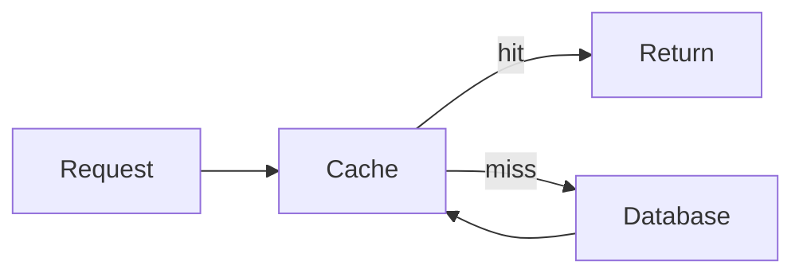

:::mental-model
**The one sentence the reader should remember.**
:::

## Opening scene

A named person, a concrete moment, and what is at stake. Do not start with a definition. Use the clinic or one outside system, and give the reader enough detail to picture the failure.

## What it is and why it exists

Plain words first. Then the pain that made this idea necessary.

## How it works

Walk through the mechanism step by step.

## A worked example

Use real numbers and trace the result. State what the reader should notice.

| Metric | Before | After |
|---|---:|---:|
| Latency | 120 ms | 12 ms |
| Load | 1,000 qps | 100 qps |

:::warning
The failure mode that bites in production, and the fix.
:::

:::widget widget-name
:::

:::deep-dive Optional deeper explanation
Material that is useful but not required for the main path.
:::

## Check yourself

:::quiz
[
  {
    "question": "A scenario question, not a definition question?",
    "options": ["Plausible answer", "Correct answer", "Real misconception", "Another misconception"],
    "answer": 1,
    "explanation": "Why this is right, and why the tempting option is wrong."
  }
]
:::

## Exercise: name the deliverable

1. A concrete artifact the reader can produce.
2. A second step with a decision to defend.
3. One failure case to explain.

:::discussion
- An open question with no single answer.
- Another question that connects this unit to the reader’s own experience.
:::

## Key takeaways

- Five to seven bullets, no new material.
- Each bullet should be understandable on its own.
- End with the tradeoff, not a summary of the topic.

## Free references

- [Authoritative free source](https://example.com) — what it adds beyond this lesson.
- [Another free source](https://example.com) — why it is worth reading.
- [A third free source](https://example.com) — the deeper dive.
